# ️ Automated Day-2 Configuration Drift Auditor

## Summary
This project is a production-grade Python automation framework designed to enforce network compliance and detect unauthorized configuration changes (drift). By comparing the "Golden Config" stored in **Nautobot** (the Single Source of Truth) against the live running-configuration pulled via SSH using **Netmiko**, the script automatically identifies rogue changes and generates a professional, executive-level HTML compliance dashboard. 

This tool reduces the Mean Time to Detect (MTTD) unauthorized network changes from weeks to seconds, ensuring strict adherence to change control processes.

---

## 🏗️ Architecture & Design Patterns

### 1. Modular Object-Oriented Design
The codebase is strictly separated into logical modules to ensure maintainability:
*   `main.py`: The orchestrator that manages the audit loop.
*   `nautobot_client.py`: Fetches the intended "Golden Config" from the Nautobot API.
*   `device_connector.py`: Handles secure SSH connections and privilege escalation via Netmiko.
*   `auditor.py`: The core logic engine that sanitizes and compares configurations using Python's native `difflib`.
*   `report_generator.py`: Translates structured data into a visual Jinja2 HTML report.

### 2. Intelligent False-Positive Mitigation
Network devices generate dynamic lines (e.g., `! Last configuration change at...`, NTP clock-periods, crypto keys) that change on every reboot or save. The `auditor.py` module includes a robust method that uses Regex to strip these dynamic lines *before* comparison, ensuring the script only flags actual logical drift. Conditionals are also used to demostrate that there are multiple ways to produce a desired result.

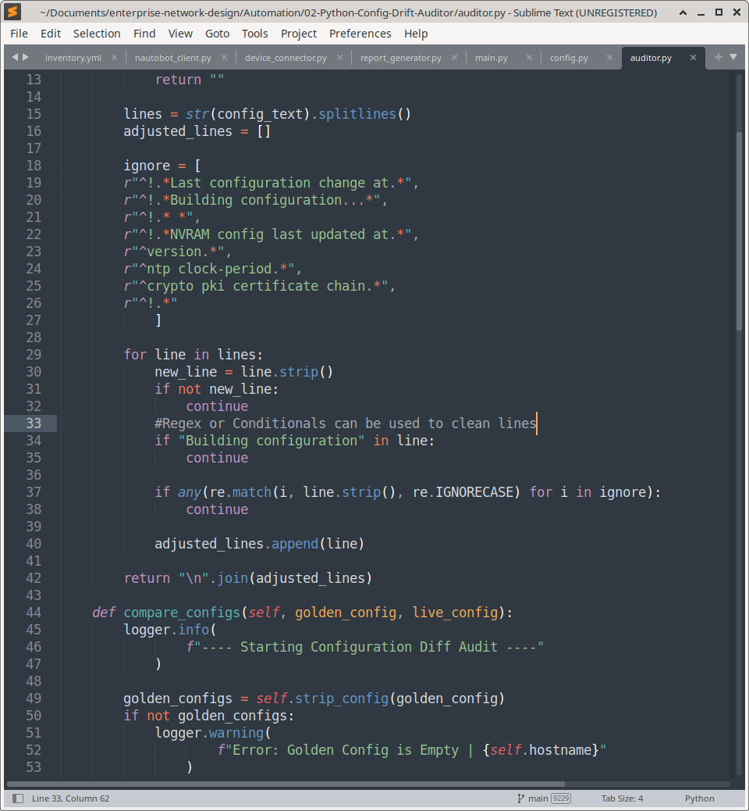

### 3. Structured Diffing & Reporting
Instead of outputting a messy terminal diff, the script parses the `difflib` output into structured dictionaries (`ADDED` vs `REMOVED`). This structured data is passed to a Jinja2 template to generate a color-coded, easy-to-read HTML dashboard.

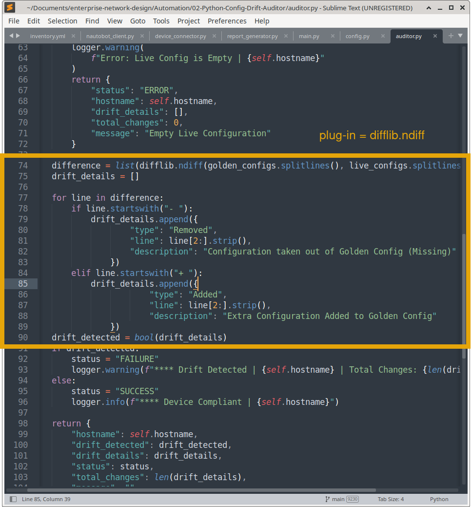

---

## Workflow Diagram

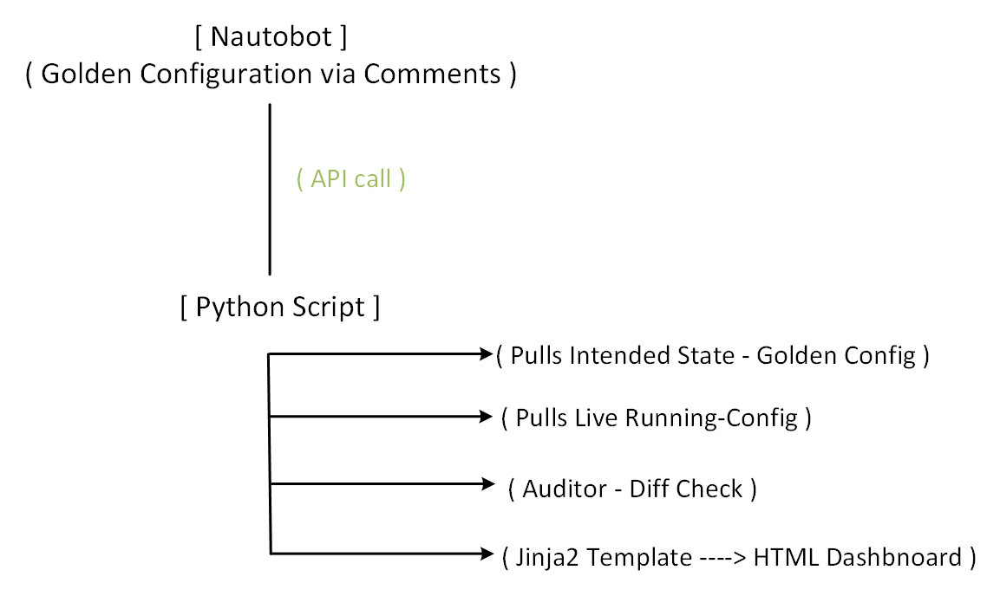

---

## Key Technical Features

*   **Netmiko SSH Integration:** Automatically handles SSH connections, terminal pagination, and Cisco `enable` mode privilege escalation.
*   **Regex Sanitization:** Filters out timestamps and dynamic blocks to prevent false-positive drift alerts.
*   **Jinja2 HTML Reporting:** Generates beautiful, color-coded compliance reports (Green for Compliant, Red for Drift).
*   **Error Handling:** Gracefully handles missing devices, blank Nautobot fields, and SSH timeouts without crashing the entire audit loop.
*   **Security First:** Credentials are strictly managed via `.env` files and excluded from version control.

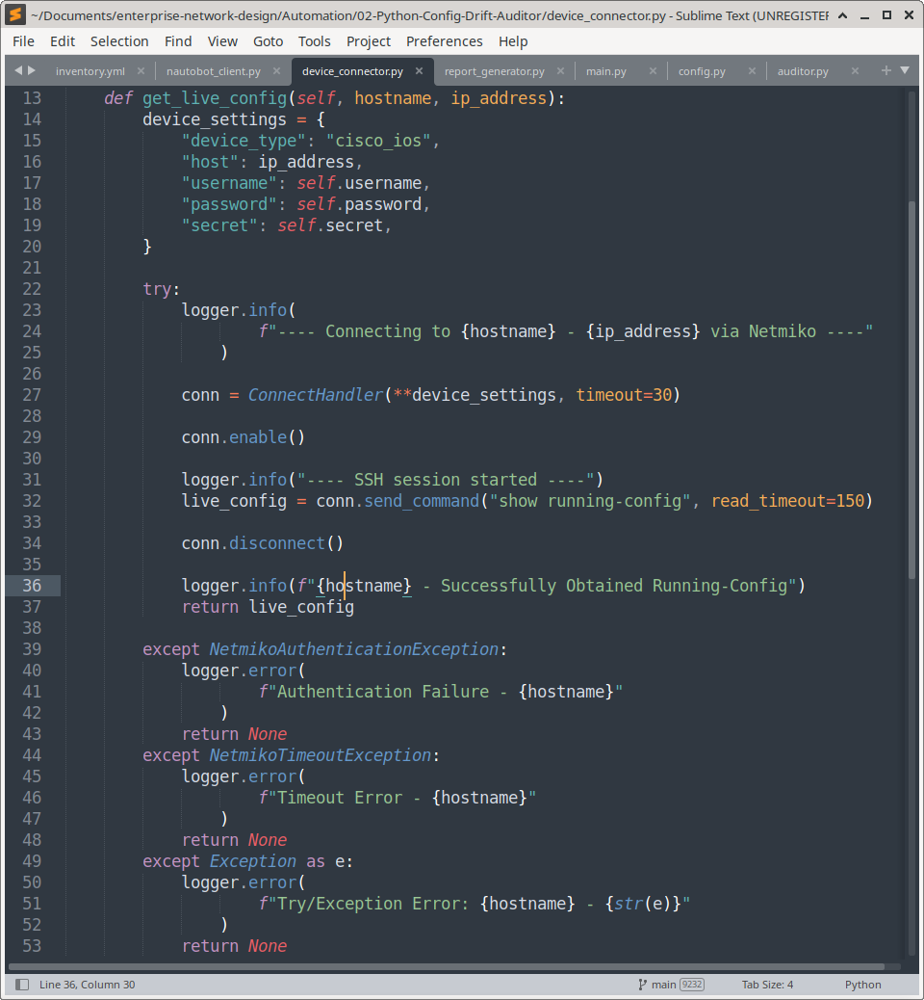

---

## Prerequisites & Setup

1. **Python Environment:** Python 3.8+
2. **Dependencies:** `pip install -r requirements.txt`
3. **Environment Variables:** Create a `.env` file:
   ```env
   NAUTOBOT_URL=http://localhost:8080
   NAUTOBOT_TOKEN=nautobot_token
   DEVICE_USERNAME=admin
   DEVICE_PASSWORD=ssh_password
   DEVICE_SECRET=enable_password
   ```
4. **Nautobot Setup:** Ensured target devices exist in Nautobot and have their "Golden Config" populated (in this lab, stored in the device Comments field).

---

## Portfolio Evidence & Execution

Below is visual proof of the compliance workflow in action.

### 1. Establishing the Source of Truth

**EDGE 1 golden configuration, should be 100% compliant**

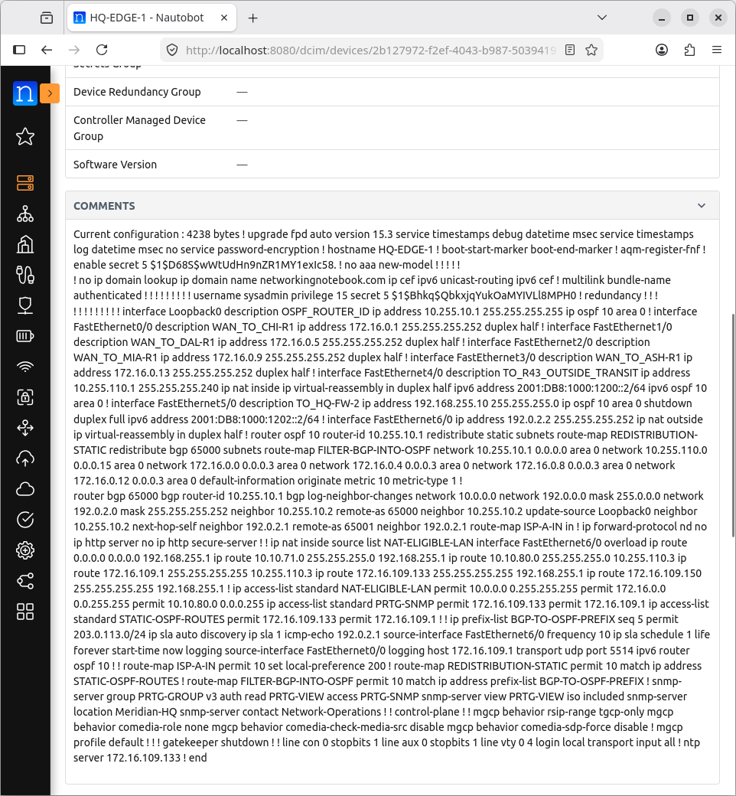

**EDGE-2 Golden Configuration, introduing wrong configuration (HQ-SW-1)**

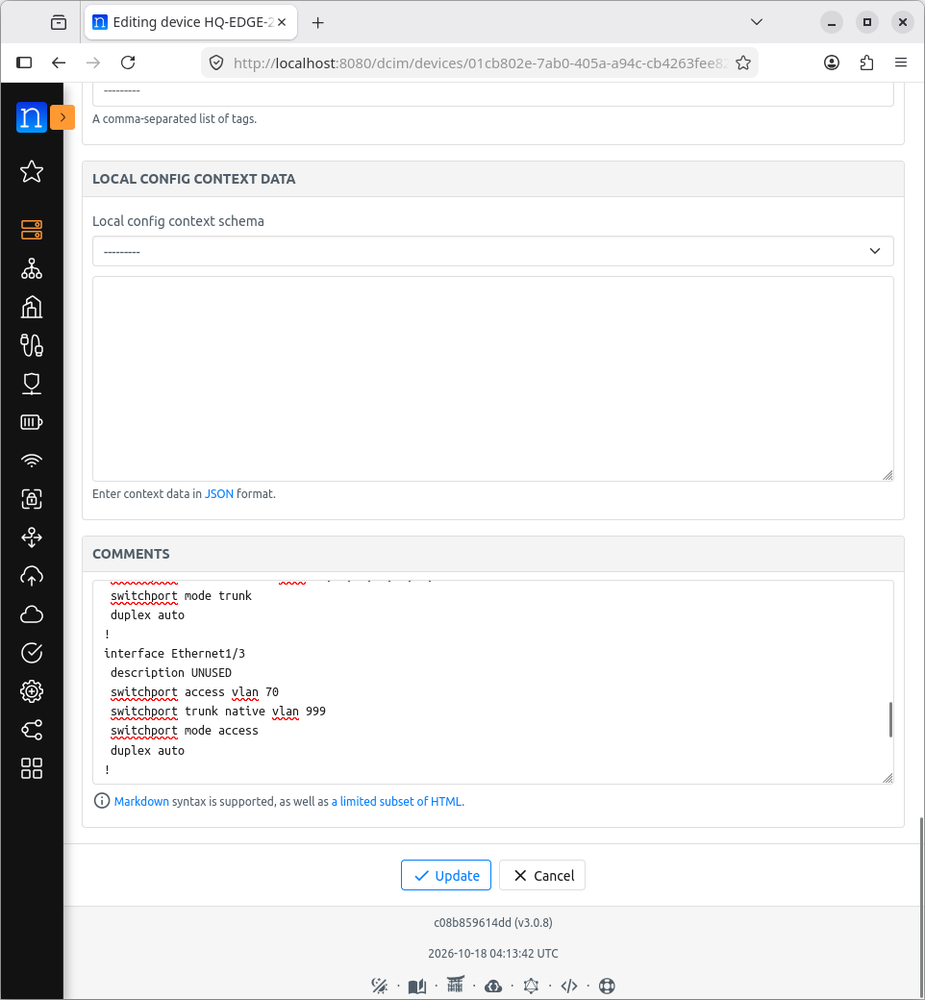

**Intentionally introducing drift by removing an SNMP ACL on HQ-R1**

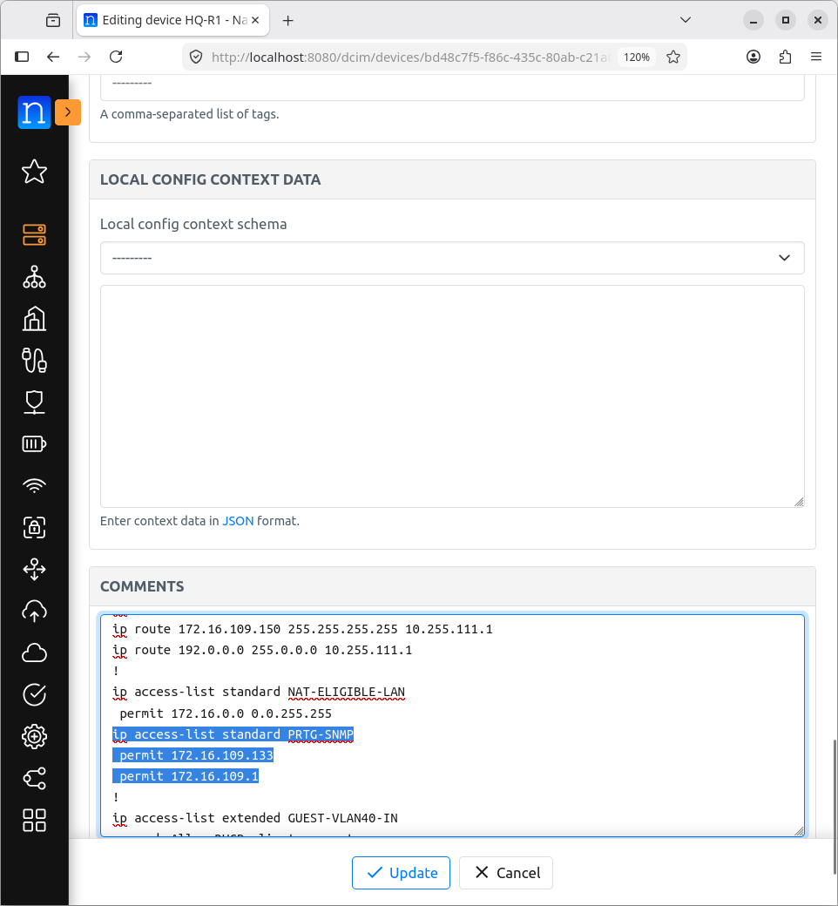

### 2. Script Execution

**The Python orchestrator successfully connecting via SSH and comparing states**

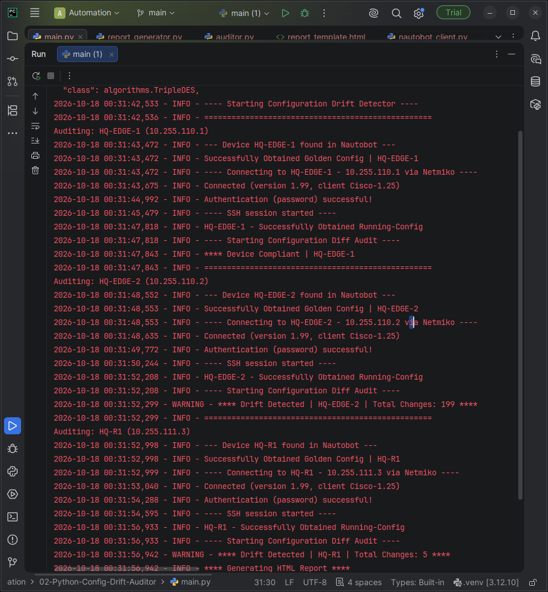)

### 3. The Compliance Dashboard (HTML Report)

**HQ-R1 showing detected drift (Missing SNMP ACL)**

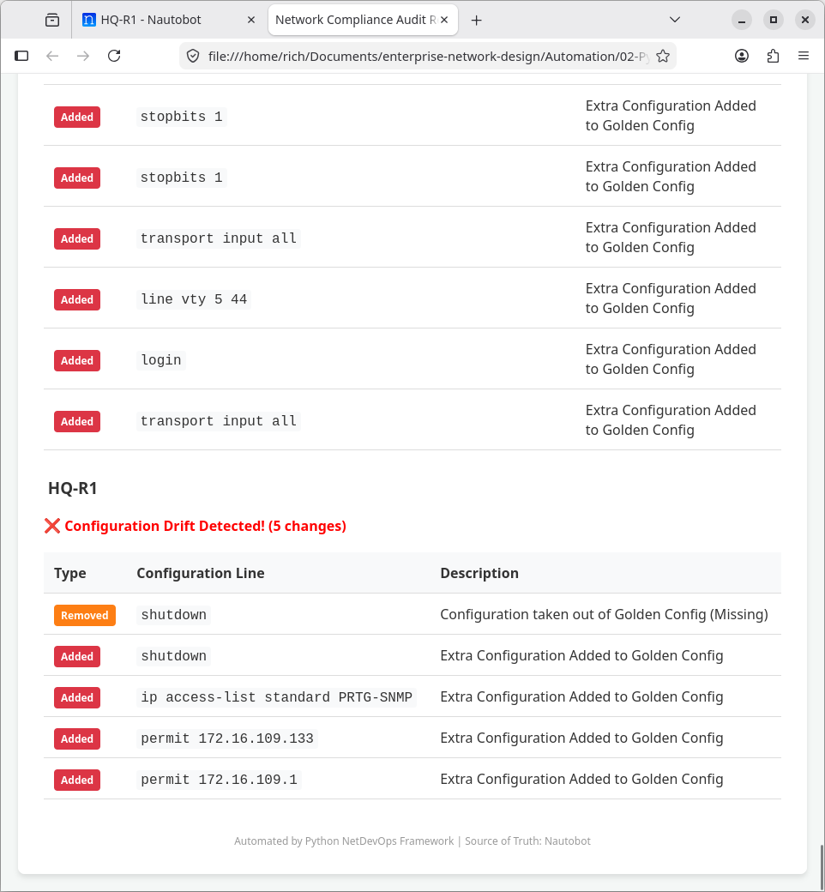

**EDGE-1 showing full compliance with the Golden Config**

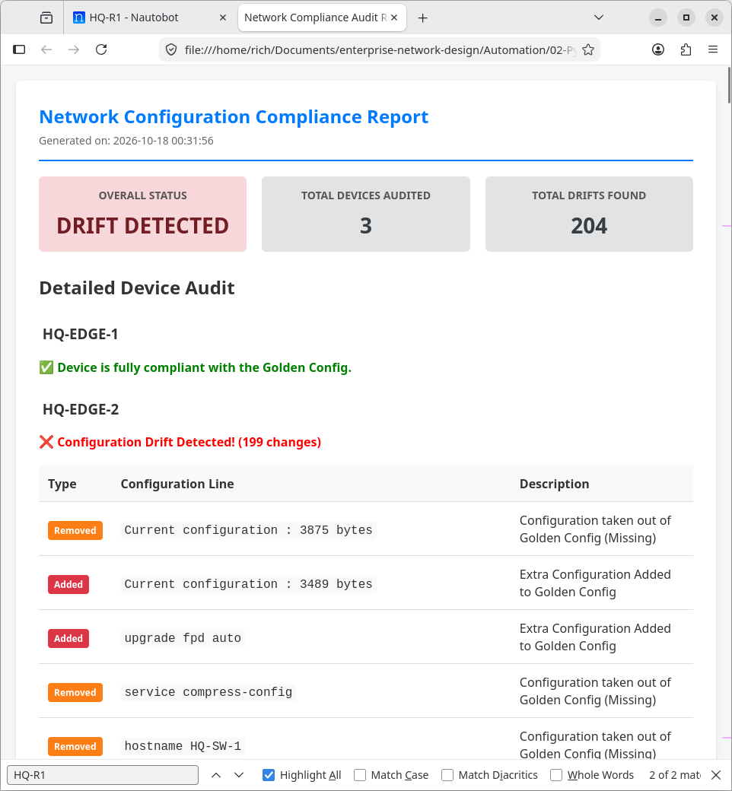

*Testing false-positive handling by applying a Switch config to a Router comment field.*

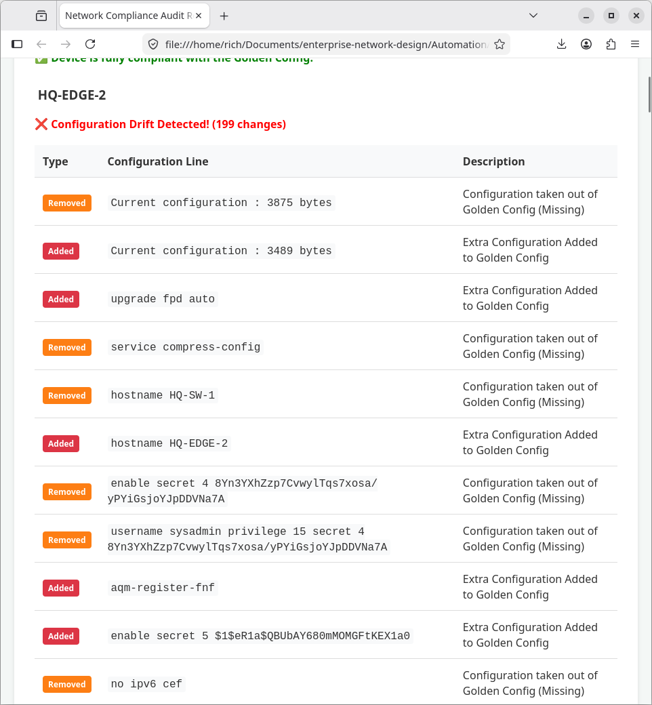


---
