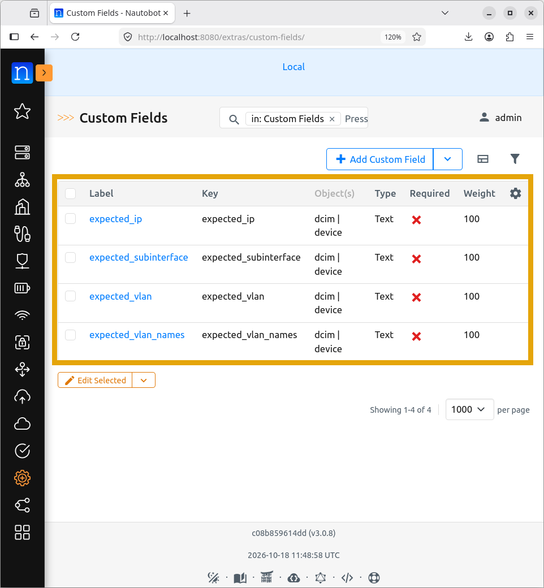
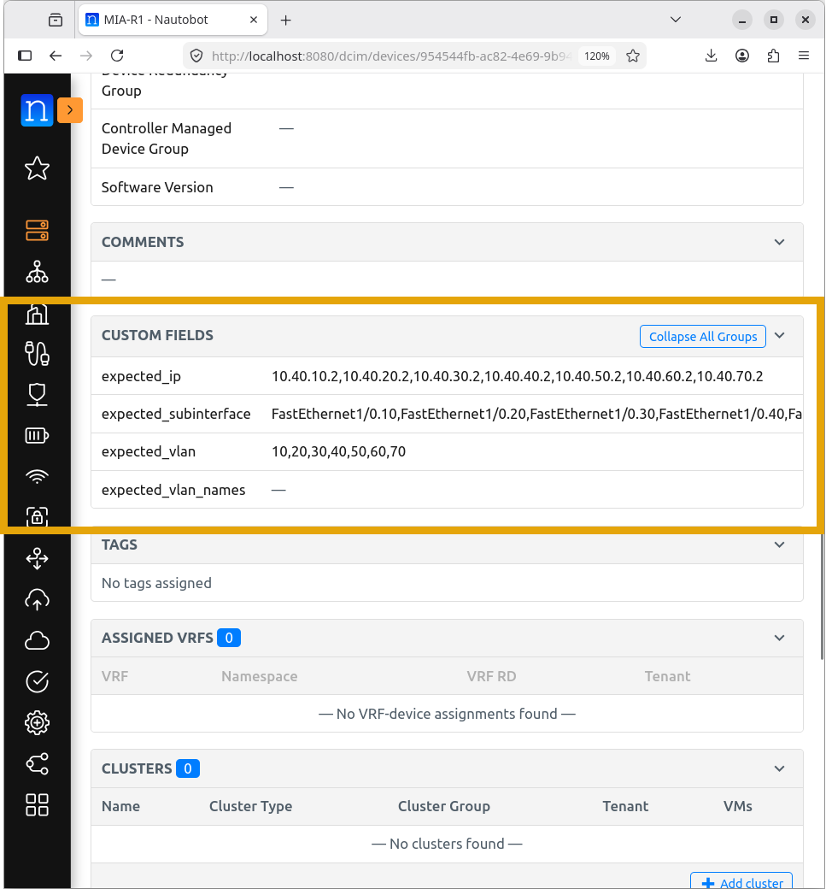
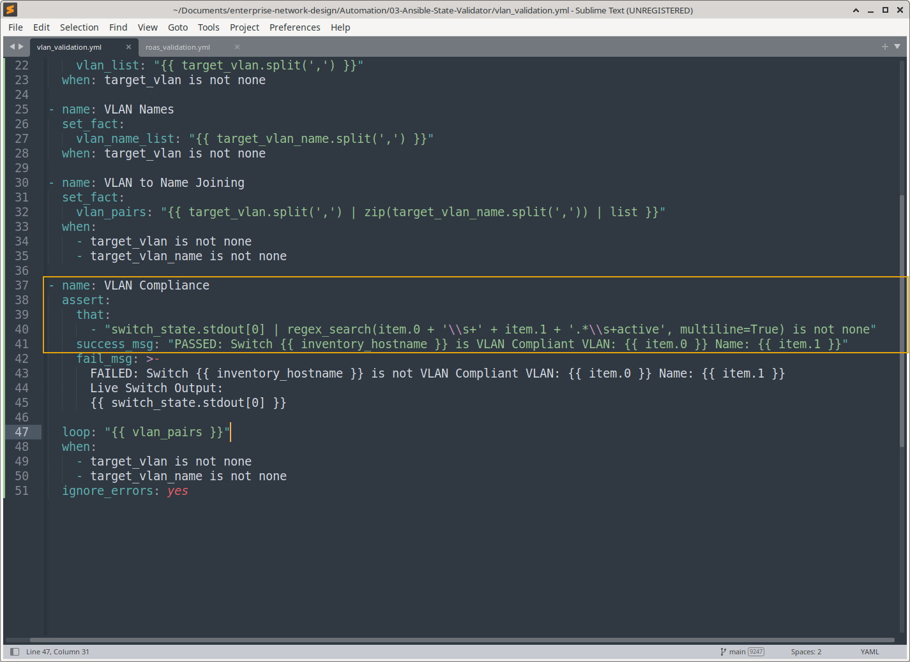
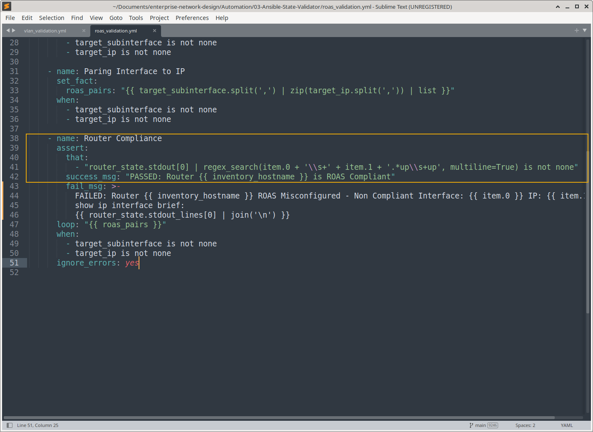
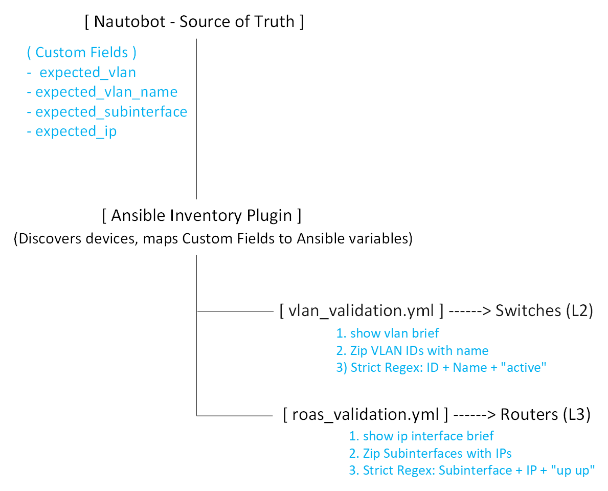
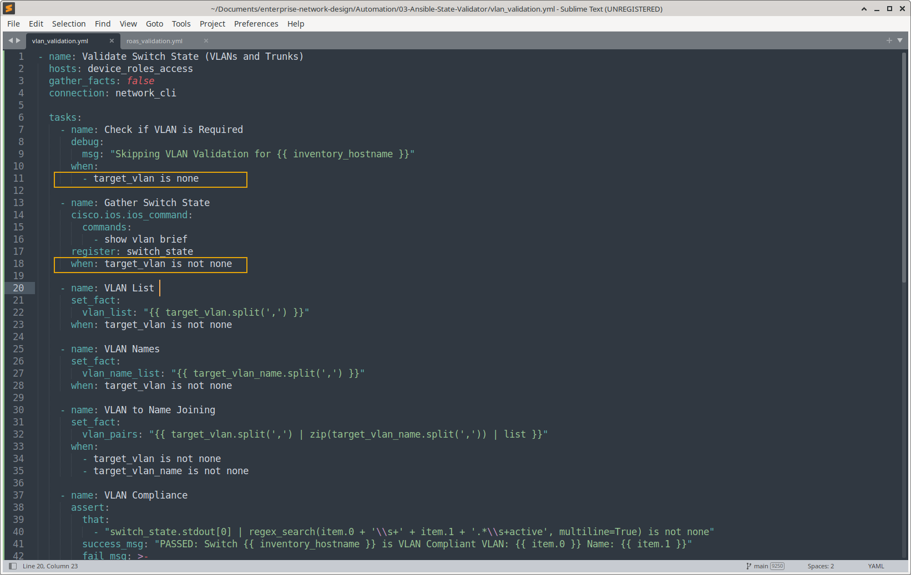
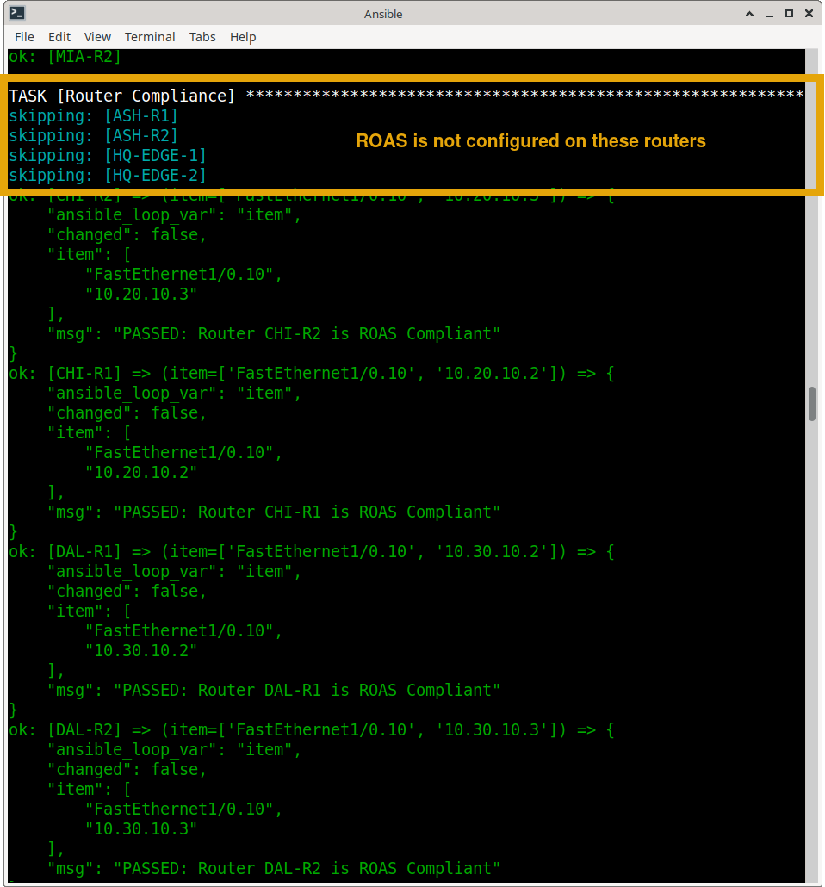
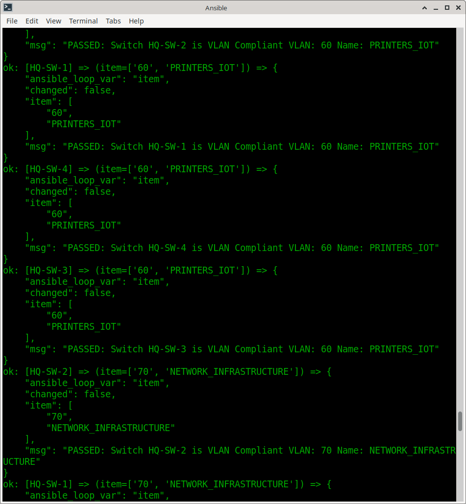
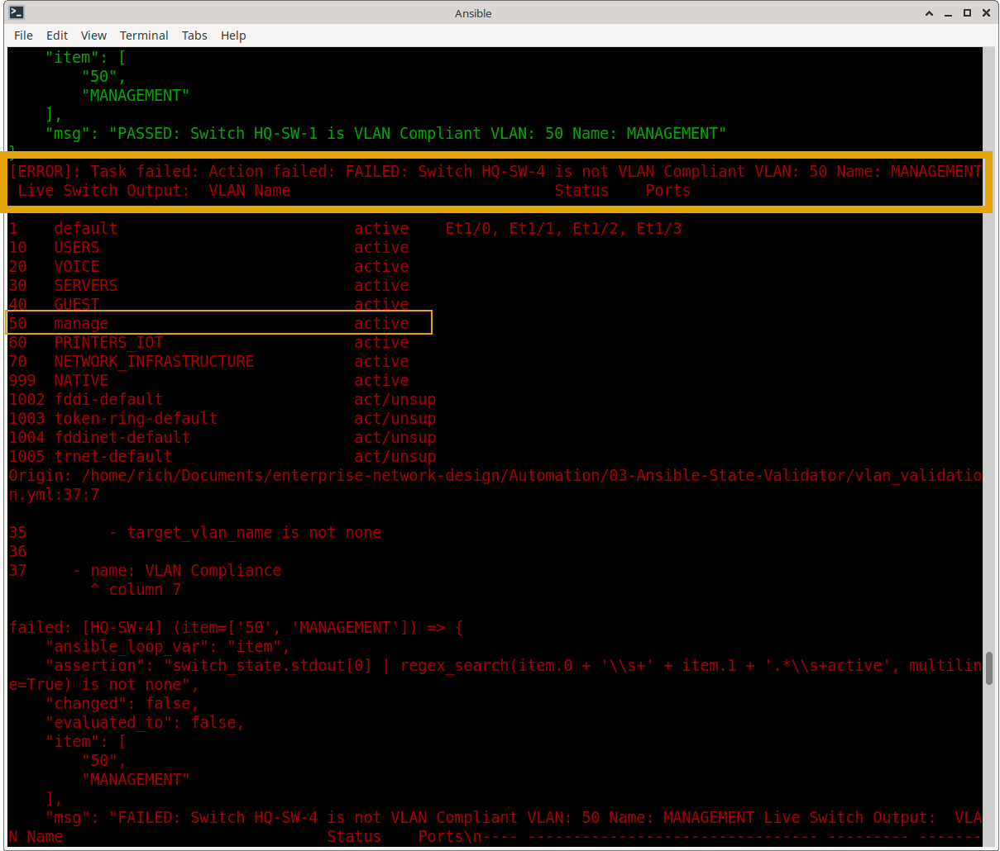

# Ansible Network State & Intent Validator (L2/L3)

## Summary
This project is a production-grade, read-only Ansible validation framework designed to enforce network compliance and detect configuration drift. By integrating Ansible with **Nautobot Dynamic Inventory**, the playbooks automatically pull the "Intended State" (Custom Fields) and compare it against the "Actual State" (Live CLI output). 

Unlike basic scripts that check for single strings, this framework uses **Layer-Aware Strict Regex Validation** to ensure that VLAN IDs match their exact names, and router subinterfaces are Up/Up with the correct IP addresses, entirely eliminating false positives.

**VLAN Playbook Execution: Please enlarge for clearer video**

**ROAS Playbook Execution: Please enlarge for clearer video**

---

## ️ Architecture & Design Patterns

### 1. Layer-Aware Separation of Concerns
Recognizing that Layer 2 (Switches) and Layer 3 (Routers) have fundamentally different compliance requirements, the validation logic is split into two specialized playbooks:
*   **`vlan_validation.yml` (Layer 2):** Validates that specific VLAN IDs exist in the database and match their exact intended names (e.g., `10` must equal `MANAGEMENT`).
*   **`roas_validation.yml` (Layer 3):** Validates that Router-on-a-Stick (ROAS) subinterfaces exist, are assigned the correct IP addresses, and are in an `up/up` operational state.

### 2. Intent-Based Dynamic Inventory
There is **zero hardcoding** in the playbooks. 
*   Ansible queries Nautobot to discover all active devices.
*   It dynamically injects the expected state (VLANs, Names, Subinterfaces, IPs) using Nautobot **Custom Fields**.
*   If a device (like an Edge Router) does not require ROAS, the Custom Field is left blank, and the playbook gracefully skips validation for that device, preventing false-positive failures.

### 3. Strict Line-by-Line Regex Validation
To prevent false positives (e.g., an IP existing on the wrong interface), the playbooks use advanced Jinja2 `zip` filters and Python `regex_search`. 
*   *Switch Check:* Ensures `VLAN_ID \s+ VLAN_NAME \s+ active` exists on the exact same line in `show vlan brief`.

*   *Router Check:* Ensures `SUBINTERFACE \s+ IP_ADDRESS \s+ up \s+ up` exists on the exact same line in `show ip interface brief`.

---

## Workflow Diagram

---

## Key Technical Features

*   **Nautobot Dynamic Inventory:** Automatically scales to include new devices the moment they are added to Nautobot.
*   **Conditional Execution (`when` clauses):** Intelligently skips devices that don't match the topology intent (e.g., skipping ROAS checks on non-ROAS edge routers).
*   **Advanced Jinja2 Filters:** Uses `zip` and `split` to pair related data points dynamically from comma-separated Nautobot strings.
*   **Detailed Failure Reporting:** When drift is detected, the playbook outputs the exact failed parameters alongside the raw live CLI output for instant troubleshooting.
*   **Read-Only Safety:** Uses `cisco.ios.ios_command` exclusively, ensuring zero risk of accidental configuration changes during audits.

---

## Prerequisites & Setup

1. **Ansible Environment:** Ansible Core 2.15+ with `networktocode.nautobot` collection installed.
2. **Nautobot Setup:** 
   * Devices must be populated with Primary IPs.
   * Custom Fields created: `expected_vlan`, `expected_vlan_name`, `expected_subinterface`, `expected_ip`.
3. **Inventory Configuration:** `nautobot_inventory.yml` configured to map Custom Fields to Ansible variables.

---

## Portfolio Evidence & Execution

Below is visual proof of the validation framework in action.

### 1. Dynamic Intent & Skipping Logic
**The playbook intelligently skips non-ROAS Edge routers because their Custom Fields are intentionally left blank in Nautobot**

### 2. Layer 2 Strict Validation (Success)

**Switches successfully validated against the Nautobot Source of Truth**

### 3. Layer 2 Drift Detection (Failure)

**The strict regex catches an intentional naming drift (e.g., "manage" vs "management") and outputs the raw CLI state for debugging**

### 4. Layer 3 Intentional Drift

**Validating the framework's ability to catch intentional interface shutdowns**

### 🎥 Execution Videos
*   [ROAS Validation Playbook Execution](media/roas_validation_playbook-2026-10-18_07.13.26.mp4)
*   [VLAN Validation Playbook Execution](media/vlan-validation-playbook.mp4)

---
