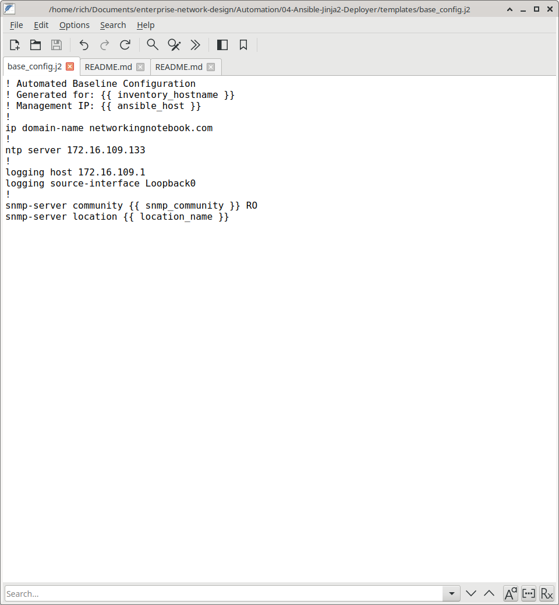
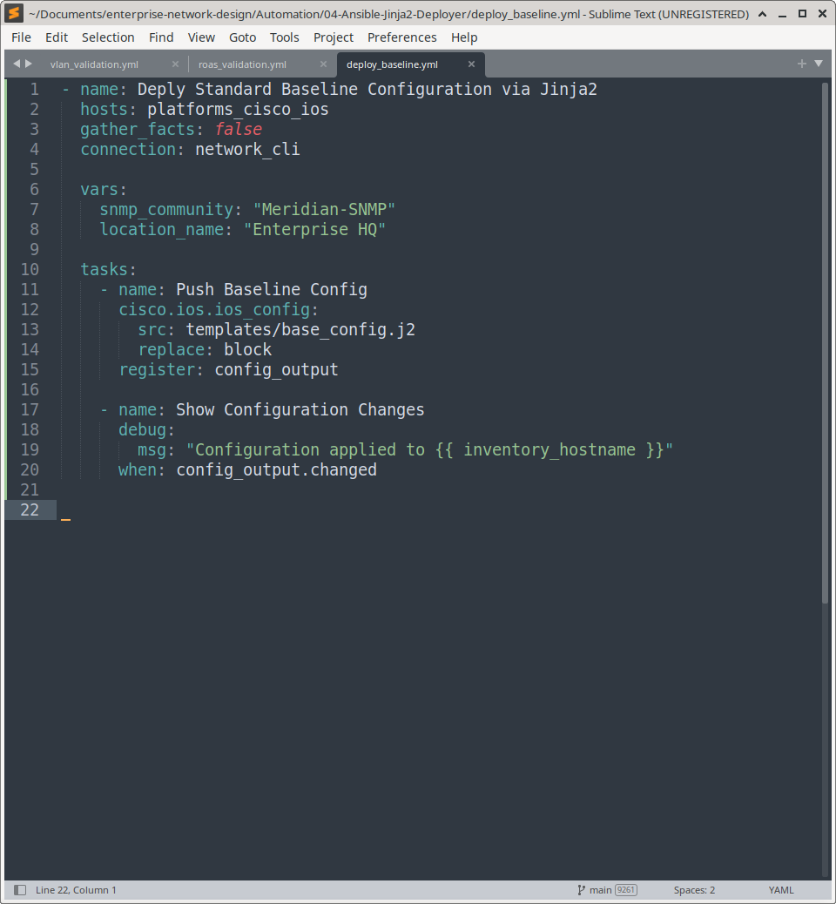
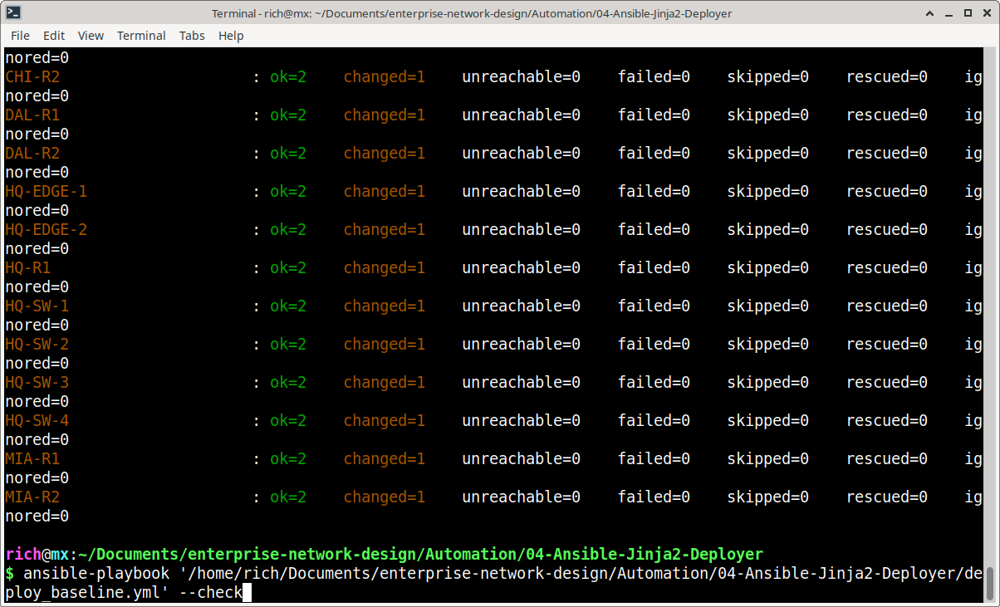
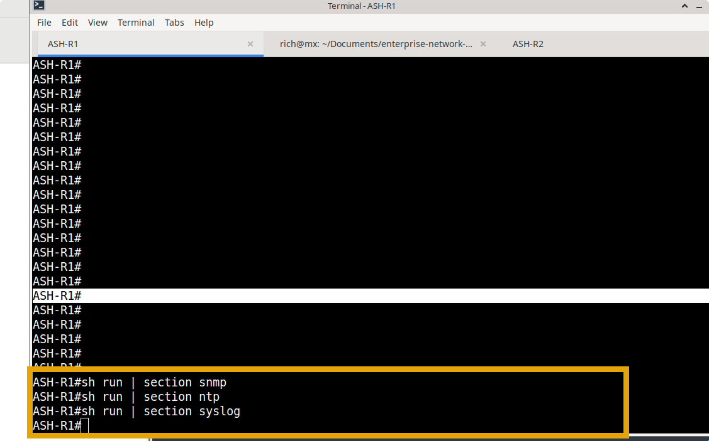
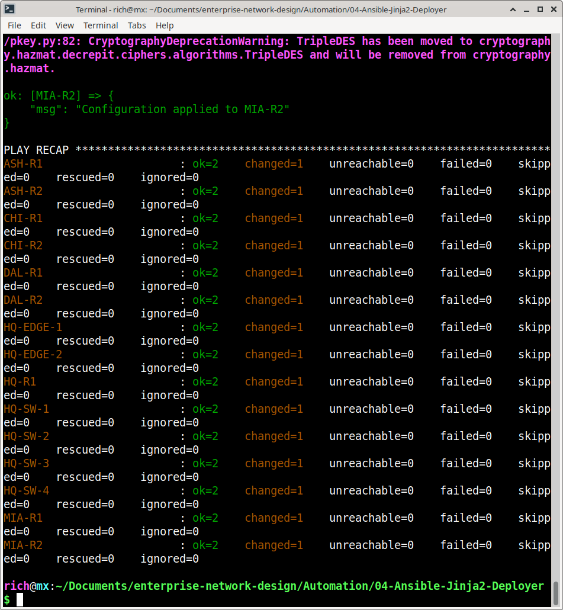
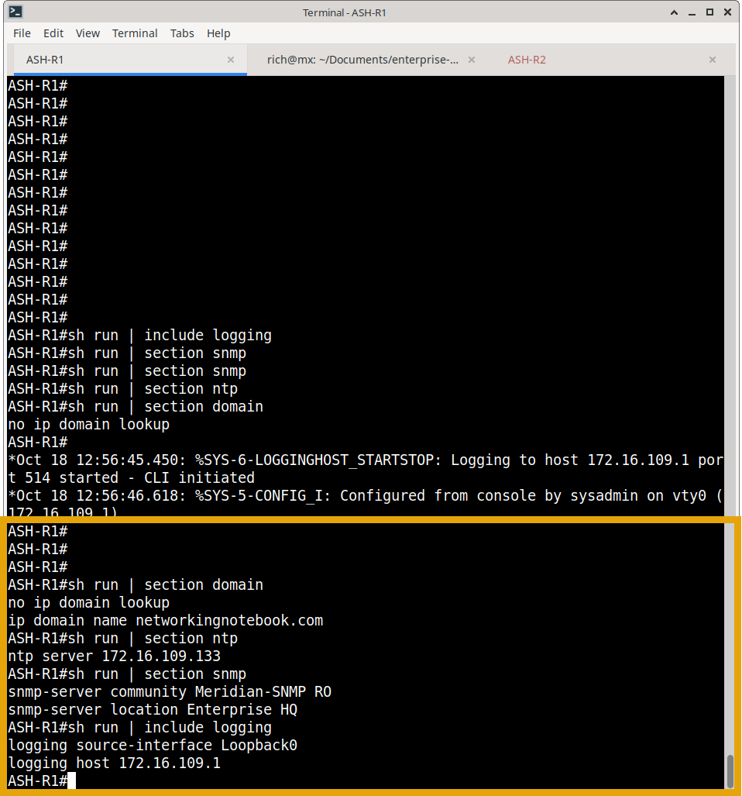

#  Ansible Jinja2 Configuration Templating & Mass Deployment

## Executive Summary
This project represents the transition from "Read-Only" auditing to "Read-Write" automation. It is a production-grade Ansible framework designed to deploy standardized baseline configurations (NTP, Syslog, SNMP, Security Banners) across a multi-vendor network. By integrating **Jinja2 templating** with **Nautobot Dynamic Inventory**, the playbook dynamically injects device-specific variables (Hostnames, IPs, Locations) at runtime, eliminating manual copy-pasting and human error.

**Playbook Execution: Please enlarge for clearer video**

https://github.com/user-attachments/assets/eddabe68-45e7-4fd1-bce4-767873592d50

---

## Architecture & Design Patterns

### 1. Jinja2 Templating Engine
Instead of maintaining hundreds of static configuration files, a single `base_config.j2` blueprint is used. Ansible renders this template individually for each device by pulling variables directly from Nautobot, ensuring 100% accuracy for device-specific parameters.

### 2. Safe, Idempotent Deployment
The playbook utilizes the `cisco.ios.ios_config` module with `replace: block`. This ensures that the generated configuration is safely merged into the existing running-config, rather than wiping out the device. 

### 3. Pre-Flight Validation (Check Mode)
A critical component of enterprise automation is safety. The framework is designed to be run with Ansible's `--check` and `--diff` flags. This performs a "Dry Run," showing the network engineer the exact line-by-line changes that *would* be made before any actual configuration is pushed to production.

---

## Workflow Diagram

---

## Key Technical Features

*   **Dynamic Variable Injection:** Uses `{{ inventory_hostname }}` to automatically tailor the config to the specific device.
*   **Safe Merging:** Uses `replace: block` to append configurations without destroying existing switch states.
*   **Dry-Run Capabilities:** Fully supports `ansible-playbook --check --diff` for risk-free pre-deployment auditing.
*   **Scalability:** Can deploy to 1 switch or 1,000 switches simultaneously without modifying the playbook code.

---

## Prerequisites & Setup

1. **Ansible Environment:** Ansible Core 2.15+ with `networktocode.nautobot` and `cisco.ios` collections installed.
2. **Nautobot Setup:** Devices must be populated in Nautobot with Primary IPs and correct Roles/Locations.
3. **Inventory Configuration:** `nautobot_inventory.yml` configured to map Nautobot data to Ansible variables.

---

## Evidence & Execution

Below is visual proof of the Jinja2 templating and deployment workflow.

### 1. Pre-Deployment State

### 2. Playbook Execution & Diff
*Ansible successfully rendering the Jinja2 template and applying the configuration block.*

### 3. Post-Deployment State
*The switch running-config after the playbook execution, showing the newly injected NTP, Syslog, and Banner configurations.*

### 🎥 Execution Video

*   [Jinja2 Template Playbook Execution](media/template-playbook.mp4)

---

### ➡️ What's Next?

With configuration templating and mass deployment fully automated, the next step is to integrate automation with ITSM workflows for service request fulfillment.

Continue to the next module to explore ITSM-Driven Service Request Provisioning:
- **[05 — ITSM-Driven Service Request Fulfillment Engine](../05-Python-Service-Request-Provisioner/)** – Jira REST API integration, automated port provisioning, and ticket closure.
