# Automated ITSM Service Request Fulfillment Engine (Jira + Netmiko + Jinja2)

## Summary
This project represents the pinnacle of operational network automation: **Ticket-Driven Provisioning**. Instead of manually reading a helpdesk ticket and logging into a switch, this Python engine integrates directly with the **Jira REST API**. It automatically parses incoming service requests, dynamically generates device-specific configurations using **Jinja2**, pushes the configuration via **Netmiko**, and updates the ITSM ticket with the results—completing the loop in under 40 seconds.

**Script Execution: Please enlarge for clearer video**

---

## ️ Architecture & Design Patterns

### 1. Closed-Loop ITSM Integration
The script acts as an autonomous network engineer. It polls Jira for tickets in the "To Do" state, transitions them to "In Progress" (Investigate), executes the technical work,and finally transitions it to "Completed". 

### 2. Dynamic Text Parsing & Templating
Helpdesk tickets are written in human language. The engine uses **Python Regex** to extract structured data (Target Device, Interface, VLAN ID) from the unstructured Jira description. It then injects these variables into a **Jinja2 blueprint** to generate a perfectly formatted, error-free Cisco IOS configuration block.

### 3. Operational Safety & Auditability
By relying on a standardized Jinja2 template, the script eliminates human copy-paste errors. Furthermore, every action is logged back to Jira, providing a permanent, auditable trail of exactly what was changed, when, and by which automated process.

---

## Workflow Diagram

---

## Key Technical Features

*   **Jira REST API Integration:** Uses HTTP Basic Auth with API tokens to query, transition, and comment on tickets using JQL (Jira Query Language).
*   **Jinja2 Templating:** Separates the logic from the configuration, ensuring a single source of truth for port provisioning standards (PortFast, Voice VLANs, etc.).
*   **Regex Data Extraction:** Intelligently parses unstructured text fields from ITSM platforms.
*   **State Management:** Dynamically handles Jira workflow transitions (e.g., mapping "Investigate" to "In Progress").

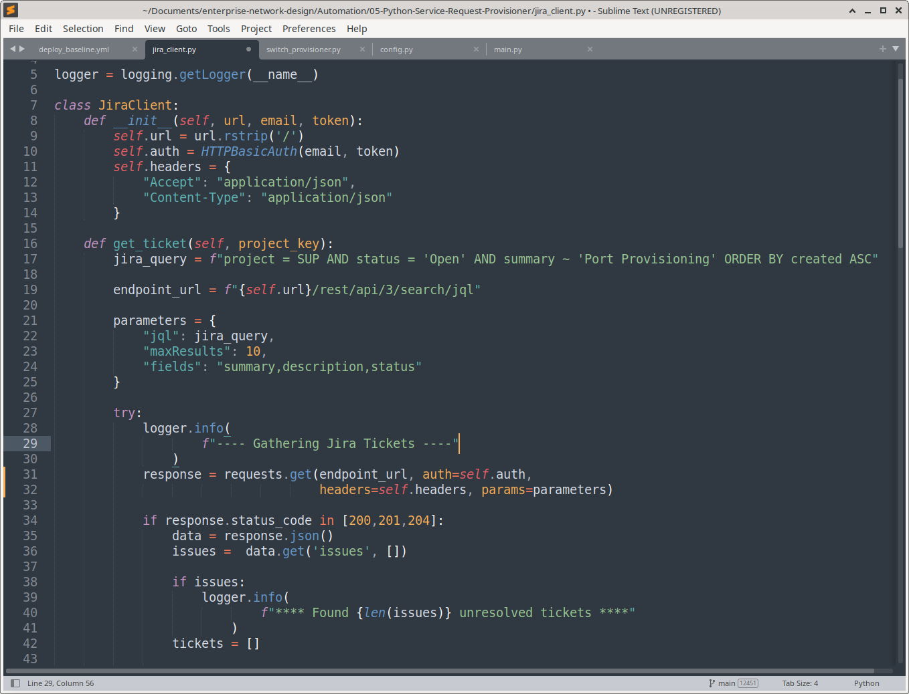

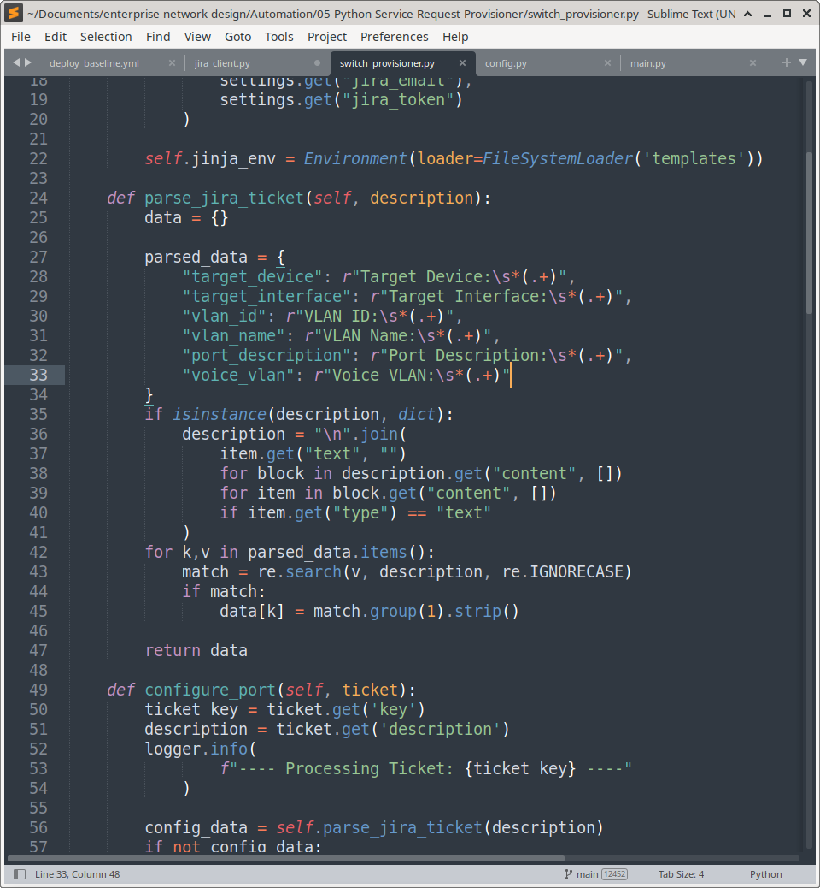

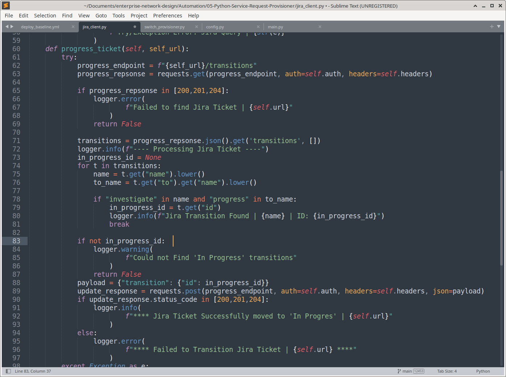

**Regex Parse Execution vs JSON**

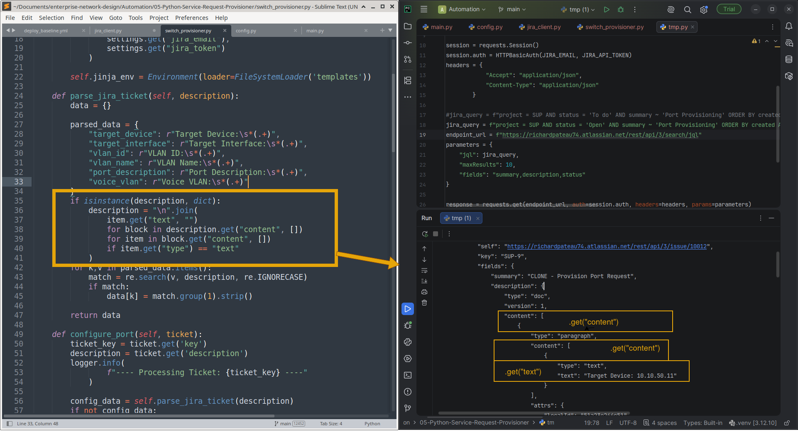

---

## Prerequisites & Setup

1. **Python Environment:** Python 3.8+ with a virtual environment (`myenv`).
2. **Dependencies:** `pip install -r requirements.txt` (includes `netmiko`, `requests`, `jinja2`, `python-dotenv`).
3. **ITSM Setup:** A Jira Cloud instance with a custom project and workflow.
4. **Credentials:** `.env` file configured with Jira API Token and Network Device SSH credentials.

---

## Portfolio Evidence & Execution

Below is visual proof of the end-to-end ITSM automation workflow.

### 1. The ITSM Trigger

**Creating the initial service request in Jira**

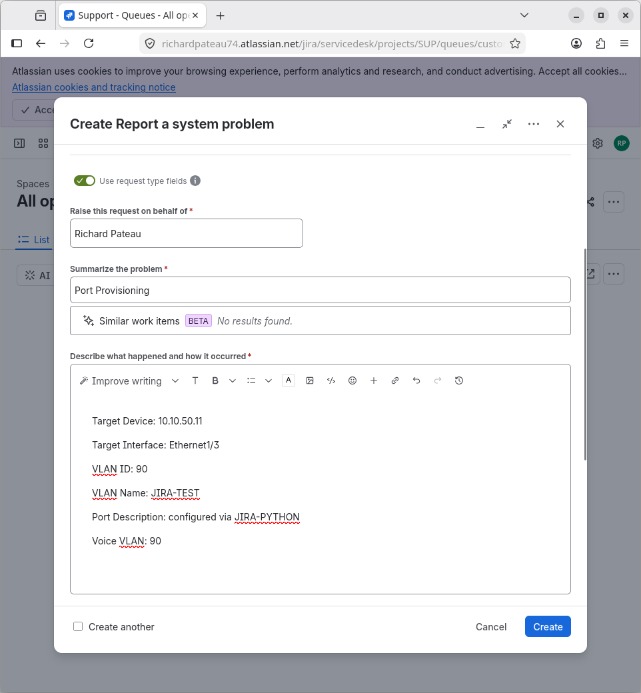

### 2. Pre-Automation State

**The ticket sits in the "To Do" column, and the switch interface is unconfigured**

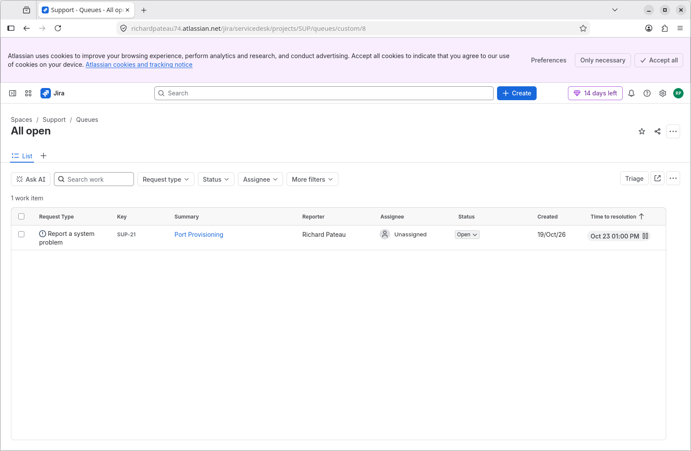

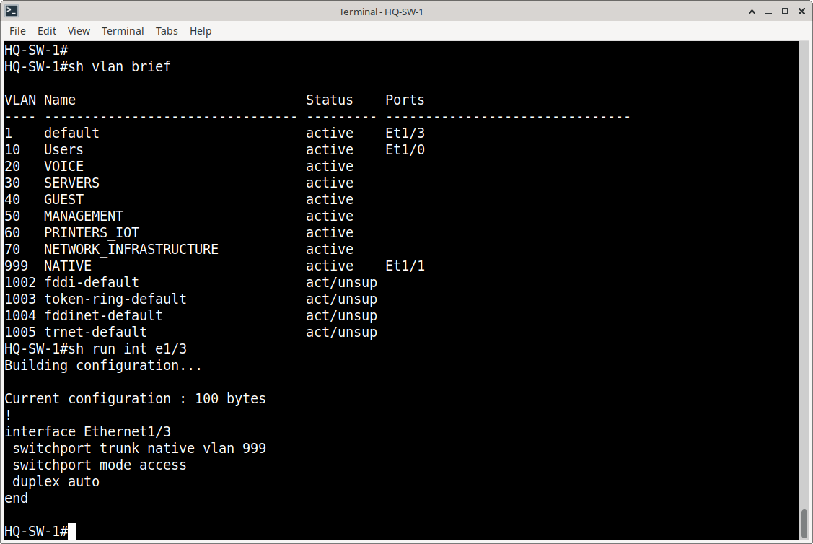

### 3. The Automation Engine

**The Jinja2 template used to generate the configuration**

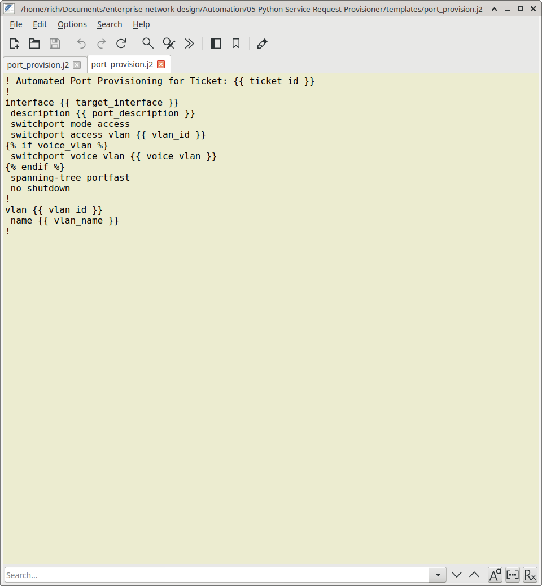

**The Python script executing, parsing the ticket, and pushing the config**
*(Completed in just 37 seconds!)*

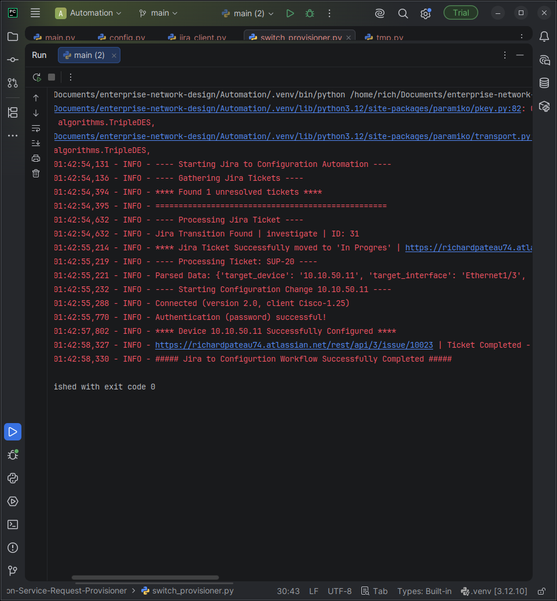

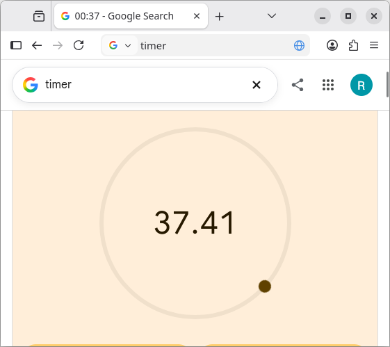

### 4. Post-Automation State

**The switch interface is now fully configured with the correct VLANs and descriptions**

### 5. Closed-Loop Feedback

**The script automatically moves the Jira ticket to "Completed"**

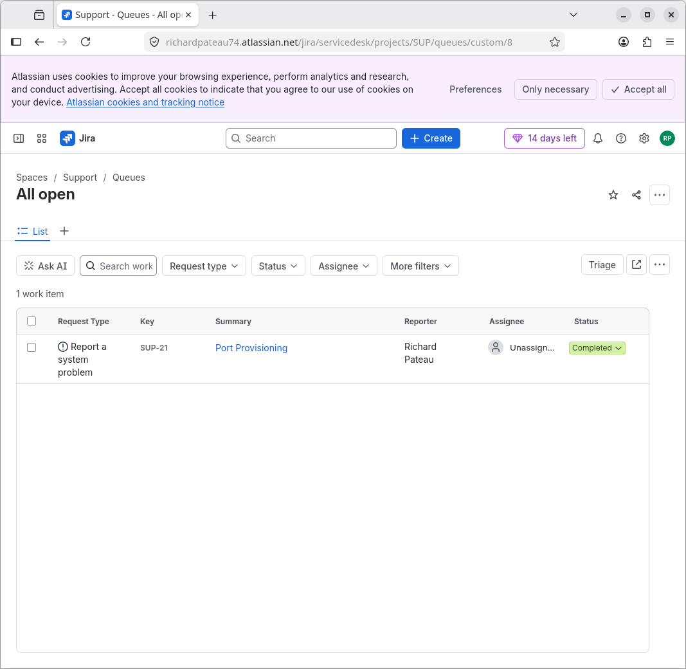

### Full Execution Video
*   [End-to-End Jira Automation Workflow](media/jira-automation.mp4)

---
