# Automated Physical Network OS Upgrade Pipeline (Ansible + TFTP)

## Summary
Automating an Operating System upgrade on physical network hardware is one of the highest-risk tasks a network engineer can perform. This project is a production-grade, 5-phase Ansible pipeline designed to safely upgrade physical Cisco switches via TFTP. It incorporates strict pre-flight checks, automated file transfer, graceful reboot handling, and post-flight version validation, transforming a multi-hour manual maintenance window into a fully automated, auditable process.

---

## Architecture & Design Patterns

### 1. The 5-Phase Upgrade Pipeline
To prevent bricking devices or causing outages, the playbook is strictly divided into sequential phases:
*   **Phase 0 & 1 (Pre-Flight):** Verifies flash memory space and captures the current IOS version to ensure the target version is different.
*   **Phase 2 (Transfer):** Downloads the new `.bin` image from a local TFTP server directly to the switch's `flash:`.
*   **Phase 3 (Configuration):** Updates the `boot system` variable and saves the configuration.
*   **Phase 4 (Reboot):** Triggers a reload and uses Ansible's `wait_for_connection` to gracefully handle the intentional SSH drop and wait for the physical hardware to boot.
*   **Phase 5 (Post-Flight):** Reconnects to the switch and uses strict Regex validation to confirm the new OS version is active.

**Phase 0**

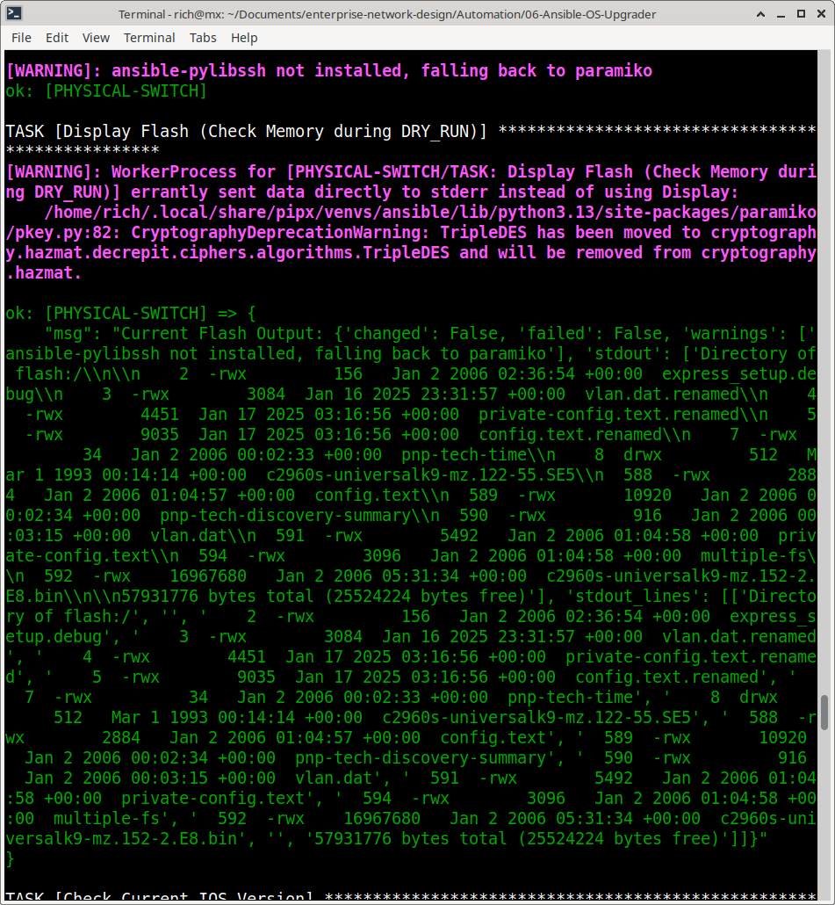

**Phase 1**

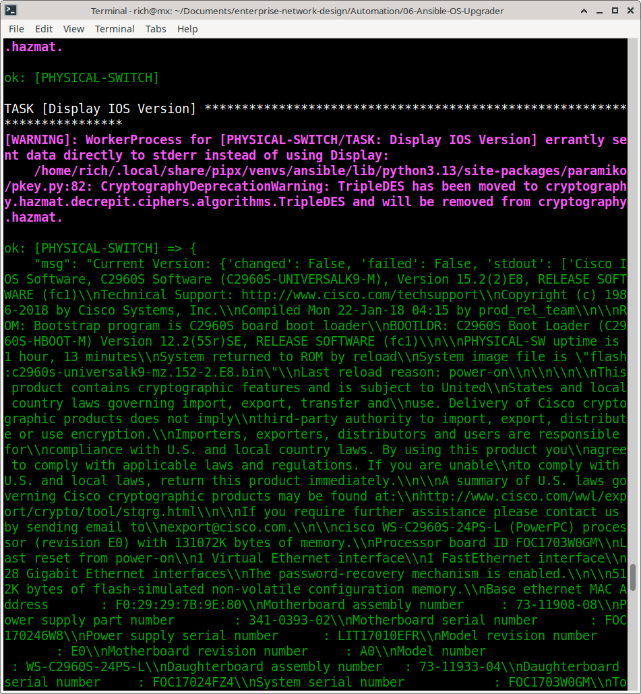

**Phase 2**

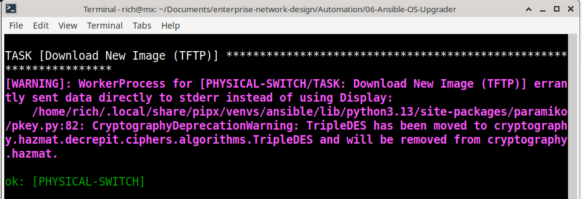

**Phase 3 & 4**

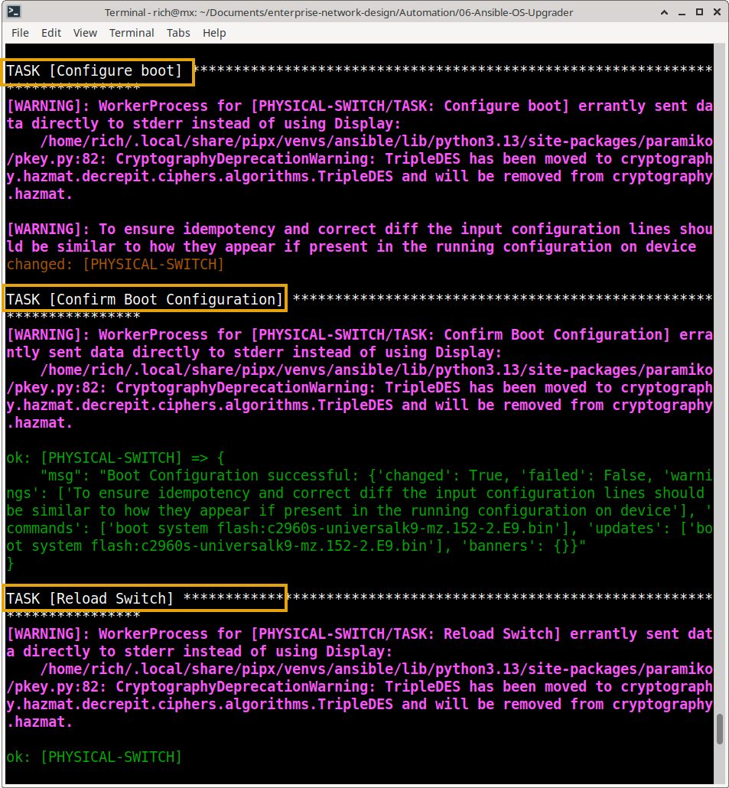

**Phase 5 / Play Recap**

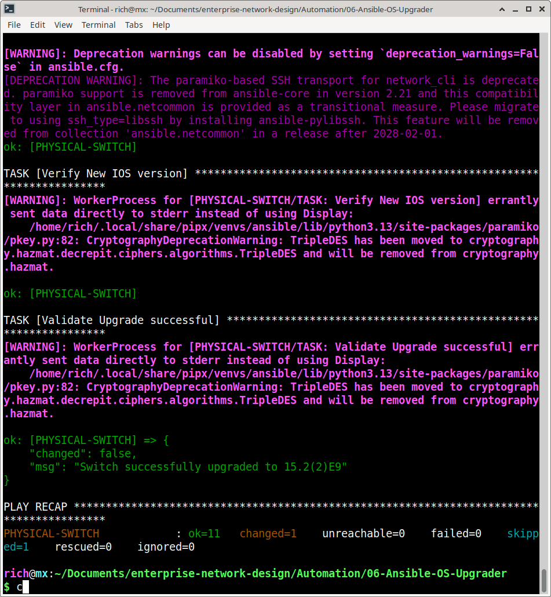

---

##  Workflow Diagram

---

## Key Technical Features

*   **TFTP Integration:** Utilizes the `cisco.ios.ios_command` module to securely pull images from a local `tftp` server.
*   **Graceful Reboot Handling:** Uses `ignore_errors: yes` on the reload task and `wait_for_connection` to seamlessly recover the SSH session after the physical switch reboots.
*   **Strict Regex Validation:** The post-flight check doesn't just assume success; it parses the `show version` output to mathematically prove the target version string is present.
*   **Edge-Case Testing:** Includes dry-run validation to ensure the regex correctly identifies version mismatches before touching production hardware.

---

## Prerequisites & Setup

1. **Ansible Environment:** Ansible Core 2.15+ with `cisco.ios` collection installed.
2. **TFTP Server:** `tftpd-hpa` installed and running on the Ansible control node (MX Linux), with the `.bin` file placed in `/srv/tftp/`.
3. **Physical Access:** Console access to the physical switch is highly recommended during the initial run for ROMMON recovery in case of image corruption.
4. **Inventory:** Nautobot Dynamic Inventory configured to map the physical switch's Primary IP.

---

## Evidence & Execution

Below is visual proof of the physical OS upgrade workflow.

### 1. Pre-Upgrade State

**The physical switch running the legacy OS (15.2(2)E8) and the flash directory before the transfer**

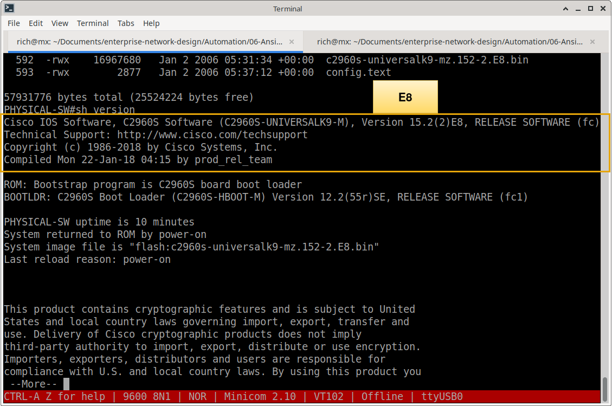

**dir flash:**

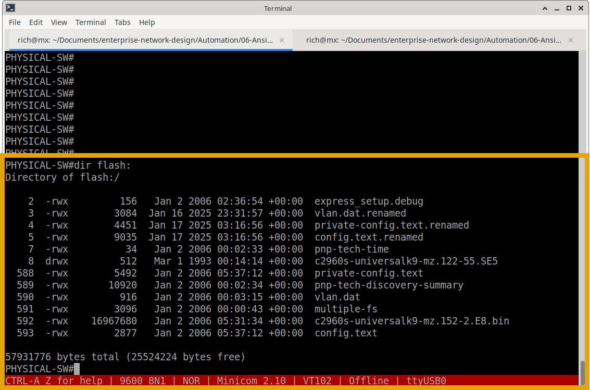

**Physical Switch Used: 2960**

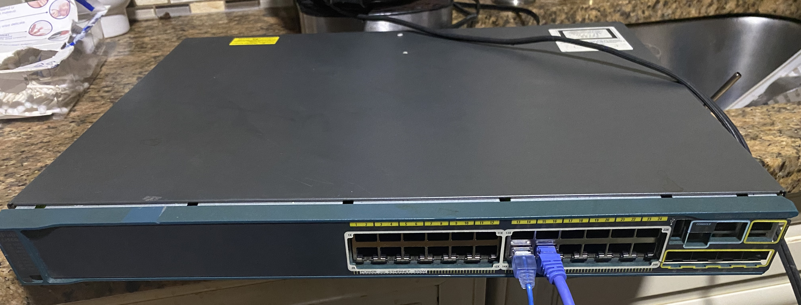

### 2. The Automation Engine in Action

**The TFTP server actively serving the file and the physical switch console initializing the flash write**

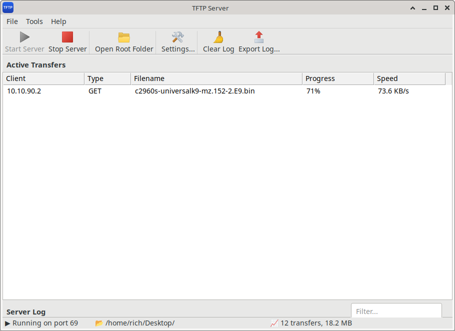

**Live Execution: Please enlarge for clearer video**

https://github.com/user-attachments/assets/e83aa885-9556-46dd-bacf-53748ee26343

### 3. Edge Case Testing (Dry Run)

**Testing the strict validation to ensure the playbook correctly fails if the version does not match expectations**

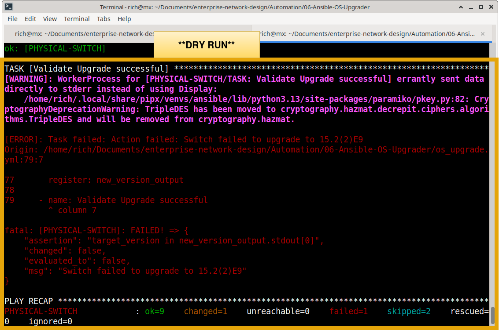

**Assert Test**

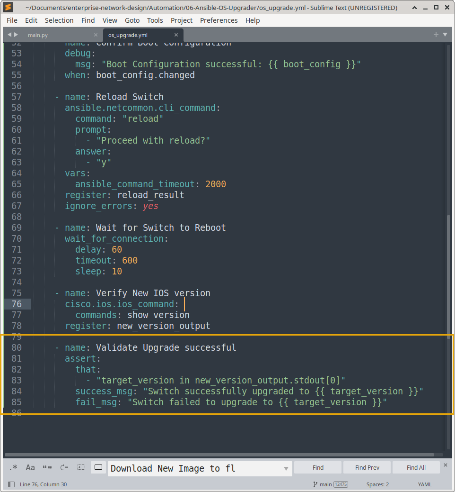

### 4. Post-Upgrade Validation

**The Ansible playbook successfully completing all 5 phases and the physical switch verifying the new OS (15.2(2)E9)**

**CONSOLE output during reboot**

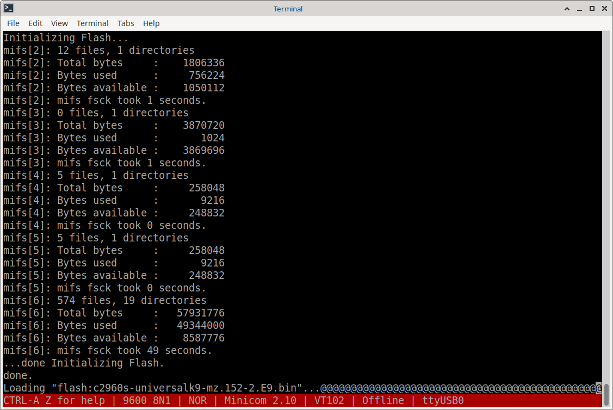

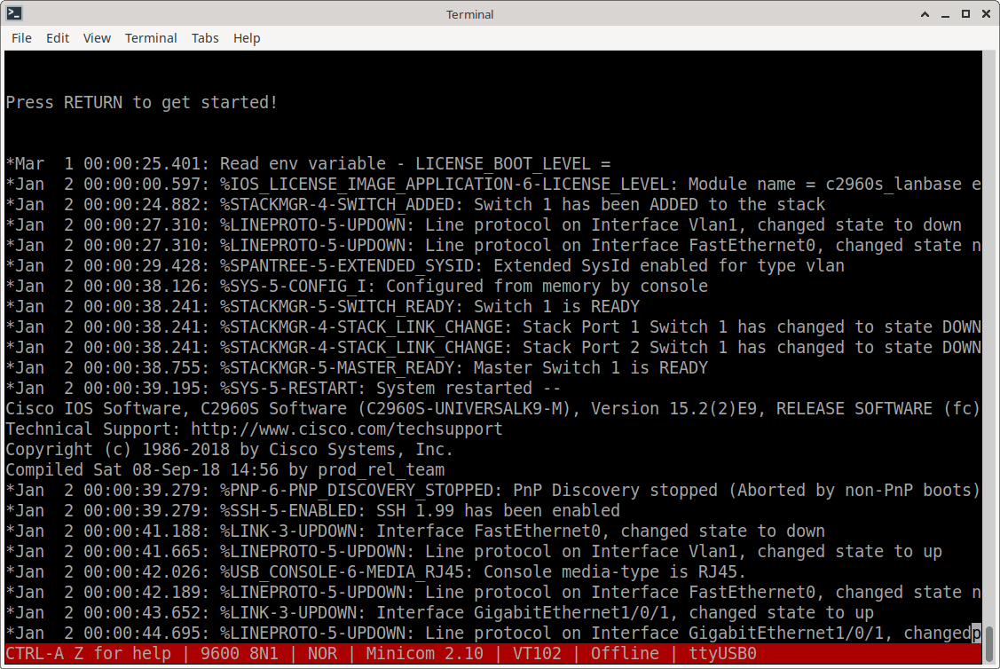

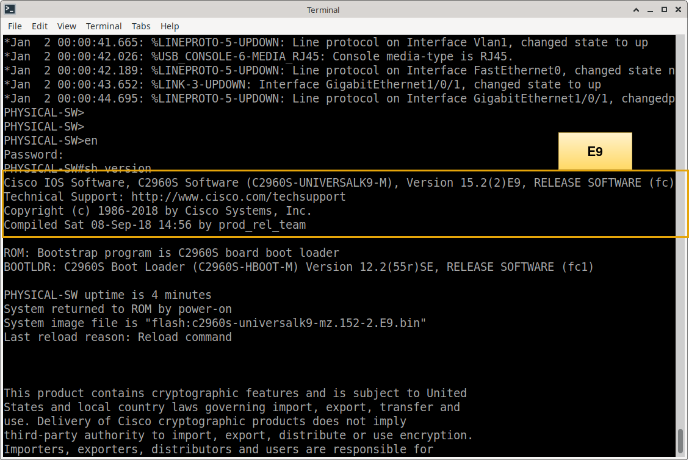

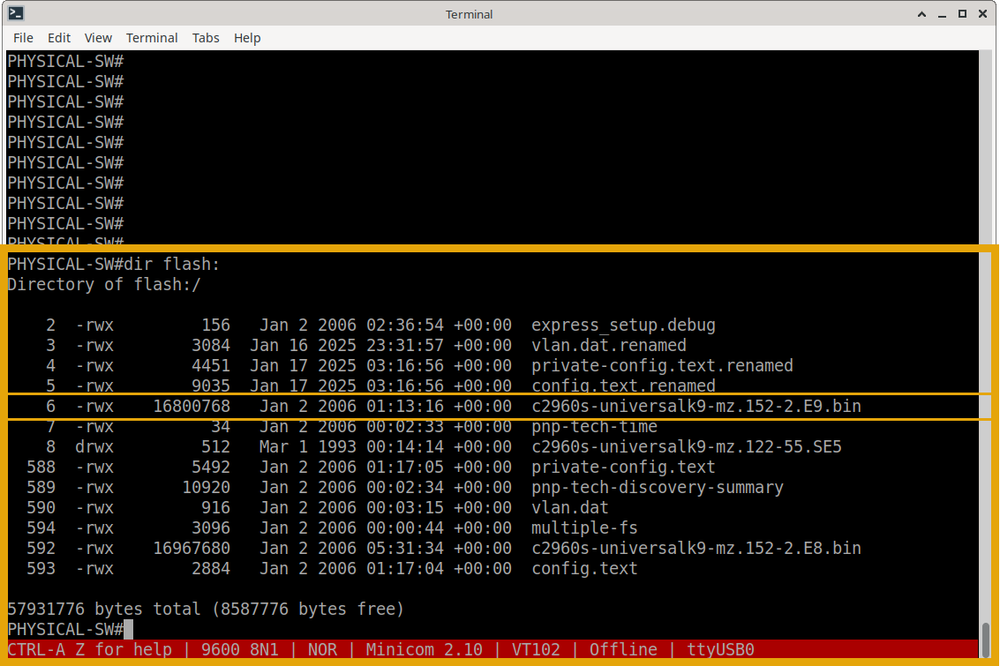

### TFTP Synchronized with Playbook Proof

 Video
* [Real-Time TFTP Download and Upgrade](media/tftp-download-real-time.mp4)

---

### What's Next?

With physical hardware OS upgrades fully automated and safely validated, the final step in the infrastructure lifecycle is to enforce code quality, peer review, and safety gates before any changes reach production.

Continue to the next module to explore Enterprise Network CI/CD:
- **[07 — Enterprise Network CI/CD Pipeline](../07-Ansible-CICD-Pipeline/)** – GitHub Actions, self-hosted runners, `ansible-lint`, and pre-deployment dry-runs.
