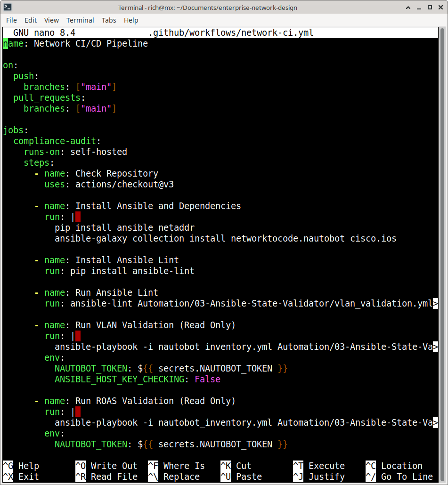
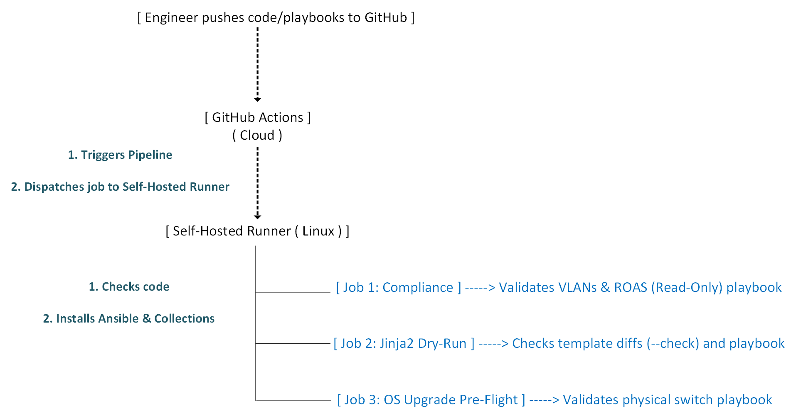
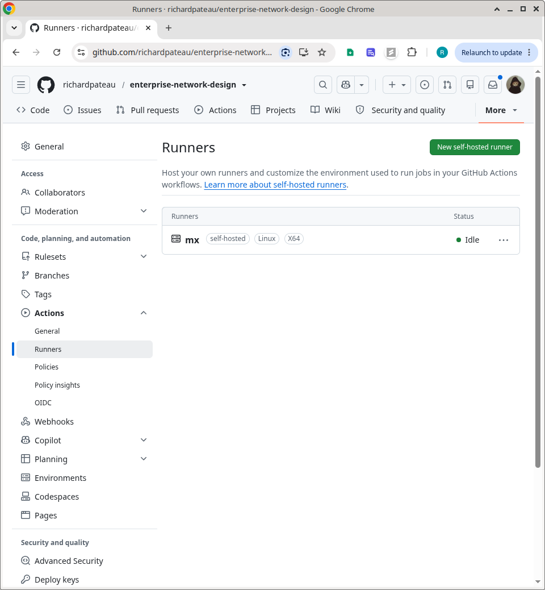
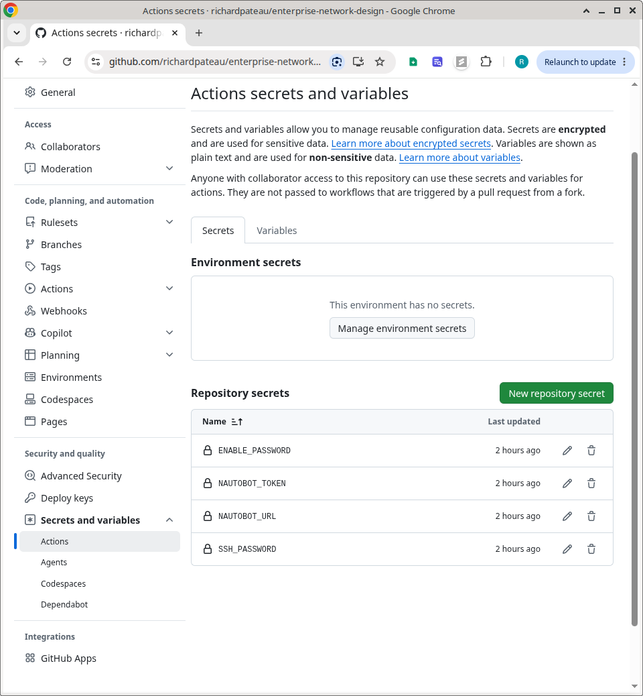
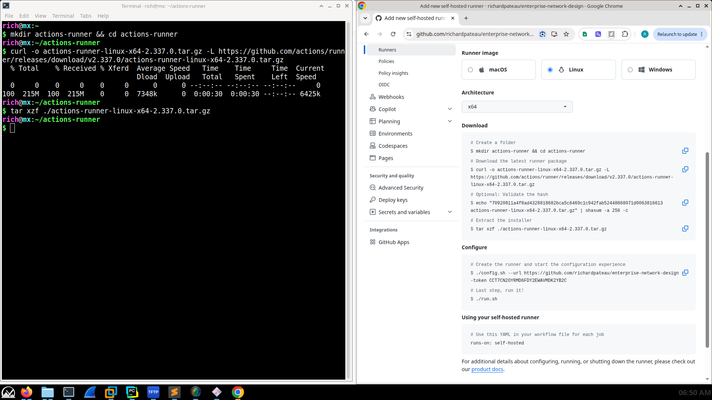
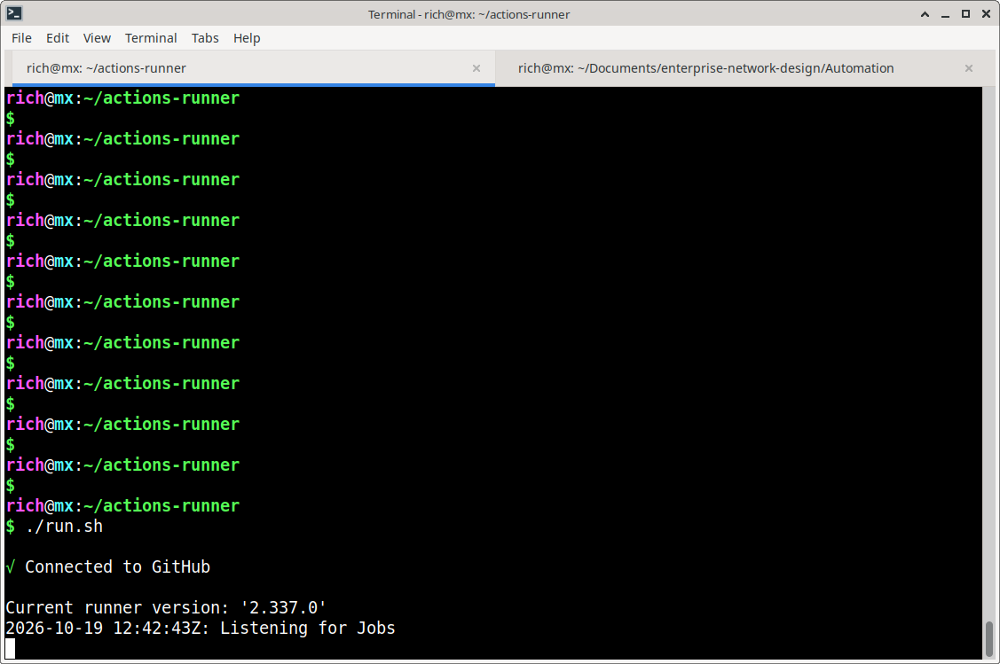
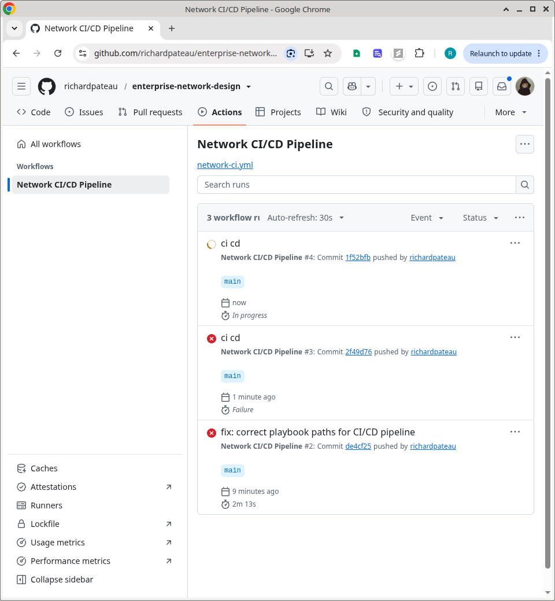
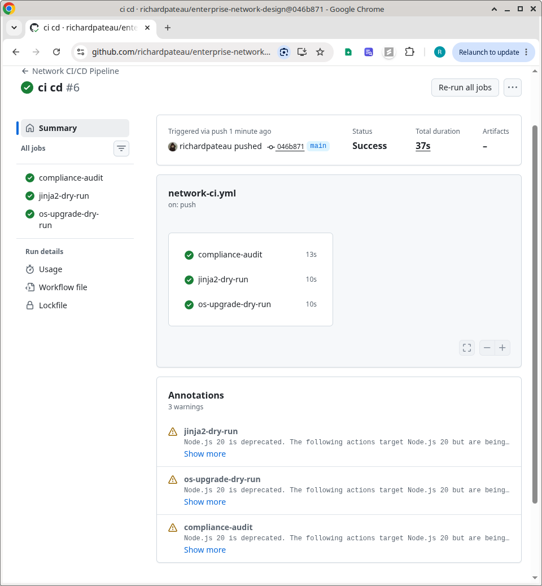
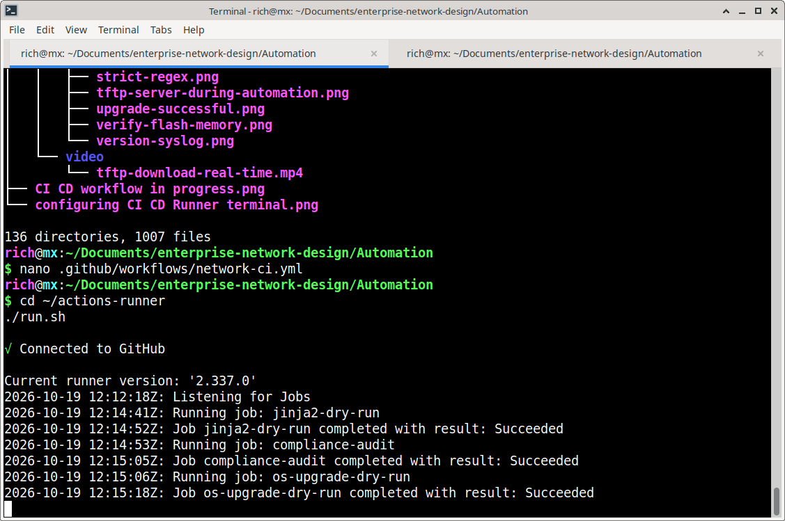

# Automated Network CI/CD Pipeline (GitHub Actions + Self-Hosted Runner)

## Summary
This project represents the principles of NetDevOps: **Continuous Integration and Continuous Deployment (CI/CD) for physical network infrastructure**. By integrating Ansible with GitHub Actions via a **Self-Hosted Runner**, this pipeline bridges the gap between cloud-based version control and on-premise network hardware. It automatically lints code, runs Ansible `--check` dry-runs, and validates network state against Nautobot, ensuring zero misconfigurations ever reach production.

---

## Architecture & Design Patterns

### 1. The Self-Hosted Runner Bridge
GitHub Actions runs in the cloud, but network hardware lives on-premise. To solve this, a GitHub Actions Self-Hosted Runner was installed on the local MX Linux control node. This allows the cloud pipeline to securely execute Ansible playbooks against the local Nautobot instance and physical switches without exposing the lab to the public internet.

### 2. Continuous Integration (The "Spellcheck")
Every time code is pushed or a Pull Request is opened, the pipeline automatically triggers:
*   **Ansible Linting:** Checks YAML syntax and best practices.
*   **Dry-Run Validation:** Executes `ansible-playbook --check --diff`. This connects to the live network, compares the intended state against the actual state, and generates a detailed diff report *without changing a single configuration*.

### 3. Multi-Stage Parallel Execution
The pipeline is divided into distinct, parallel jobs to maximize efficiency and safety:
*   **Fleet Compliance Audit:** Runs read-only VLAN and ROAS state validators against the entire Nautobot inventory.
*   **Jinja2 Dry-Run:** Validates template rendering and configuration merging.
*   **OS Upgrade Pre-Flight:** Runs strict pre-upgrade checks on physical hardware.

---

## Workflow Diagram

---

## Key Technical Features

*   **Self-Hosted Runner:** Securely bridges cloud CI/CD with local, on-premise network infrastructure.
*   **Ansible `--check --diff`:** Provides a safe, non-destructive preview of all network changes before deployment.
*   **Manual Triggers (`workflow_dispatch`):** Allows engineers to manually trigger compliance audits directly from the GitHub UI after making changes in Nautobot.
*   **Parallel Job Execution:** Runs multiple validation suites simultaneously, reducing pipeline execution time.

---

## Prerequisites & Setup

1. **GitHub Repository:** Hosted on GitHub with Actions enabled.
2. **Self-Hosted Runner:** Configured on the local Ansible control node (Linux x64).
3. **GitHub Secrets:** Securely stores `NAUTOBOT_TOKEN` and SSH credentials.
4. **Ansible Environment:** Control node has Python 3.10+, Ansible, and required collections (`cisco.ios`, `networktocode.nautobot`).

---

## 📸 Portfolio Evidence & Execution

Below is visual proof of the CI/CD pipeline architecture and execution.

### 1. Infrastructure Setup
**Configuring the Self-Hosted Runner on the local MX Linux machine to bridge the cloud and the lab**

### 2. Pipeline Execution
**The GitHub Actions UI showing the workflow in progress, executing multiple parallel jobs**

### 3. Dry-Run Validation (The Core Value)

**The pipeline successfully executing the compliance audit, Jinja2 dry-run, and OS upgrade pre-flight checks**

**Live Execution: Please enlarge for clearer video**

**The terminal output showing every dry-run passing successfully, proving the network is compliant and the code is safe**

---

