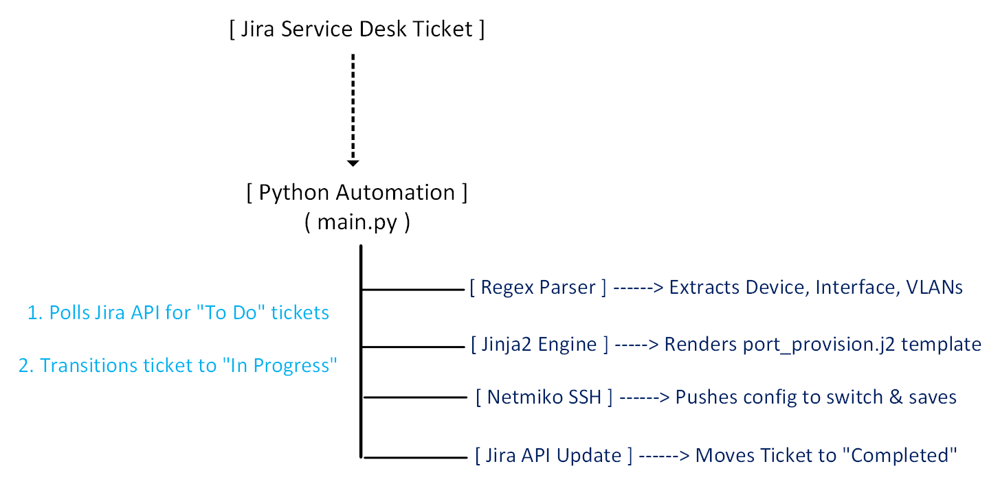
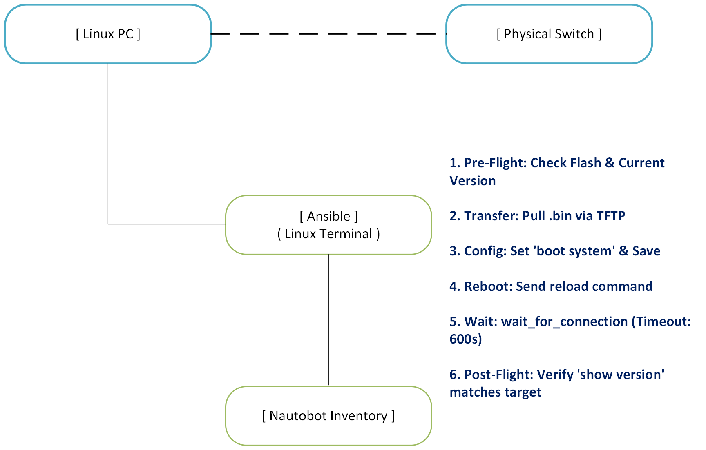
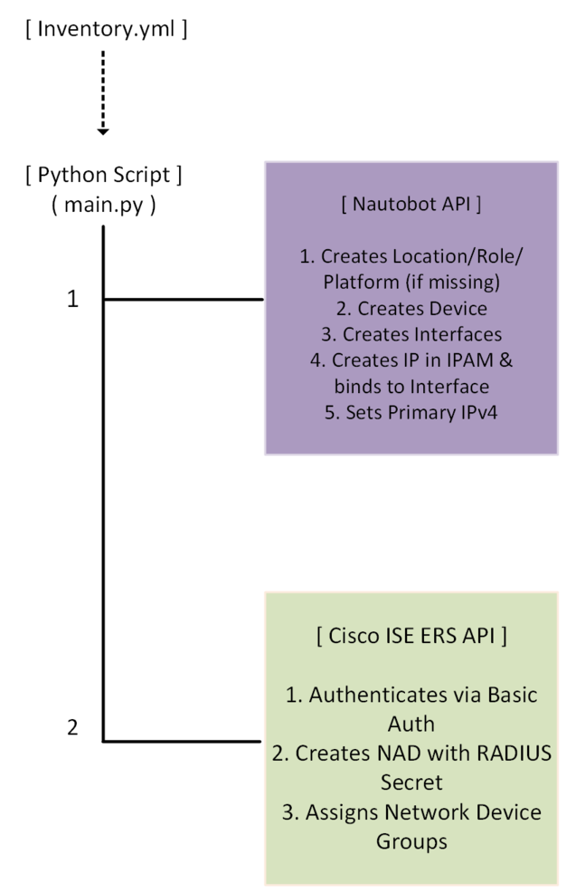
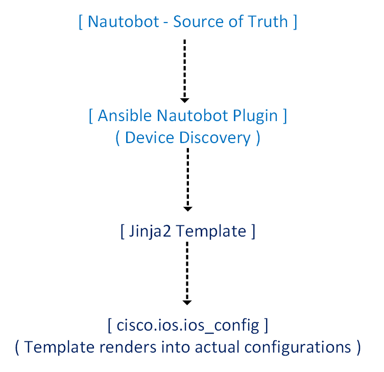
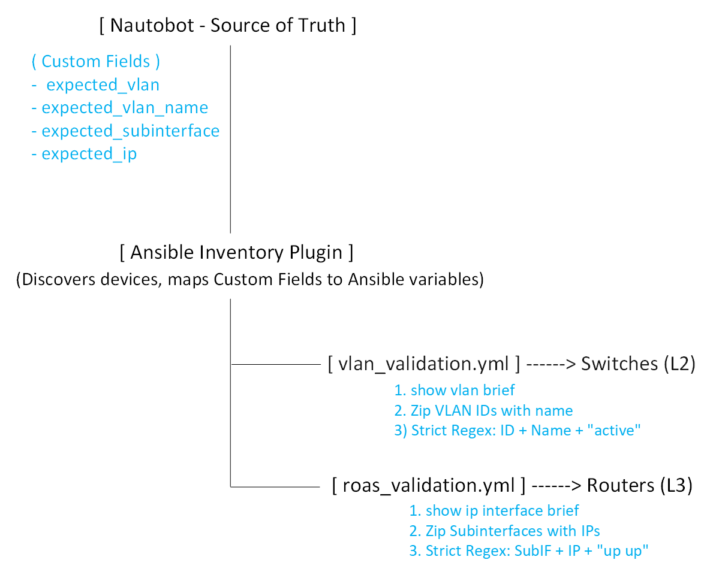

# Enterprise Network Automation & NetDevOps Portfolio

## Summary
Welcome to my comprehensive Network Automation portfolio. This repository is not a collection of isolated scripts; it is a cohesive, enterprise-grade **NetDevOps ecosystem**. 

Designed to solve real-world operational challenges, this portfolio demonstrates a complete automation lifecycle: from **Zero-Touch Provisioning** and **ITSM-driven service fulfillment**, to **safe physical hardware upgrades**, **CI/CD pipeline gating**, and **pre-deployment mathematical network modeling**. 

Every project is built around a central **Source of Truth (Nautobot)**, ensuring that automation is dynamic, scalable, and strictly aligned with business intent.

---

## Core Competencies
*   **Languages & Frameworks:** Python 3, Ansible, Jinja2, YAML, Bash
*   **Network Automation:** Netmiko, NAPALM, PyNautobot, Cisco IOS/IOS-XE
*   **CI/CD & DevOps:** GitHub Actions, Self-Hosted Runners, Git, Docker
*   **Validation & Modeling:** Batfish (Pre-deployment reachability), Ansible `--check`, Regex
*   **ITSM & APIs:** Jira REST API, Webhooks, JSON parsing
*   **Source of Truth:** Nautobot (Dynamic Inventory, Custom Fields, IPAM)

---

## Automation Tasks

This repository is organized into modular, production-ready projects. Click on any folder to view its dedicated `README.md`, architecture diagrams, and execution videos.

### [01] [Day 1 Zero-Touch Provisioning & NAC Integration](01-Python-NAD-Onboarding/)
*   **The Problem:** Manually onboarding new network devices into the Source of Truth and Network Access Control (NAC) systems is tedious and prone to IP/credential mismatches.
*   **The Solution:** A Python automation script that ingests new device details, dynamically creates the device record in **Nautobot**, assigns IP addresses via IPAM, and automatically configures the device as a Network Access Device (NAD) in **Cisco ISE**.
*   **Business Value:** Reduces Day 1 onboarding time from hours to minutes, ensuring 100% accuracy between the physical device, the Source of Truth, and the security policy.

### [02] [Day 2 Configuration Drift Auditor & Alerting](02-Python-Config-Drift-Auditor/)
*   **The Problem:** Unauthorized or accidental configuration changes (drift) on network devices cause outages and compliance violations.
*   **The Solution:** A Python engine using **Netmiko** and **Difflib** that SSHs into devices, compares the live running-config against the Nautobot Source of Truth, generates a visual **HTML compliance report**, and instantly fires a **Slack webhook alert** if drift is detected.
*   **Business Value:** Provides continuous, real-time compliance monitoring and instant NOC alerting, drastically reducing Mean Time to Detect (MTTD) for unauthorized changes.

### [03] [Ansible Intent-Based Network State Validator](03-Ansible-State-Validator/)
*   **The Problem:** Knowing a configuration was pushed doesn't guarantee the network is actually passing traffic correctly.
*   **The Solution:** A read-only Ansible framework using **Nautobot Dynamic Inventory** and **Custom Fields**. It intelligently validates Layer 2 (VLANs/Trunks) on switches and Layer 3 (ROAS Subinterfaces/IPs) on routers using strict Regex assertions, gracefully skipping devices where the topology doesn't apply.
*   **Business Value:** Shifts automation from "push and pray" to "verify and validate," ensuring the actual data plane matches the intended business logic without risking configuration changes.

### [04] [Ansible Jinja2 Templating & Mass Deployment Engine](04-Ansible-Jinja2-Deployer/)
*   **The Problem:** Applying standard baseline configurations (NTP, Syslog, SNMP) to hundreds of devices manually leads to copy-paste errors and inconsistent environments.
*   **The Solution:** An Ansible templating engine that pulls device-specific variables (Hostnames, IPs, Locations) directly from Nautobot, renders them into a **Jinja2** blueprint, and safely merges the configuration using `replace: block` and `--check --diff` dry-runs.
*   **Business Value:** Ensures 100% configuration consistency across the fleet while eliminating human error through safe, pre-deployment visual diffing.

### [05] [ITSM-Driven Service Request Fulfillment Engine](05-Python-Service-Request-Provisioner/)
*   **The Problem:** Manual port provisioning from helpdesk tickets is slow, error-prone, and lacks auditability.
*   **The Solution:** A Python engine that polls the **Jira REST API** for new tickets, parses the unstructured text using Regex, dynamically renders a **Jinja2** configuration, pushes it via **Netmiko**, and automatically updates the Jira ticket to "Completed" with a detailed comment.
*   **Business Value:** Reduces port provisioning time from 15 minutes to **under 40 seconds**, with a perfect, immutable audit trail.

### [06] [Automated Physical Hardware OS Upgrade Pipeline](06-Ansible-OS-Upgrader/)
*   **The Problem:** Upgrading physical switch OS versions manually is high-risk and prone to human error (e.g., wrong boot variable, full flash).
*   **The Solution:** A 5-phase Ansible playbook that performs pre-flight flash checks, securely downloads the `.bin` via **TFTP**, updates the boot system, gracefully handles the SSH drop during reboot, and performs strict post-flight version validation.
*   **Business Value:** Transforms a multi-hour, high-risk maintenance window into a fully automated, repeatable, and safe pipeline.

### [07] [Enterprise Network CI/CD Pipeline](07-Ansible-CICD-Pipeline/)
*   **The Problem:** Pushing network changes directly from a laptop lacks peer review, syntax checking, and safety gates.
*   **The Solution:** A **GitHub Actions** pipeline utilizing a **Self-Hosted Runner** to bridge the cloud with on-premise infrastructure. It automatically runs `ansible-lint`, executes fleet-wide read-only compliance audits, and performs Ansible `--check --diff` dry-runs on every Pull Request.
*   **Business Value:** Catches misconfigurations *before* they reach production, enforcing "Infrastructure as Code" best practices and reducing Mean Time to Deploy (MTTD).

### [08] [Pre-Deployment Network Modeling & Reachability (Batfish)](08-Python-Batfish-Modeler/)
*   **The Problem:** Ansible `--check` only validates text diffs. It cannot tell you if a new ACL will accidentally block management traffic or create a routing loop.
*   **The Solution:** A Python validator that ingests raw configurations into a **Batfish** Docker container, builds a vendor-agnostic mathematical model of the network, and simulates actual packet flows (e.g., proving SSH is permitted and Telnet is explicitly denied).
*   **Business Value:** Provides mathematical proof of network behavior, acting as the ultimate safety gate before any configuration is deployed.

---

## High-Level Architecture

**ITSM-Driven Service Request Fulfillment Engine**

---

**Automated Physical Hardware OS Upgrade Pipeline**

---

**Day 1 Zero-Touch Provisioning & NAC Integration**

---

**Pre-Deployment Network Modeling & Reachability (Batfish)**

---

**Enterprise Network CI/CD Pipeline**

---

**Ansible Jinja2 Templating & Mass Deployment Engine**

---

**Ansible Intent-Based Network State Validator**

---

**Configuration Drift Auditor & Alerting**

## How to Navigate
1. Browse the numbered folders (e.g., `05-Python-Service-Request-Provisioner`) to see individual project documentation.
2. Each project folder contains its own `README.md`, `requirements.txt`, source code, and a `screenshots` / `videos` directory proving real-world execution.

---

## Contact & Connect
*   **Email:** [richard.pateau@yahoo.com]
*   **Portfolio Website:** [https://richardpateau.github.io/]
*   **Blog:** [networkingnotebook.com]

*Thank you for reviewing my work. I look forward to discussing how these automation principles can drive operational excellence for your team.*

---

### What's Next?

With the high-level NetDevOps ecosystem and project portfolio overview established, the next step is to dive into the first automation project.

Continue to the first module to explore Day 1 Zero-Touch Provisioning:
- **[01 — Day 1 Zero-Touch Provisioning & NAC Integration](01-Python-NAD-Onboarding/)** – Python automation for Nautobot device creation, IPAM assignment, and Cisco ISE NAD configuration.
