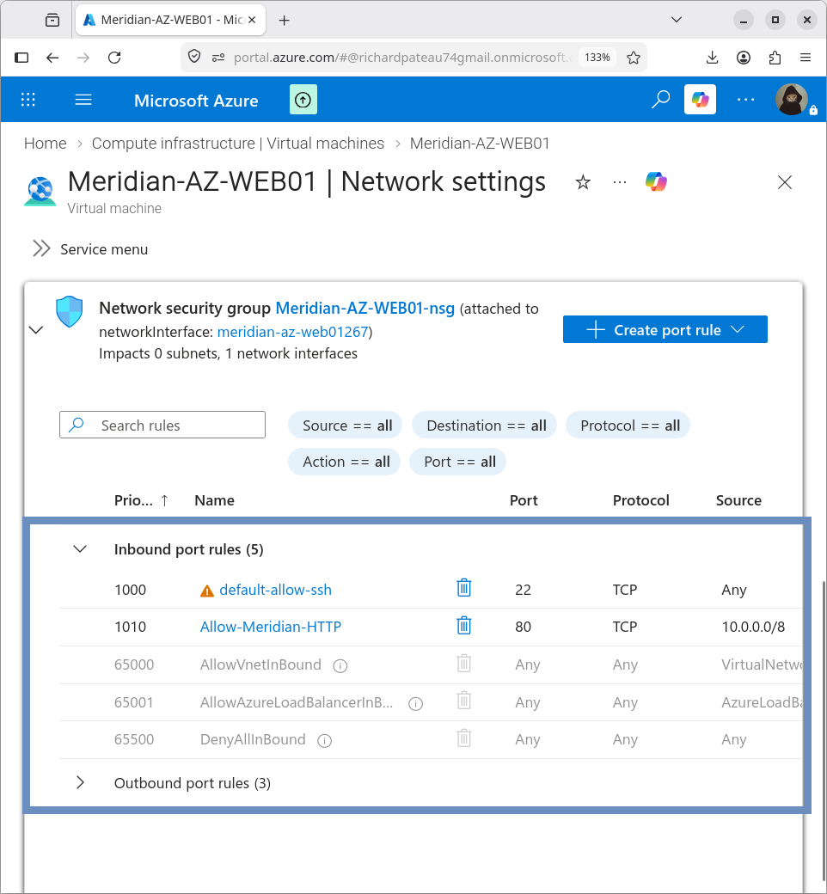

# Web Server

## Overview

`MERIDIAN-AZ-WEB01` hosts an Apache HTTP Server application.

The web server provides an internal application workload that demonstrates Azure application hosting and hybrid connectivity over the site-to-site VPN.

## Web Server Software

| Field          | Value                    |
|-------------------|--------------------------|
| Web Server        | Apache HTTP Server       |
| Operating System  | Ubuntu Server 24.04 LTS  |
| HTTP Port         | 80/TCP                   |

## Apache Installation

Apache was installed on the Azure VM using the Ubuntu package manager.

The service is managed with:

```bash
systemctl status apache2
```

Apache was verified as active (running).

## Web Application

The default Apache webpage was replaced with a custom Meridian Financial Services page.

| Item          | Value                     |
|---------------|---------------------------|
| Document root | /var/www/html/index.html  |
| Access URL    | http://10.200.10.4        |

## Application Content

The webpage identifies the workload with the following information:

```text
Meridian Financial Services – Hybrid Azure Application Server
Server Name: MERIDIAN-AZ-WEB01
Platform: Microsoft Azure
Region: East US
VNet: Meridian-Azure-VNet
Subnet: Azure-Apps
Private IP: 10.200.10.4
Web Server: Apache HTTP Server
Hybrid Connectivity: Site-to-site IPsec VPN
```

## Application Access

The application is served only on the VM’s private IP:

```text
http://10.200.10.4
```

- The Azure VM has no public IP
- The website was successfully accessed from the Meridian environment using the private address
- This demonstrates application-layer connectivity over the private hybrid network

## HTTP Security

The VM’s Network Security Group includes the following rule:

| Setting          | Value               |
|------------------|---------------------|
| Rule Name        | Allow-Meridian-HTTP |
| Source           | 10.0.0.0/8          |
| Destination Port | 80/TCP              |
| Action           | Allow               |
| Priority         | 1010                |



## Verification

**Plese enlarge for clearer video**

https://github.com/user-attachments/assets/1e9e57af-f7ac-4056-a3f8-237f7d43cb66

### Application Verification

Accessing http://10.200.10.4 from the Meridian network successfully loaded the custom Meridian Financial Services webpage.

This confirms:

- Azure VM is reachable over the private network
- TCP port 80 is accessible
- NSG permits the required HTTP traffic
- Apache is serving the application
- Custom webpage is delivered correctly

## Implementation Status

### Completed

- Ubuntu Server deployed
- Apache installed and running
- Custom webpage created and deployed
- HTTP port 80 configured in the VM NSG
- Private SSH access tested
- Private HTTP application access tested
- Custom webpage successfully served from 10.200.10.4

---

### What's Next?

With the application server fully configured, secured, and successfully serving traffic over the private hybrid network, the next step is to provide it with controlled outbound Internet access for updates and external communications.

Continue to the next module to explore the controlled egress implementation:
- **[05 — Internet Egress](../05-Internet-Egress/)** – Azure NAT Gateway configuration and private VM Internet egress.
