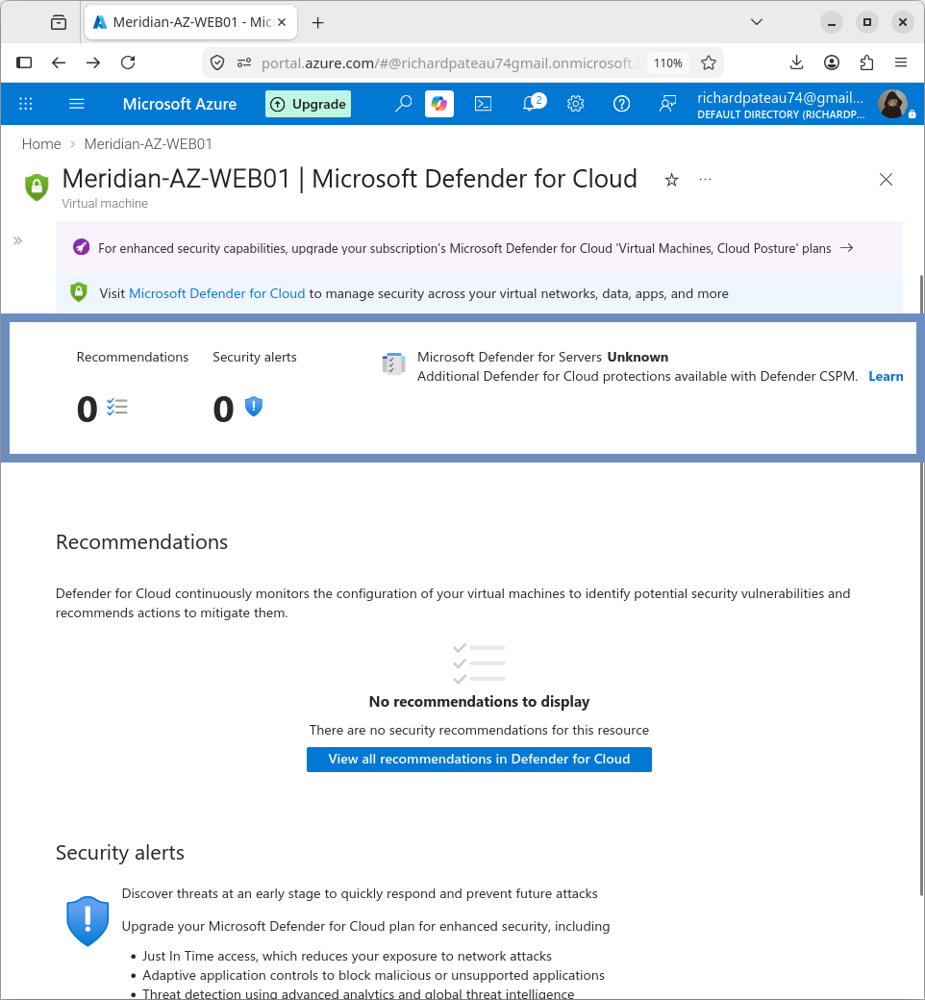

# Microsoft Defender for Cloud

## Overview

Microsoft Defender for Cloud recommendations were reviewed for the Meridian Azure environment after the security configuration was completed.

The purpose of this validation was to identify outstanding security recommendations and active attack paths.

## Validation Results

At the time of validation:

| Category                  | Result |
|---------------------------|--------|
| Critical recommendations  | 0      |
| High recommendations      | 0      |
| Medium recommendations    | 0      |
| Low recommendations       | 0      |
| Active attack paths       | 0      |
| Overdue recommendations   | 0      |

No recommendations were reported during the validation.

## Interpretation

The Azure environment had **no active Defender for Cloud recommendations** at the time the validation was performed.

This represents the security state observed during the project validation period. It does **not** imply that future recommendations cannot appear as Azure resources or security conditions change.

## Design Notes

- Defender for Cloud was used as a validation checkpoint after NSG hardening, Trusted Launch, and resource locks were applied
- A clean recommendation state supports the layered security posture of the environment
- Ongoing monitoring is recommended as the environment grows

---

### ➡️ Next Section

Continue to the detailed Network Security Group (NSG) configuration and rule validation:
- **[Network Security Groups (NSG)](nsg.md)** – Inbound/outbound rules, effective security validation, and traffic filtering.
