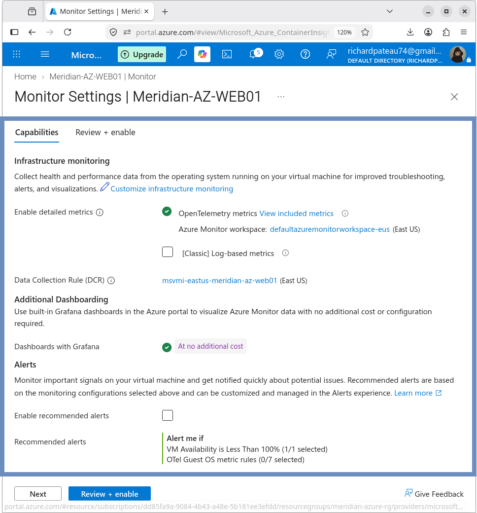
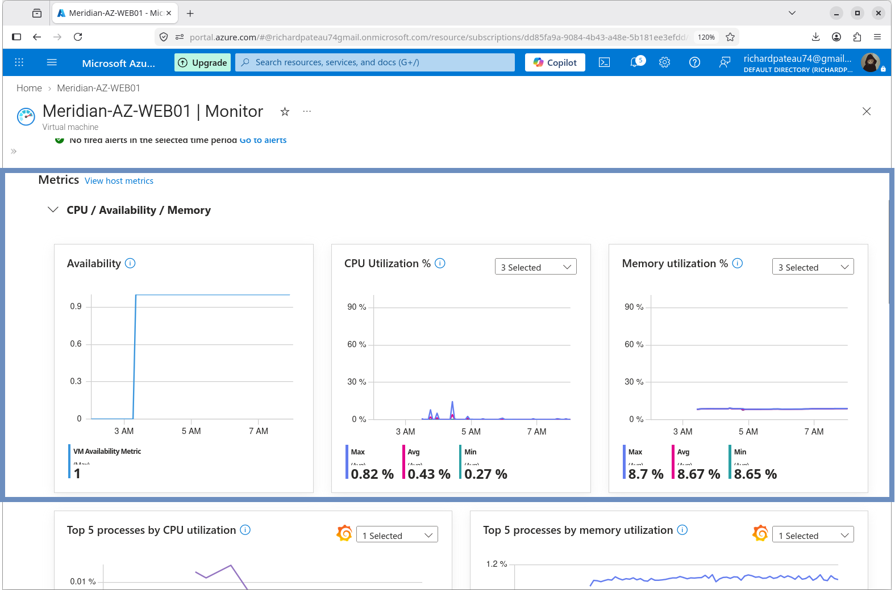

# Data Collection

## Overview

Azure Monitor uses a Data Collection Rule to define how monitoring data is collected for the Azure VM.

## Azure Monitor Workspace

| Property | Value                            |
|----------|----------------------------------|
| Name     | defaultazuremonitorworkspace-eus |
| Region   | East US                          |
| Purpose  | Azure Monitor metrics            |

## Data Collection Rule

| Property          | Value                          |
|-------------------|--------------------------------|
| Name              | msvmi-eastus-meridian-az-web01 |
| Region            | East US                        |
| Monitored VM      | MERIDIAN-AZ-WEB01              |
| Collection method | OpenTelemetry-based monitoring |

## OpenTelemetry

Detailed OpenTelemetry metrics were enabled during the VM monitoring configuration.

This provided guest operating-system and resource-level metric visibility beyond basic VM availability.

## Metrics Observed

Following onboarding, the VM produced monitoring data including:

- CPU utilization
- Memory utilization
- Availability
- Process-level CPU
- Host metrics

### Host CPU (validation period)

| Metric  | Value (approx.) |
|---------|-----------------|
| Average | 0.43%           |
| Minimum | 0.27%          |
| Maximum | 0.82%          |

These values represent the observed monitoring period during validation.

## Validation

The Monitor page showed populated metric data after onboarding completed successfully.

## Result

The Azure VM was successfully connected to Azure Monitor through the configured monitoring workspace and Data Collection Rule.

---

### What's Next?

With monitoring and alerting fully configured and validated, the final step is to ensure the environment can be recovered in the event of a disaster.

Continue to the final module to explore the backup and disaster recovery architecture:
- **[09 — Backup & Disaster Recovery](../09-Backup-DR/)** – Recovery Services Vault, backup policies, recovery points, and restore validation.
