# 05 — ISE MAC Authentication Bypass (MAB) & Dynamic VLAN Assignment

## Overview
While 802.1X is the gold standard for corporate endpoints, many enterprise devices (IP phones, printers, IoT sensors) lack an 802.1X supplicant. To maintain a Zero-Trust posture without leaving ports completely open, Cisco ISE utilizes MAC Authentication Bypass (MAB). 

In this implementation, a Cisco CP-8841 IP phone is authenticated via its MAC address, profiled as a trusted device, and dynamically assigned to the Voice VLAN (VLAN 90) via RADIUS attributes.

| Component | Detail |
|---|---|
| Access switch | `PHYSICAL-SW`, port `Gi1/0/2` |
| RADIUS / policy server | Cisco ISE `192.168.122.2` (evaluation license) |
| Endpoint | Cisco CP-8841 IP phone, MAC `00:A2:89:6D:E9:CC` |
| DHCP | Served by the switch in this topology |
 

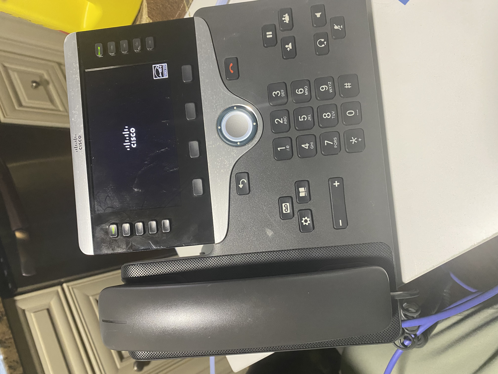

---

## Implementation Phases

### Phase 1: Switchport Configuration (MAB Fallback)
To support both 802.1X laptops and MAB IP phones on the same physical port, the switch is configured in `multi-domain` host mode. 

The authentication order is explicitly set to `mab dot1x`. If a port is set to `dot1x mab`, the switch waits for an 802.1X timeout (up to 60 seconds) before trying MAB. By prioritizing MAB, non-802.1X devices authenticate instantly, drastically reducing boot times for IP phones.

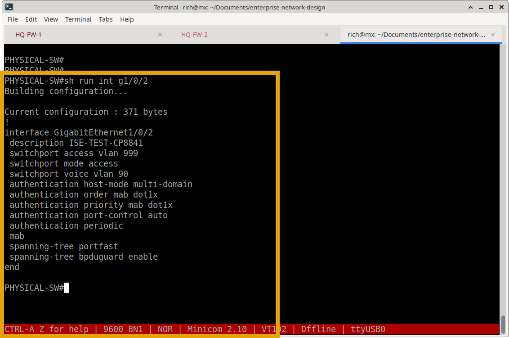

**AAA Configuration**

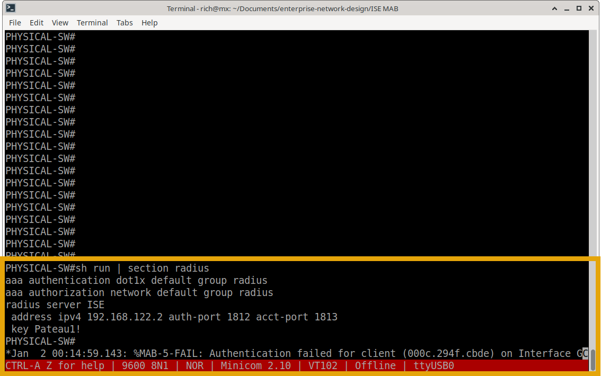

### Phase 2: ISE Endpoint & Identity Group Setup
Because the local switch acts as the DHCP server in this specific lab topology, ISE cannot snoop the DHCP Option 60 probe. To simulate the ISE Profiling engine, the endpoint is manually registered.

1. **Endpoint Identity Group:** Created a dedicated group (`Cisco-IP-Phones`) to logically separate voice devices from standard data endpoints.
   
   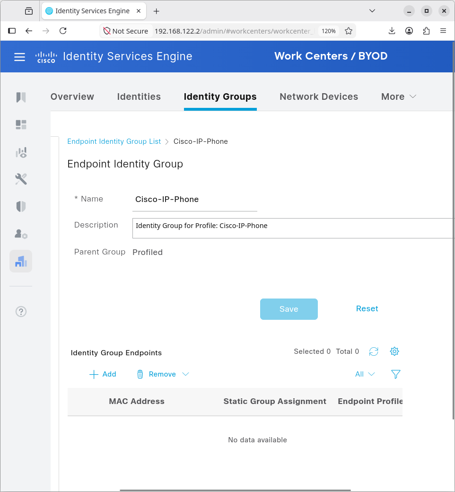

2. **Endpoint Registration:** The MAC address of the physical CP-8841 (`00:A2:89:6D:E9:CC`) was added to ISE and statically mapped to the `Cisco-IP-Phones` profile.
   
   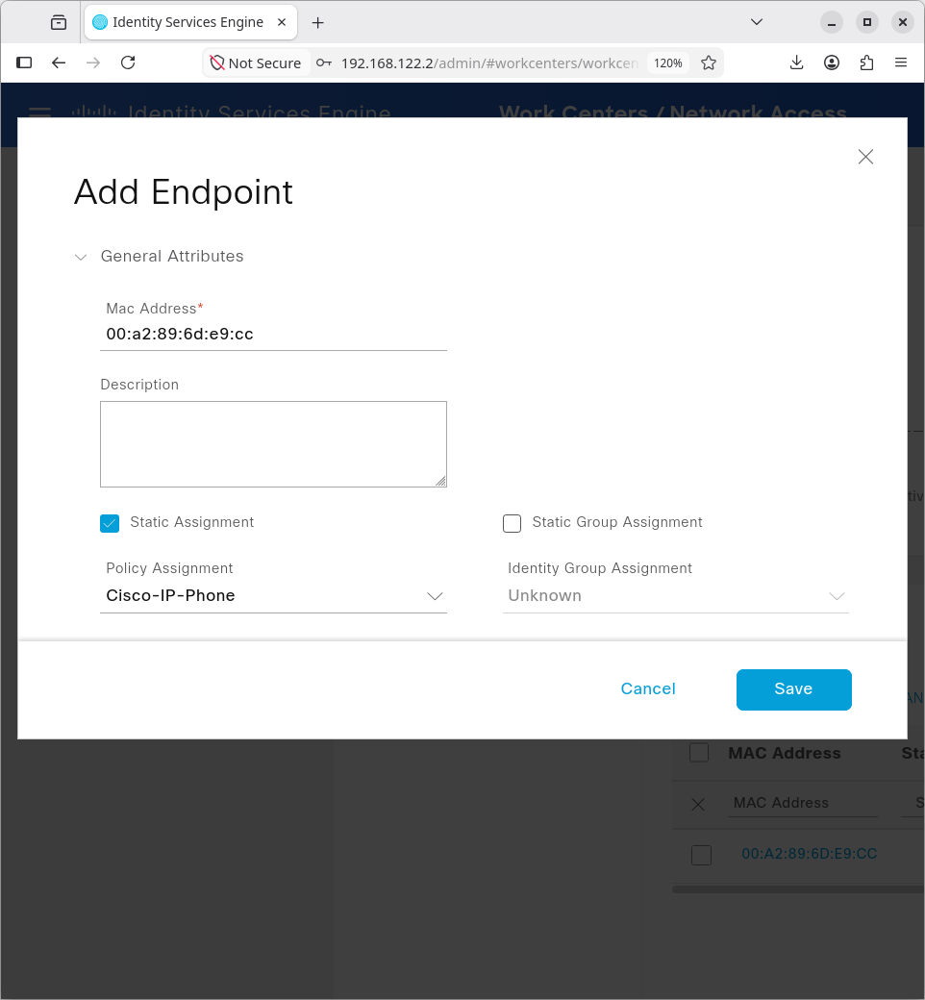

### Phase 3: Authorization Profile (Dynamic VLAN Push)
An Authorization Profile was created in ISE containing specific RADIUS AV-pairs. When ISE authenticates a device matching the `Cisco-IP-Phones` condition, it pushes these attributes back to the switch, instructing it to dynamically move the port to VLAN 90.

*   `Tunnel-Type`: VLAN
*   `Tunnel-Medium-Type`: IEEE-802
*   `Tunnel-Private-Group-ID`: 90
*   `Voice Domain Permission`: Enabled 

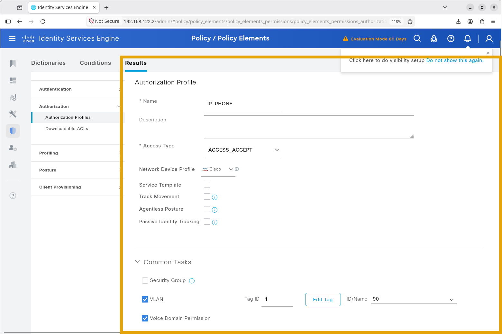

---

## Verification & Evidence

### 1. ISE Live Logs (Authentication Success)
The ISE Live Logs confirm that the switch sent a RADIUS Access-Request using the MAC address as the username. ISE successfully matched the endpoint profile and returned an Access-Accept.

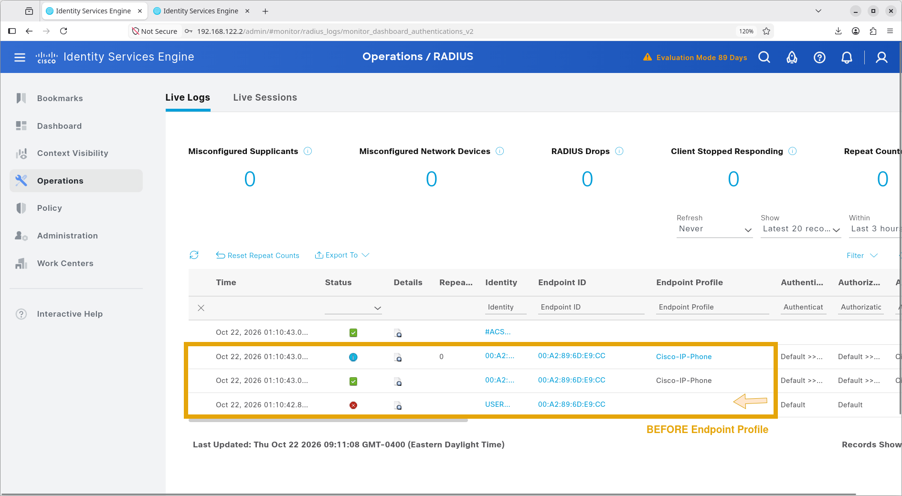

### 2. Switch Authentication Session Details
Running `show authentication sessions interface Gi1/0/2 details` on the physical switch proves the exact method and status. Note that `dot1x` is stopped, and `mab` shows `Authc Success`.

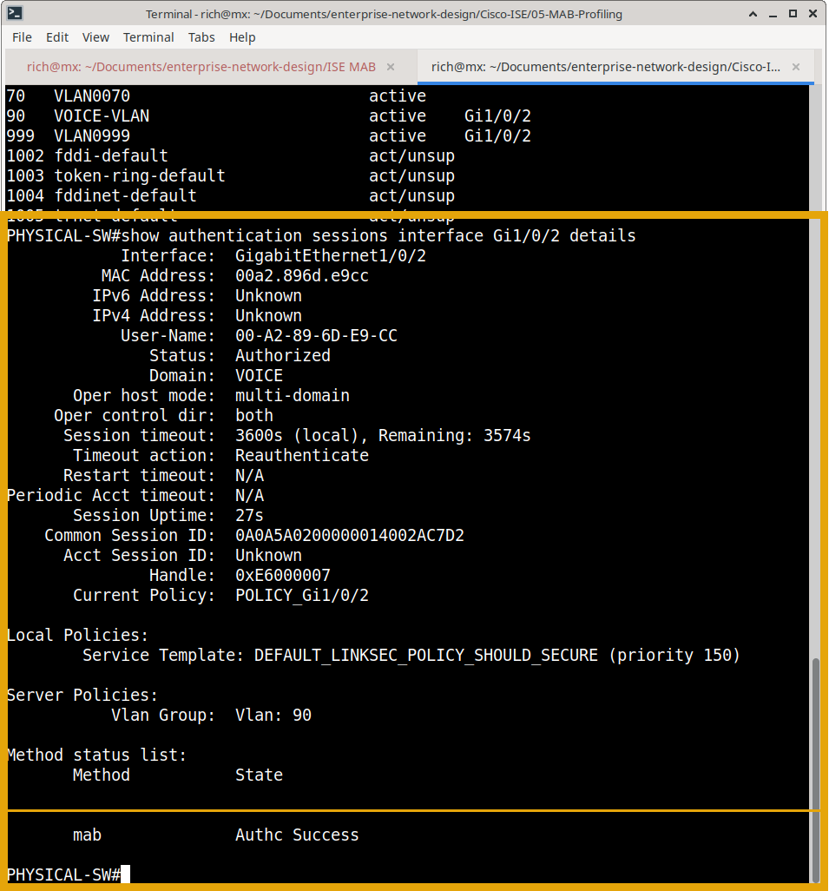

### 3. Dynamic VLAN Assignment
The ultimate proof of Network Access Control is dynamic segmentation. Running `show vlan brief` confirms that the switch dynamically moved `GigabitEthernet1/0/2` from the default Data VLAN into `VOICE-VLAN 90` based purely on the ISE authorization policy.

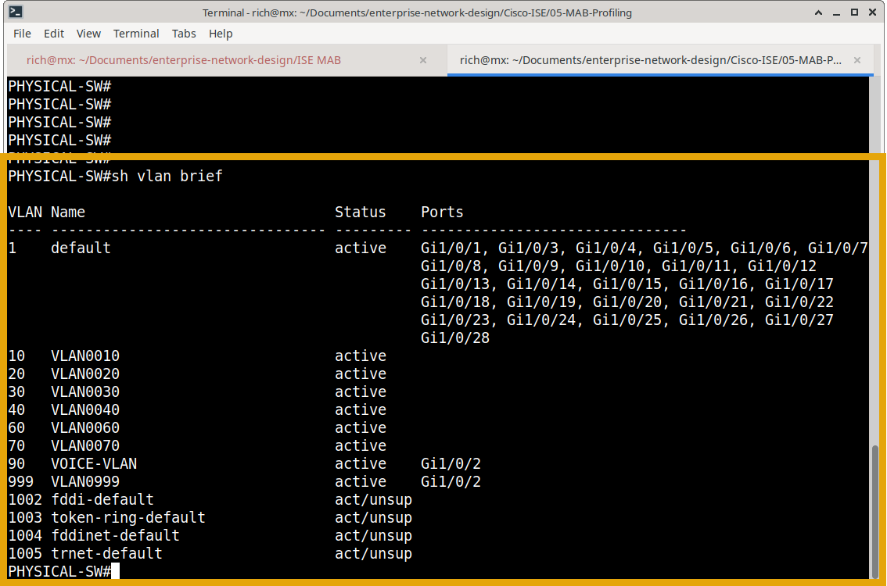

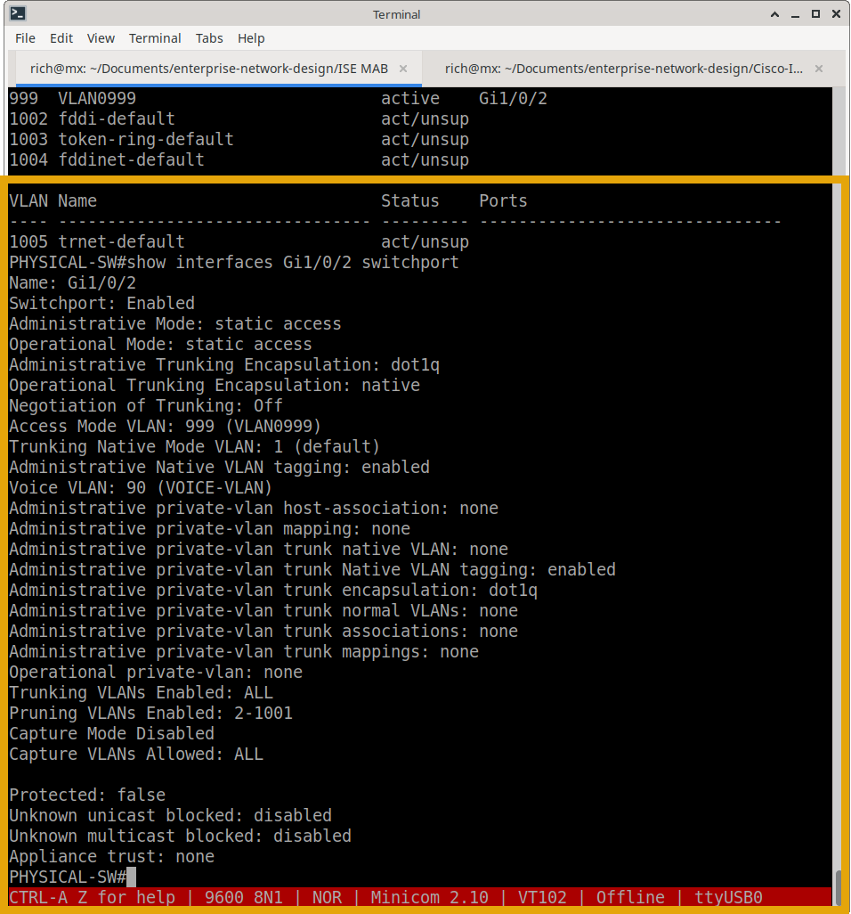

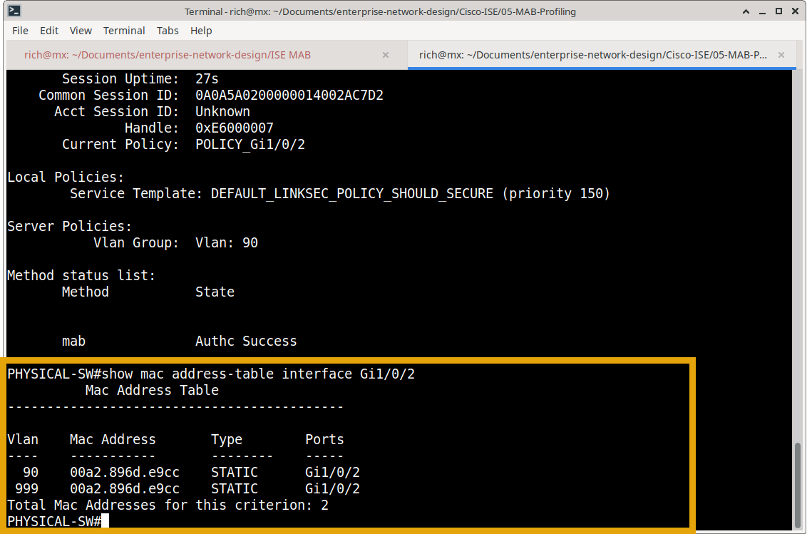

### 4. Negative Testing: Unauthorized Access Blocking
A robust Network Access Control (NAC) solution must not only allow trusted devices but actively block unknown ones. 

To validate the security posture, a test device with an unregistered MAC address (`ca2a.428a.008c`) was connected to the switchport. 

**Observations:**
1.  **Switch Status:** The `show authentication sessions` output confirms the port remains in an `Unauthorized` state. The MAB method shows as `Stopped` because the authentication attempt failed.
 
 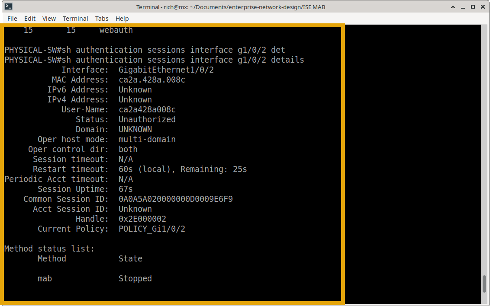
 
2.  **Syslog Evidence:** The switch console generates a `%MAB-5-FAIL` syslog message, explicitly stating that authentication failed for the client on Interface Gi1/0/2. This confirms that ISE correctly rejected the unknown MAC address.
  
  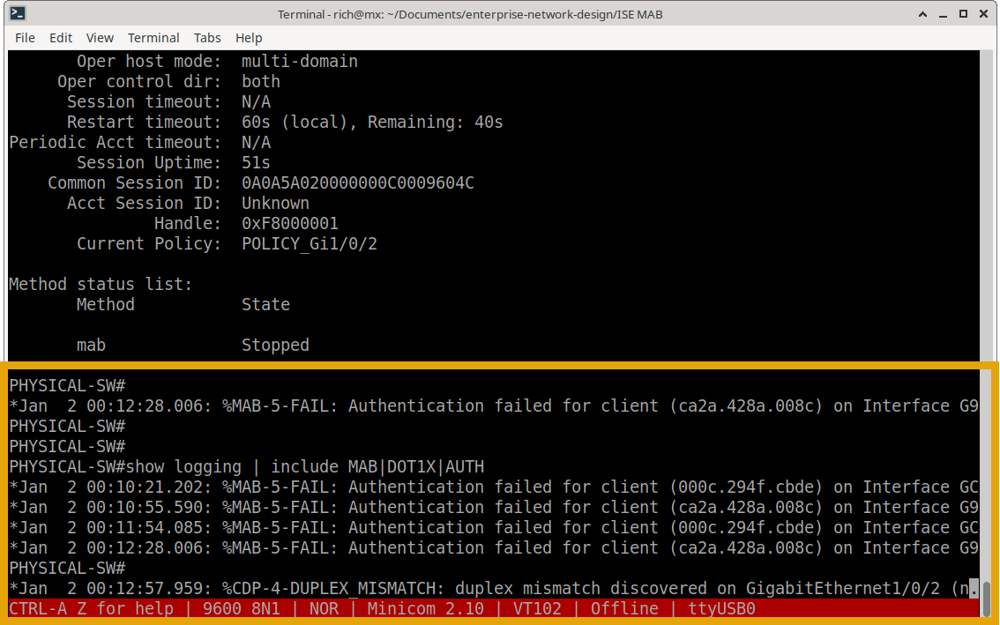
  
This negative test proves that the network is not open; only devices explicitly defined in the ISE policy can gain access.

---

### What's Next?

With the wired network access control, guest isolation, administrative security, and IoT/Voice profiling fully implemented and validated, the next step is to extend this identity-driven security to the wireless network.

Continue to the next major module to explore the Wireless LAN Controller implementation:
- **[Cisco Wireless LAN Controller (WLC)](../../Cisco-WLC/)** – Wireless network design, WLC configuration, AP join process, and wireless security policies.
