# Cisco ISE — TACACS+ Implementation & AAA Model

## Overview

This document details the configuration model used to enforce centralized TACACS+ administration within the Meridian environment. It covers the ISE policy framework (Authentication, Authorization, Accounting) and the corresponding Cisco IOS device configuration.

---

### 1 Authentication Policy

Within the Device Administration Policy Set, the Authentication Policy is configured to validate all administrative login attempts against the available identity sources.

*   **Rule Name:** `Default`
*   **Conditions:** *(None)* — This rule applies to all TACACS+ authentication requests entering this Policy Set.
*   **Use (Identity Source Sequence):** `All_User_ID_Stores`

**Mechanism:** 
By using the `All_User_ID_Stores` sequence, ISE will automatically check the administrator's credentials against both the internal ISE user database and the integrated Active Directory. This ensures that network administrators can authenticate using their centralized AD credentials.

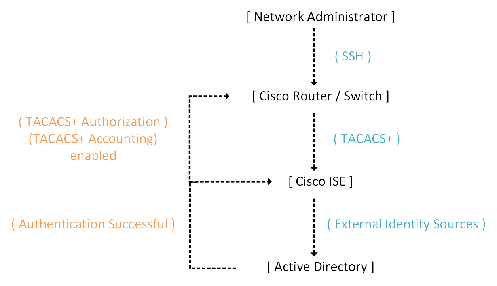

### 1.1 Authorization Policy (Shell Profiles)
Upon successful authentication, ISE evaluates the Authorization Policy to determine the administrator's privileges.
*   **Condition:** `External Groups` CONTAINS `Meridian_Network_Admins`
*   **Action:** Apply Shell Profile: `NetAdmin_Priv15_FullAccess`
*   **Mechanism:** The Shell Profile dictates the default Privilege Level (15) and can optionally apply a **Command Set** to explicitly permit or deny specific CLI commands (e.g., permitting `show` and `configure terminal`, but denying `reload`).

**Device Administration Policy**

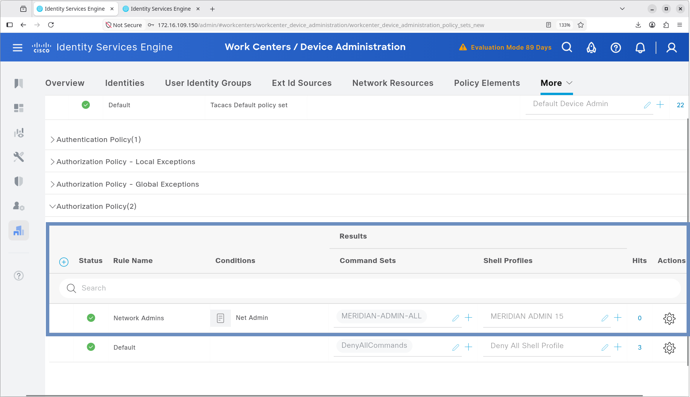

**Conditions: Net Admin**

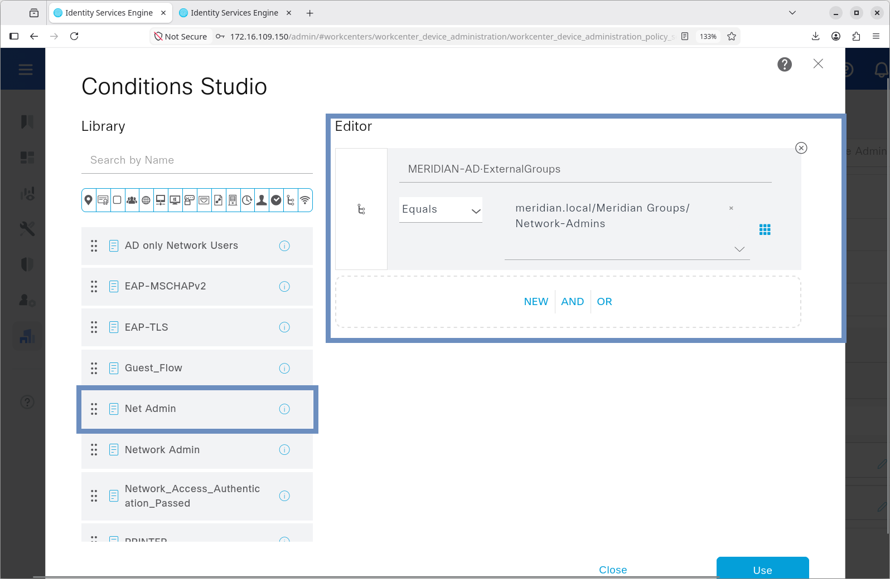

**Command Set: MERIDIAN-ADMIN-ALL**

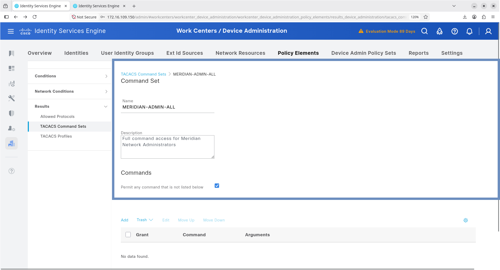

**Shell Profile: MERIDIAN ADMIN 15**

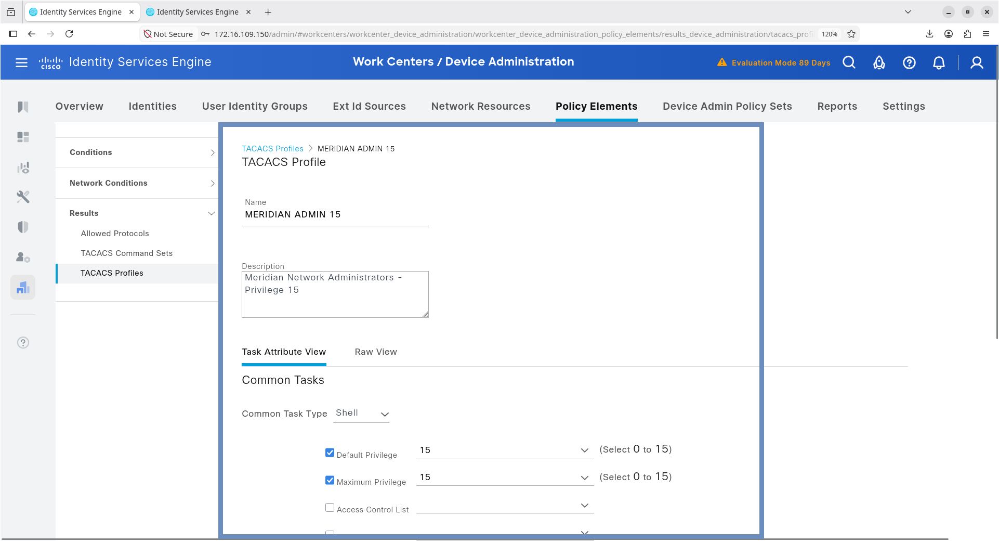

### 1.2 Accounting Policy
Accounting is enabled to track administrative sessions and command execution.
*   **Action:** Account `Session` (Start/Stop) and `Command` (per-command logging) to the ISE TACACS+ Accounting service.

---

## 2. Network Device (NAS) Configuration

The Cisco device must be configured to use ISE as the primary TACACS+ server for AAA.

```cisco
! 1. Define the TACACS+ Server
tacacs server MERIDIAN-ISE
 address ipv4 10.50.50.10
 key <STRONG_SHARED_SECRET>
 timeout 5

! 2. Configure AAA Methods
aaa new-model
aaa authentication login default group tacacs+ local
aaa authorization exec default group tacacs+ local 
aaa authorization commands 15 default group tacacs+ local
aaa accounting exec default start-stop group tacacs+
aaa accounting commands 15 default start-stop group tacacs+

! 3. Apply to VTY Lines
line vty 0 15
 transport input ssh
 login authentication default
```
The `local` keyword at the end of the AAA commands provides a fallback mechanism in case ISE becomes unreachable, preventing administrative lockout.

---

## 3. AAA Validation & Evidence Matrix

The implementation was validated through rigorous functional testing. The following evidence matrix maps the test scenarios to the captured artifacts.

### 3.1 Positive Authentication & Authorization
**Objective:** Verify successful admin login and Privilege 15 assignment.
*   **ISE Evidence:** Live Logs showing `Authentication: SUCCESS` and `Authorization: PASS` with the `NetAdmin_Priv15_FullAccess` shell profile.
*   **Device Evidence:** Successful SSH login as `netadmin.test`, immediately dropping into `enable` mode (Privilege 15) without requiring a secondary enable password.

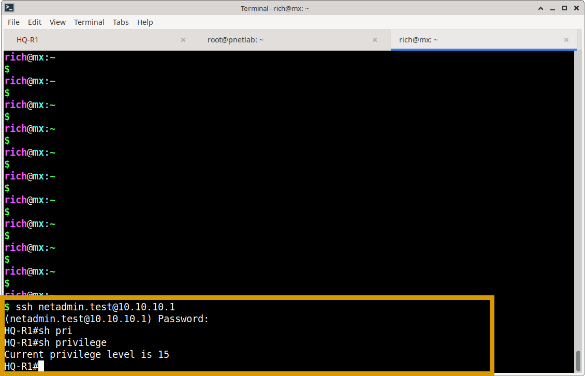

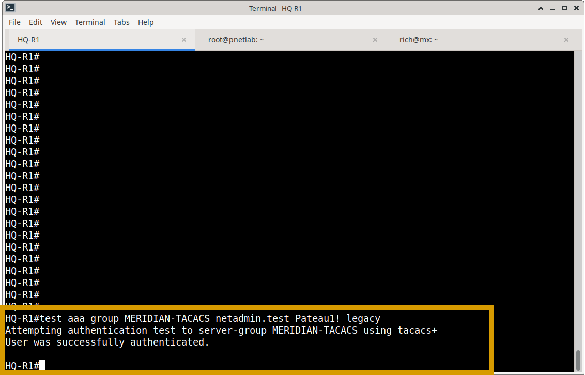

### 3.2 Negative Authentication (Access Denial)
**Objective:** Verify that invalid credentials are rejected securely.
*   **ISE Evidence:** Live Logs showing `Authentication: FAILED` with reason `Invalid credentials`.
*   **Device Evidence:** SSH connection terminates with `Access denied`. Router `debug tacacs` shows the rejection packet from ISE.

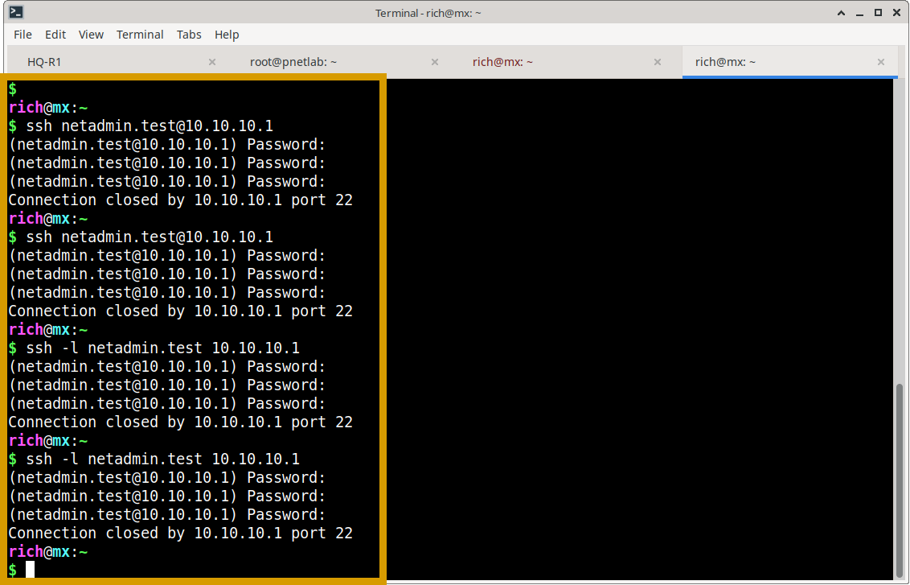

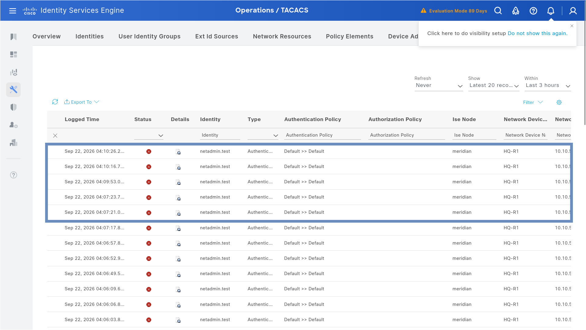

**HQ-R1: debug tacas authentication**
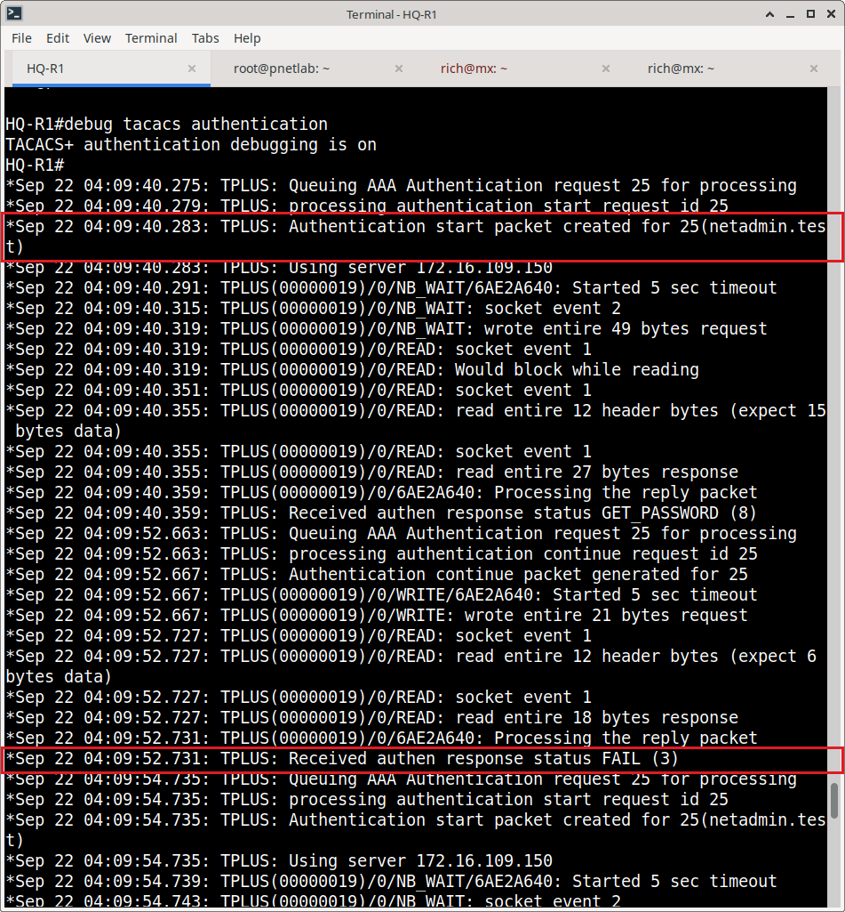

### 3.3 Accounting Verification (Audit Trail & Non-Repudiation)

**Objective:** Verify that TACACS+ Command Accounting successfully logs every administrative action executed on the network device, tying specific commands to the authenticated user identity (`netadmin.test`).

**Test Scenario:**
The administrator logged into **HQ-R1** and performed configuration changes, specifically creating a subinterface (`FastEthernet 0/0.80`) and applying 802.1Q encapsulation (`dot1Q 900`).

**Evidence & Observation:**

1.  **Device-Side Execution:**
    The terminal session on HQ-R1 confirms the execution of specific configuration commands by the authenticated user.

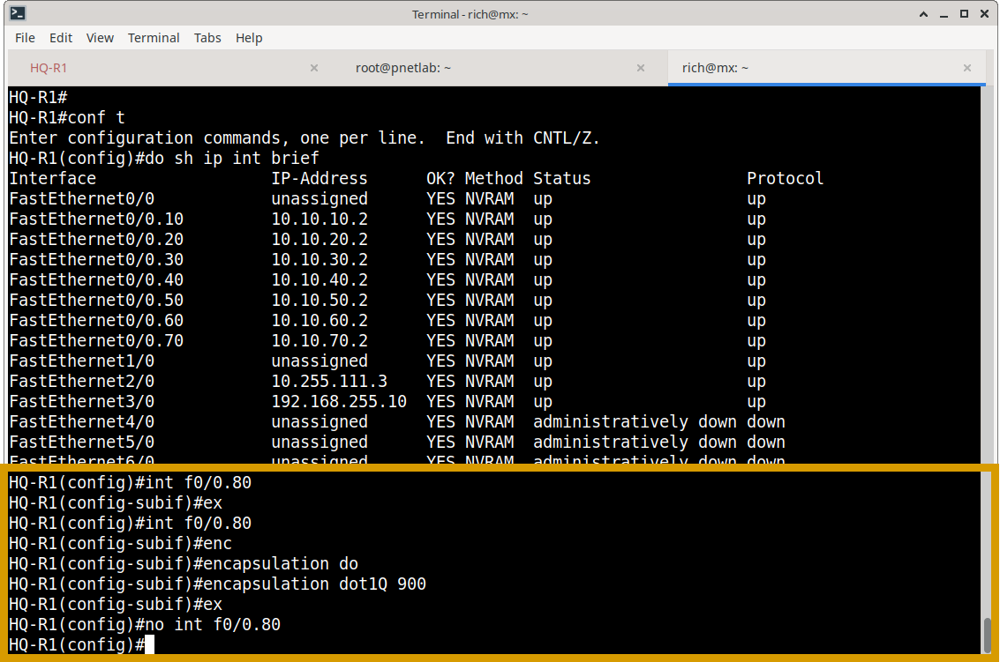

2.  **ISE Command Accounting Report:**
    The ISE "TACACS Command Accounting" report provides a granular, timestamped log of the session. Crucially, it captures not just the commands, but the **arguments** used.

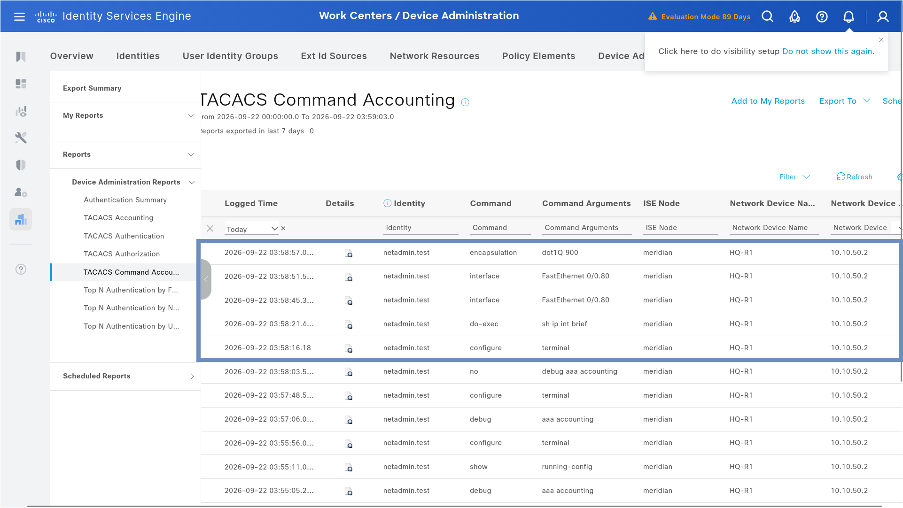

**Key Observations from ISE Report:**
*   **Identity Correlation:** Every command is explicitly tied to the `netadmin.test` identity.
*   **Command Granularity:** ISE logged the exact sequence: `configure terminal` $\rightarrow$ `interface FastEthernet 0/0.80` $\rightarrow$ `encapsulation dot1Q 900`.
*   **Audit Capability:** This level of visibility ensures that if a configuration change causes a network outage, the exact administrator and the specific commands responsible can be identified immediately.

## 4. Evidence Repository

Curated screenshots validating this implementation are stored in:
`Cisco-ISE/04-TACACS/screenshots/`

**Evidence Checklist:**

**ISE Policy Configuration:**
- [x] `device-administration-policy.png` (Proof of TACACS+ Device Admin Policy Set)
- [x] `authentication-policy.png` (Proof of Authentication Policy using All_User_ID_Stores)
- [x] `command-set.png` (Proof of Command Set configuration)
- [x] `tacacs-profile-privilege-15.png` (Proof of Shell Profile assigning Privilege 15)
- [x] `conditional-rule.png` (Proof of conditional authorization rules)

**Authentication Testing (Positive & Negative):**
- [x] `successful-login.png` (Proof of successful SSH login as netadmin.test)
- [x] `test-aaa-group.png` (Proof of AAA group testing on the router)
- [x] `ise-log-failures.png` (Proof of failed credential handling in ISE Live Logs)
- [x] `r1-debug-failed-auth.png` (Router-side debug proof of TACACS+ rejection)
- [x] `failed-ssh-attempts.png` (Proof of SSH access denial on the CLI)

**Accounting Verification (Audit Trail):**
- [x] `accounting-test-cli.png` (Router-side CLI proof of commands executed by admin)
- [x] `logs-accounting-test.png` (ISE TACACS Command Accounting report showing exact commands logged)

---

### What's Next?

With administrative access securely controlled and audited via TACACS+, the final piece of the ISE implementation focuses on securely onboarding non-802.1X capable devices.

Continue to the final ISE module to explore MAC Authentication Bypass and device profiling:
- **[05 — MAB Profiling & Dynamic VLAN Assignment](../05-MAB-Profiling/)** – Multi-domain host mode, MAB-first authentication, Endpoint Identity Groups, and RADIUS-driven VLAN assignment for IoT/Voice endpoints.
