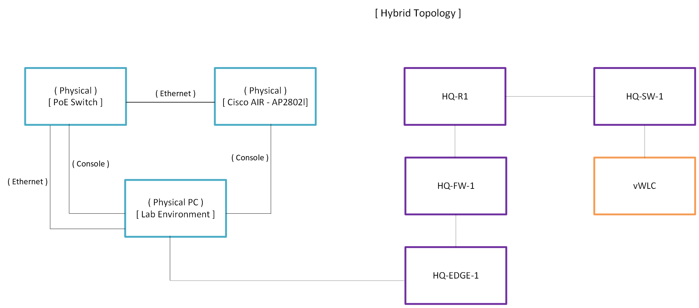
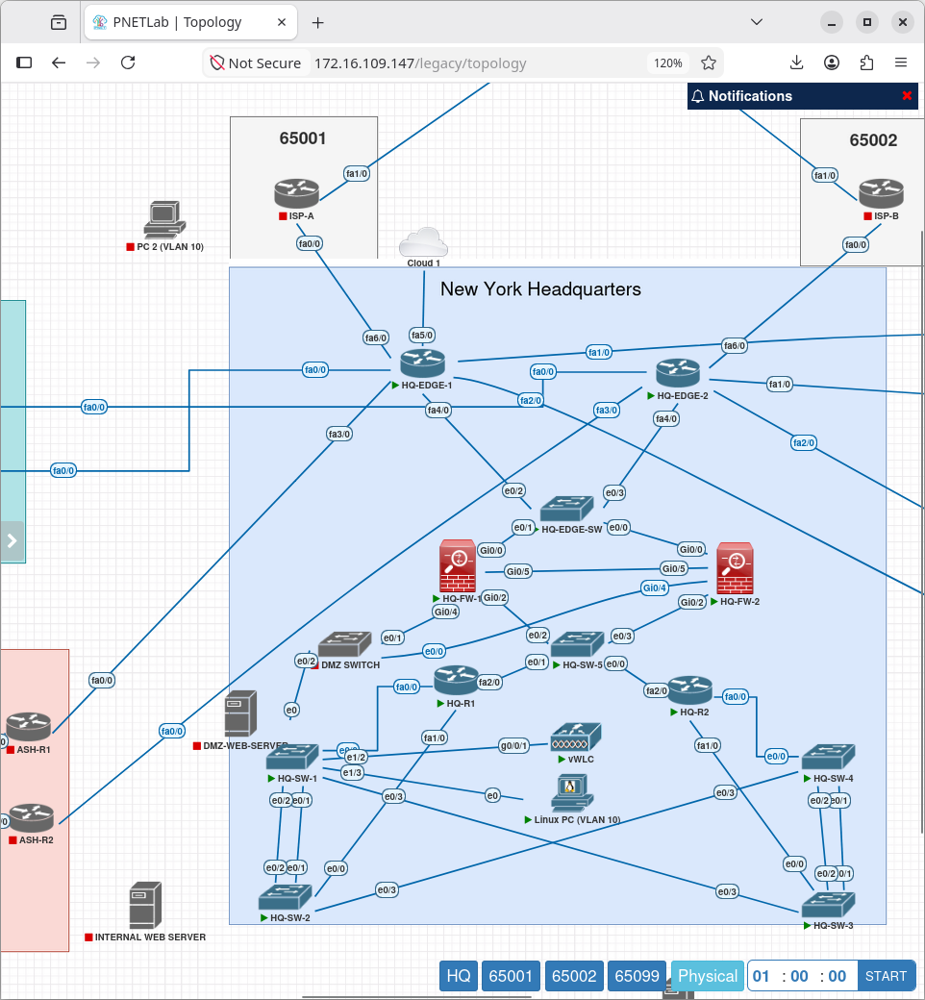
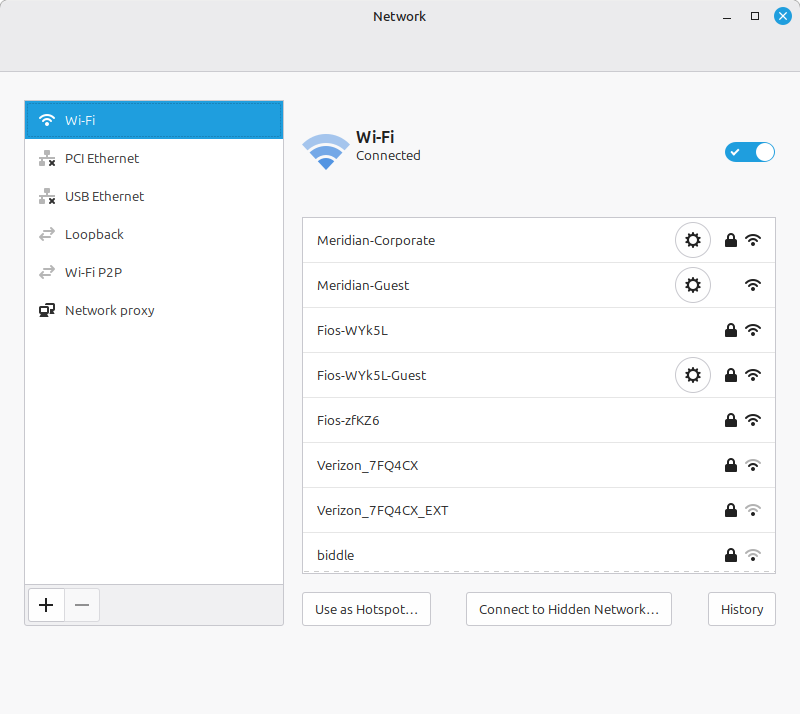
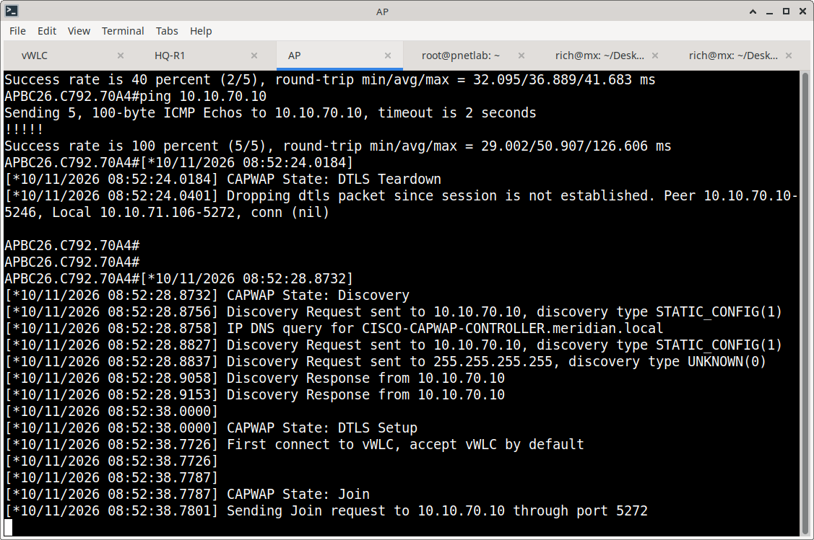
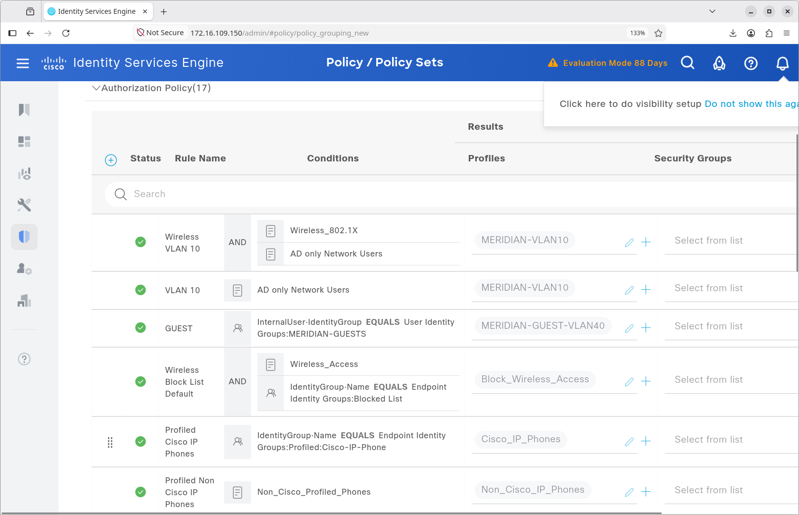
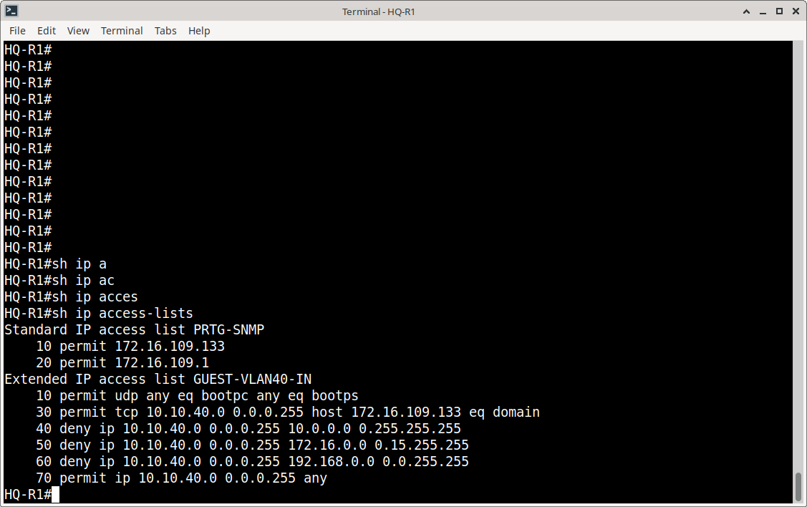
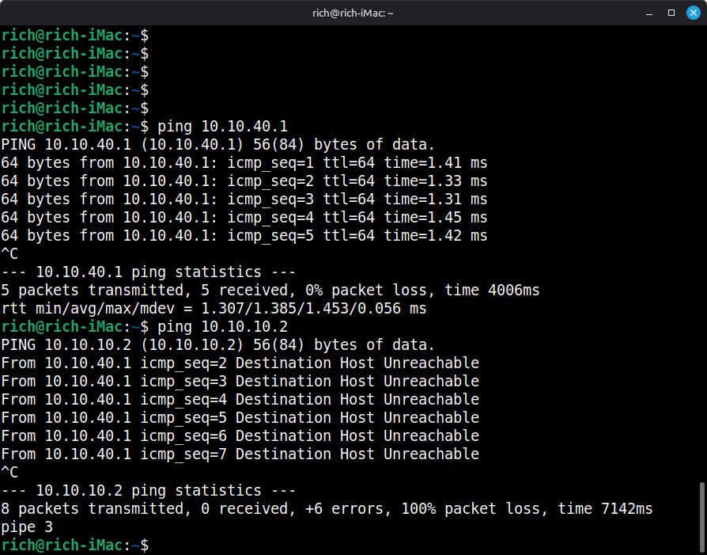

# Cisco Controller-Based Wireless Implementation

## Overview

This project implements a secure, controller-based enterprise wireless network for the Meridian Financial Services environment. The architecture utilizes a Cisco virtual Wireless LAN Controller (vWLC 8.7.102.0), physical Cisco Aironet 2802I access points, and deep integration with Cisco Identity Services Engine (ISE) for identity-driven network access.

The implementation delivers two distinct wireless services: a secure, 802.1X-authenticated corporate network and a segmented, splash-page-enabled guest network.

**Please enlarge for clearer video**

---

## Architecture

### Core Components
| Component | Purpose |
| :--- | :--- |
| **Cisco vWLC 8.7.102.0** | Centralized wireless management, RF control, and policy enforcement. |
| **Cisco Aironet 2802I APs** | Physical Layer 1/2 wireless access and CAPWAP tunneling to the WLC. |
| **Cisco ISE** | Centralized RADIUS authentication (802.1X) and dynamic VLAN authorization. |
| **Meridian Core Switching** | VLAN transport, PoE provisioning, and trunking to APs. |

### Wireless Service Profiles
| WLAN Name | SSID | VLAN | Security & Access Method |
| :--- | :--- | :--- | :--- |
| **Corporate** | `Meridian-Corporate` | 10 | WPA2/AES with 802.1X (RADIUS to ISE) |
| **Guest** | `Meridian-Guest` | 40 | Open/Web Auth with Custom Splash Page & Guest Isolation |

---

## Implementation Highlights

### 1. Controller & AP Provisioning
The vWLC was deployed and configured with management addressing (VLAN 70). Physical Aironet 2802I APs were connected via PoE switches, obtained IP addresses via DHCP, and successfully established CAPWAP tunnels to the vWLC.

### 2. Corporate 802.1X Integration
The `Meridian-Corporate` WLAN was configured to forward 802.1X credentials to Cisco ISE (RADIUS). ISE evaluates the user against Active Directory and returns a dynamic authorization profile (`MERIDIAN-VLAN10`), placing the authenticated client directly into the corporate VLAN.

### 3. Guest Network & Isolation
The `Meridian-Guest` WLAN provides a customized web splash page for onboarding. Crucially, Layer 3 access control lists (ACLs) and ISE policies are enforced to ensure guest traffic (VLAN 40) is strictly isolated from internal Meridian subnets (e.g., VLAN 10).

---

## Validation & Testing

The implementation was rigorously validated through both positive and negative testing, captured via CLI, GUI, and packet analysis:

- ✅ **AP Registration:** Verified CAPWAP join process and radio status.
- ✅ **Corporate Success:** Validated 802.1X authentication success and dynamic VLAN 10 assignment (see video evidence).
- ✅ **Corporate Failure:** Validated that incorrect credentials are rejected by ISE, preventing network access (see video evidence).
- ✅ **Guest Onboarding:** Verified splash page rendering on mobile devices and successful VLAN 40 IP assignment.
- ✅ **Guest Isolation:** Confirmed via ICMP testing and ACL verification that guest clients cannot reach internal corporate resources.

---

## Documentation Structure

| Document | Purpose |
| :--- | :--- |
| `README.md` | Architecture, service profiles, and validation summary. |
| `configuration.md` | Detailed configuration reference, ISE integration, and evidence matrix. |
| `screenshots/` | Curated images of WLC GUI, CLI outputs, and ISE logs. |
| `videos/` | Dynamic proof of 802.1X authentication flows and guest onboarding. |

---
