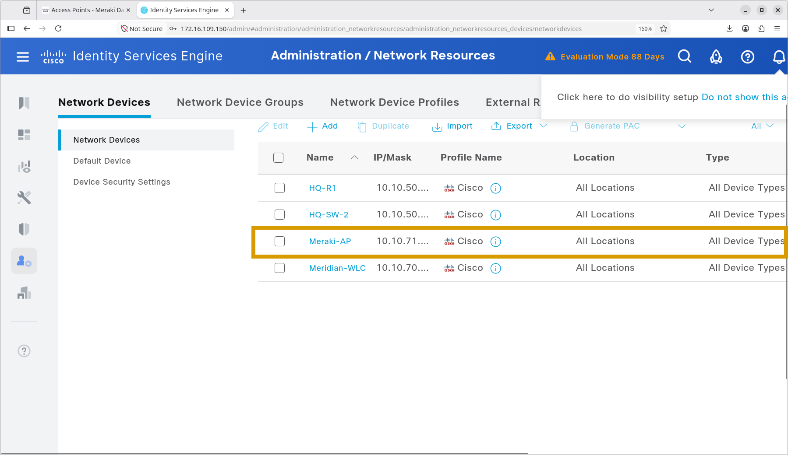
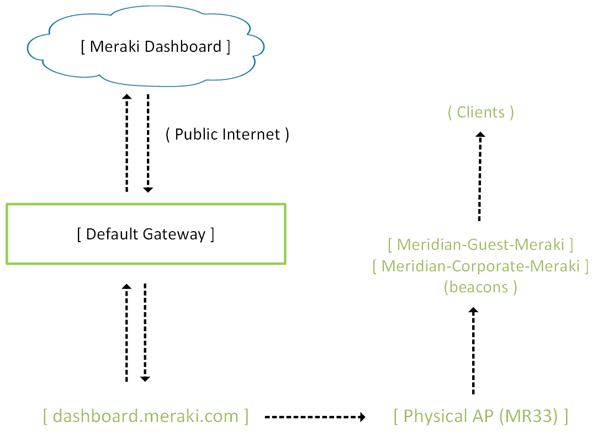
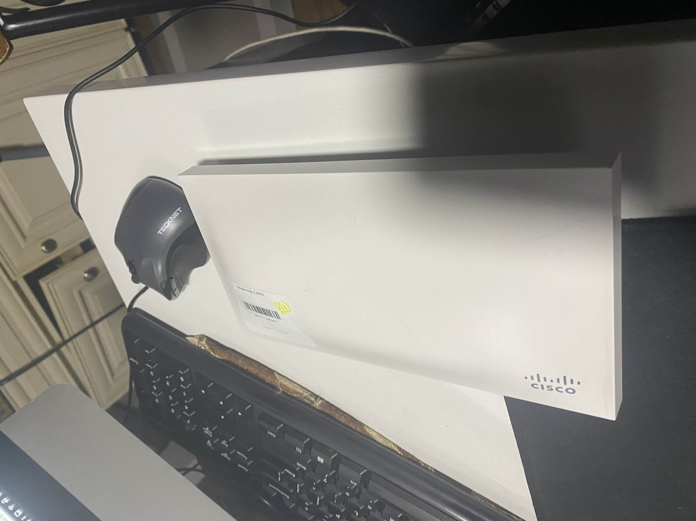
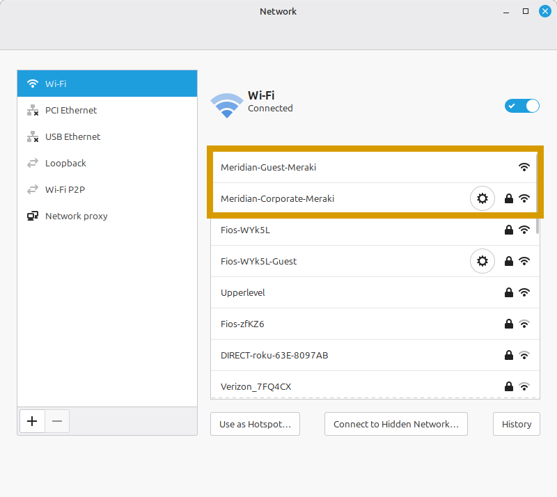
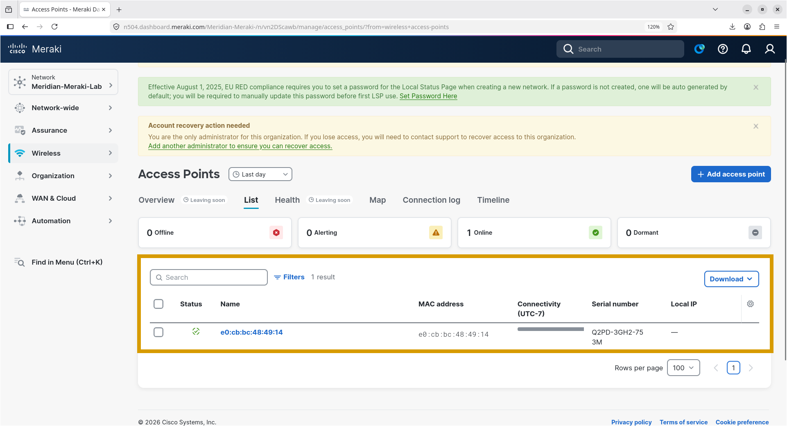

# Meraki Cloud-Managed Wireless Lab

## Overview

This project implements a cloud-managed wireless network for Meridian Financial Services using a Cisco Meraki MR33 access point and the Meraki Dashboard.

The lab demonstrates cloud-based access point management, corporate 802.1X authentication through Cisco Identity Services Engine (ISE), guest wireless onboarding, VLAN assignment, and authentication troubleshooting.

**Environment:** Home lab / portfolio project  
**Platform:** Cisco Meraki Dashboard  
**Access point:** Meraki MR33  
**Dashboard network:** `Meridian-Meraki-Lab`  
**MR33 management IP:** `10.10.71.112`

**Please enlarge for clearer video**

https://github.com/user-attachments/assets/fb88896f-27e0-4841-9747-cd123ecaec80

https://github.com/user-attachments/assets/85b8cb94-f67c-4e26-bf8f-c9c49aff8157

---

## Objectives

- Claim and bring a Meraki MR33 online in the Meraki Dashboard.
- Configure corporate and guest wireless networks.
- Integrate corporate wireless authentication with Cisco ISE using RADIUS and 802.1X.
- Assign corporate clients to VLAN 10 and guest clients to VLAN 40.
- Customize the guest splash page and onboarding experience.
- Validate successful and failed corporate authentication.
- Verify client connectivity and capture IP assignment evidence.
- Document configuration, validation, and outstanding security tests.

---

## Architecture

| Component | Purpose |
| :--- | :--- |
| **Meraki MR33** | Cloud-managed wireless access point |
| **Meraki Dashboard** | Central device and WLAN management |
| **Cisco ISE** | Corporate RADIUS authentication and authorization |
| **Windows Server 2022** | Existing Meridian DHCP/DNS services |
| **HQ-R1** | Meridian router with configured guest-network ACL |

### Wireless Networks

| SSID | Security / Access | VLAN |
| :--- | :--- | :--- |
| `Meridian-Corporate-Meraki` | WPA2-Enterprise / 802.1X | 10 |
| `Meridian-Guest-Meraki` | Guest splash page with click-through onboarding | 40 |

---

## Implementation Highlights

### Cloud-Managed Access Point
The Meraki MR33 was claimed in the Dashboard and brought online.
- **Model:** MR33
- **Cloud ID:** `Q2PD-3GH2-753M`
- **MAC address:** `e0:cb:bc:48:49:14`
- **Management IP:** `10.10.71.112`

### Corporate Wireless (802.1X)
Configured `Meridian-Corporate` to use enterprise authentication through Cisco ISE. The workflow uses RADIUS and 802.1X. Successful authentication permits an authorized corporate client to connect and assigns them to VLAN 10. Rejected credentials provide a negative test case.

### Guest Wireless & Isolation
Configured `Meridian-Guest` with a customized splash page and click-through onboarding. Guest clients are assigned to VLAN 40. 

*Note on Guest Isolation:* The screenshot `vlan-40-sh-acl.png` shows that HQ-R1 contains the extended ACL `GUEST-VLAN40-IN` which denies guest traffic to all RFC1918 private subnets. However, because the MR33 uses a separate network path that does not directly traverse the lab's routing/firewall path, guest isolation across the Meridian internal networks has **not been fully tested** for this specific Meraki implementation.

---

## Evidence Inventory

| File | Purpose |
| :--- | :--- |
| `meraki-ap-added.png` | AP claim/addition evidence |
| `ap-online.png` | Dashboard device status |
| `meridian-ssid-overview.png` | SSID overview |
| `clients-page-meraki.png` | Dashboard client monitoring |
| `iphone-connected-to-corporate-meraki.png` | Corporate client connection |
| `iphone-connected-to-guest-meraki.png` | Guest client connection |
| `meraki-iphone-splash-page.png` | Guest splash-page presentation |
| `splash-page-configuration.png` | Splash-page configuration |
| `vlan-10-ip-iphone.png` | Corporate client address evidence |
| `meraki-vlan-40-ip-iphone.png` | Guest client address evidence |
| `live-logs.png` | Authentication/event log evidence |
| `permit-access-live-logs.png` | Permit/success log evidence |
| `meraki-successful-sign-in-2026-10-12_07.16.38.mp4` |  Video: Successful corporate sign-in |
| `meraki-failed-sign-in-2026-10-12_07.17.40.mp4` | 🎬 Video: Failed corporate sign-in |
| `meraki-guest-successful-2026-10-12_07.48.31.mp4` | 🎬 Video: Guest onboarding |
| `vlan-40-sh-acl.png` | HQ-R1 guest ACL configuration evidence |

---

## Skills Demonstrated

- Meraki Dashboard administration
- Cloud-managed wireless deployment
- Corporate WPA2-Enterprise / 802.1X
- Cisco ISE and RADIUS integration
- Guest splash-page configuration
- VLAN assignment and client addressing

---

### Next Section

Continue to the detailed configuration reference, ISE integration, and evidence matrix for the Meraki wireless implementation:
- **[Configuration Details](configuration.md)** – Detailed Dashboard configuration, CAPWAP/Cloud setup, ISE RADIUS integration, and validation evidence.
