# Meraki Wireless Lab — Configuration 

## 1. Scope

This document records the Meraki MR33 configuration for the Meridian Financial Services wireless lab. Corporate wireless authentication uses Cisco ISE, while the guest WLAN provides a customized click-through splash page.

This is a configuration reference, not a full Dashboard configuration export. Unknown or unverified values are intentionally not invented.

---

## 2. Device and Dashboard

| Setting | Value |
| :--- | :--- |
| **Vendor** | Cisco Meraki |
| **Model** | MR33 |
| **Dashboard network** | `Meridian-Meraki-Lab` |
| **Cloud ID** | `Q2PD-3GH2-753M` |
| **MAC address** | `e0:cb:bc:48:49:14` |
| **Management IP** | `10.10.71.112` |
| **Dashboard status** | Online, as reported during implementation |


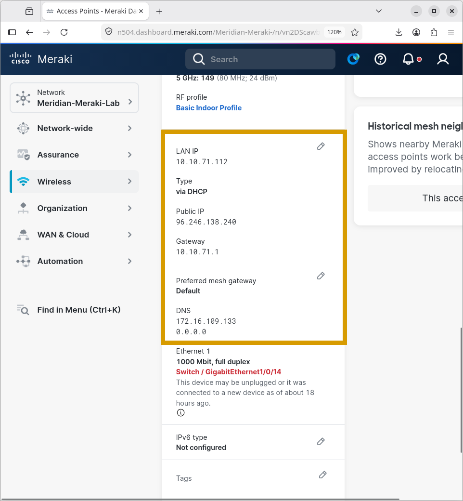

---

## 3. Corporate WLAN

| Setting | Value |
| :--- | :--- |
| **SSID** | `Meridian-Corporate-Meraki` |
| **Security** | WPA2-Enterprise / 802.1X |
| **Authentication** | External RADIUS |
| **RADIUS server** | `172.16.109.150` |
| **Authentication port** | UDP 1812 |
| **Accounting port** | UDP 1813 |
| **VLAN tagging** | Enabled |
| **VLAN ID** | 10 |

### Authentication Workflow
1. A corporate wireless client attempts to connect to `Meridian-Corporate`.
2. The client authenticates using 802.1X.
3. Meraki forwards authentication requests to Cisco ISE using RADIUS.
4. ISE evaluates the configured authentication and authorization policies.
5. An authorized client is permitted to connect and receives the corporate network assignment (VLAN 10).

The lab includes a successful corporate sign-in recording and a failed sign-in recording. RADIUS shared secrets are deliberately excluded.

**Please enlarge for clearer video**

https://github.com/user-attachments/assets/46924ebf-e3ba-4a8e-abd3-4ff0f9657b83

https://github.com/user-attachments/assets/03e36f05-ce47-4136-941c-e6338bec11ff

**ISE: Adding Meraki to network devices**


**ISE Policy**

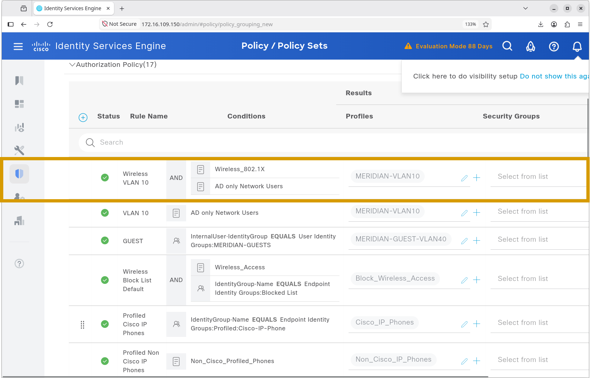

**Configuring RADIUS via ISE IP**

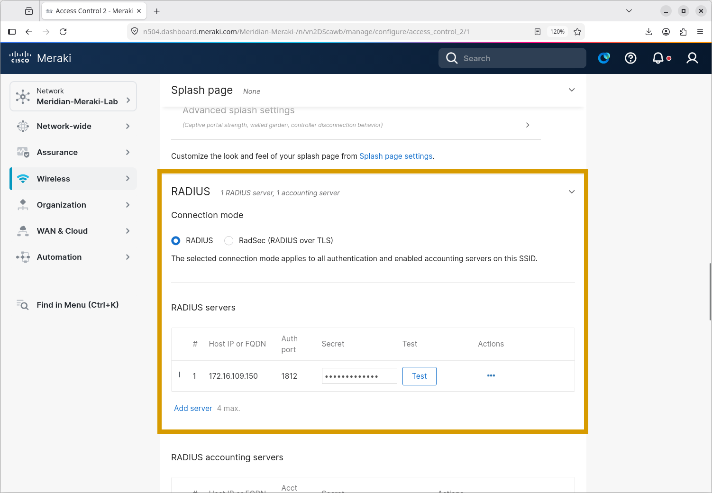

**Assigning VLAN 10 to Meridian-Corporate-Meraki**

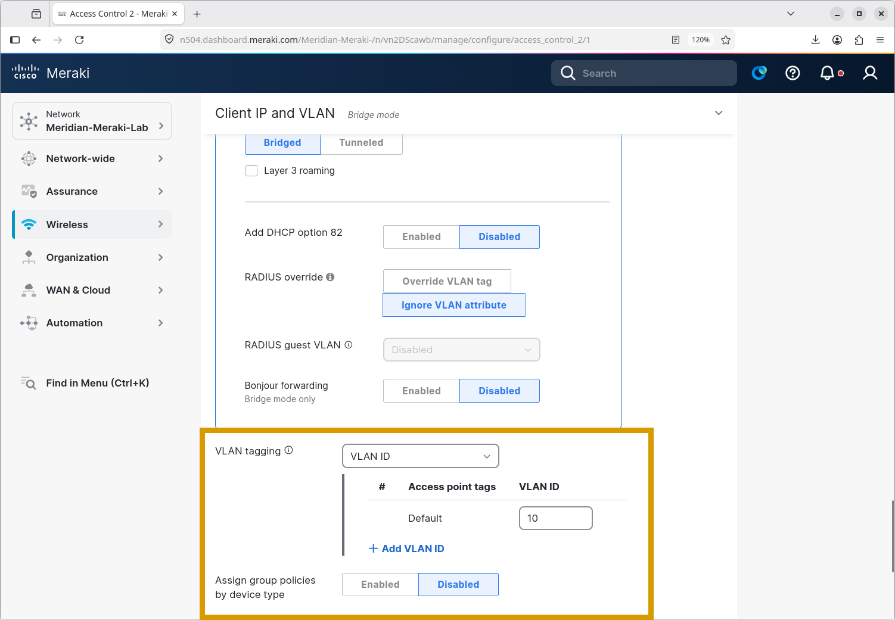

**SSID Overview**

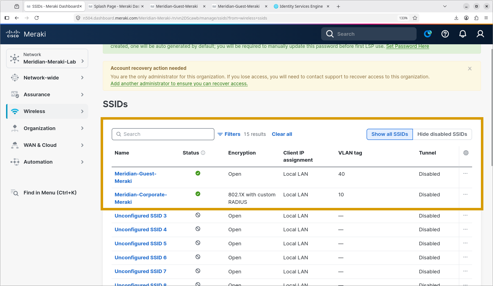

**VLAN 10 IP address successfully associated**

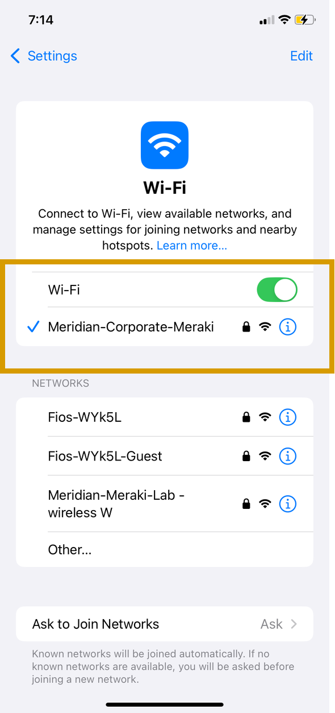

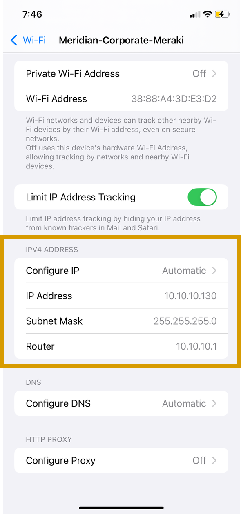

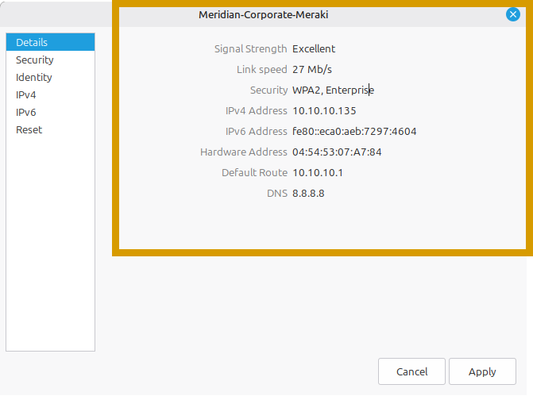

---

## 4. Guest WLAN

| Setting | Value |
| :--- | :--- |
| **SSID** | `Meridian-Guest` |
| **Security** | Open guest WLAN |
| **Splash page** | Click-through |
| **VLAN tagging** | Enabled |
| **VLAN ID** | 40 |
| **Guest portal** | Customized Meridian welcome/consent page |

The guest workflow presents the customized splash page to the connecting client. The splash-page screenshot, guest client screenshots, and guest connection recording document the onboarding experience. A working splash page does not independently prove network-layer isolation.

**Pleas enlarge for clearer video**

https://github.com/user-attachments/assets/dbd81db5-aa3e-489a-8814-2c49e5d13373

**Configuring click-through for Meridian-Guest-Meraki**

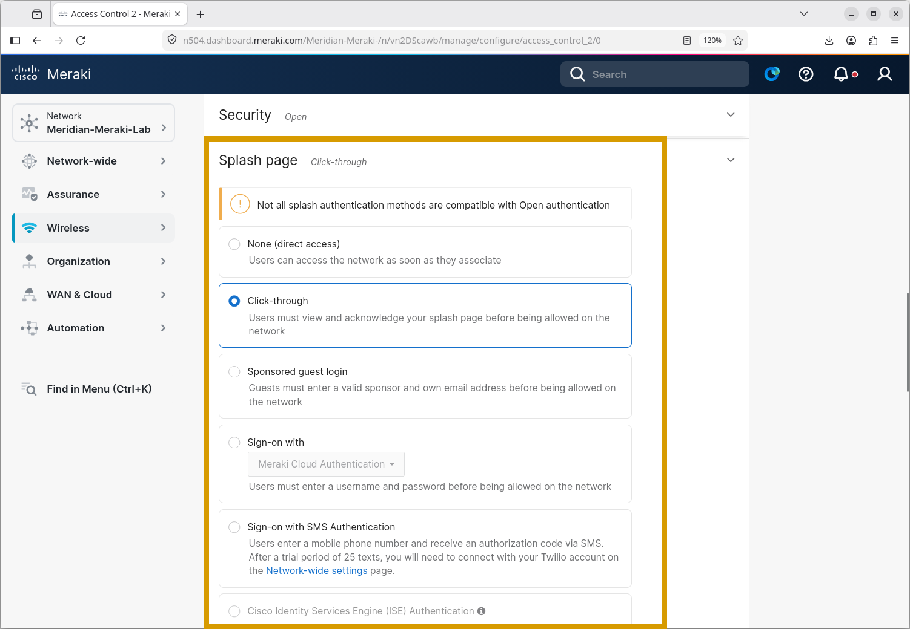

**Mapping VLAN 40 to Meridian-Guest-Meraki**

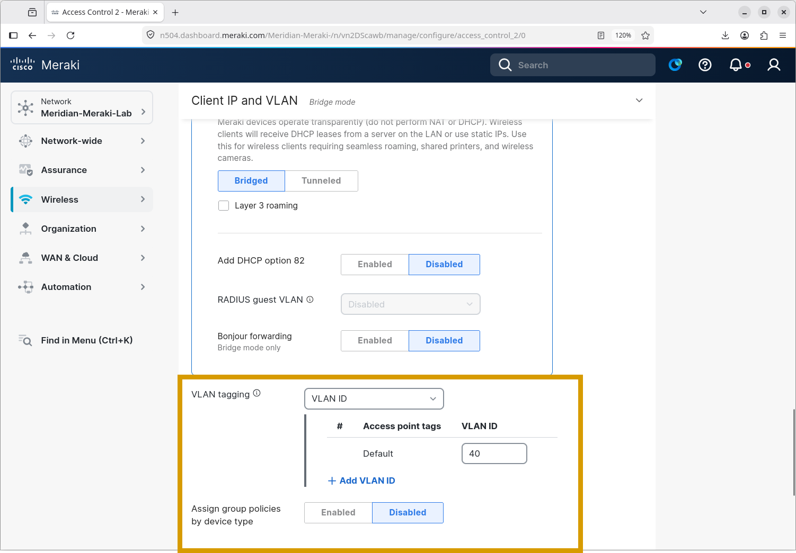

**Configuring splash page**

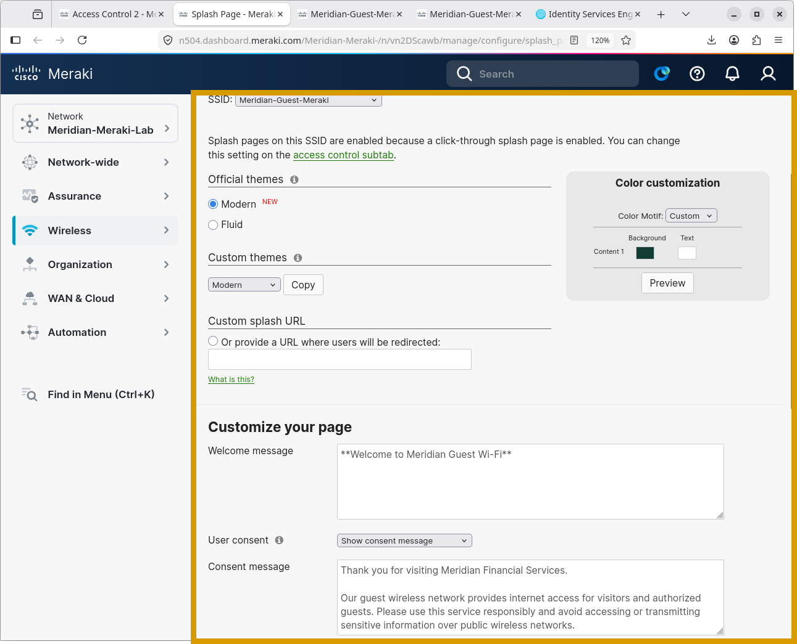

**Guest beacons**


**Meridian-Guest-Meraki VLAN 40 IP address assigned**

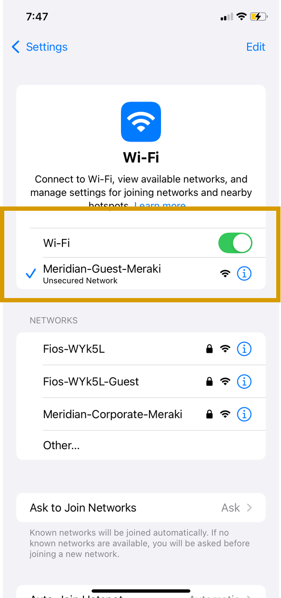

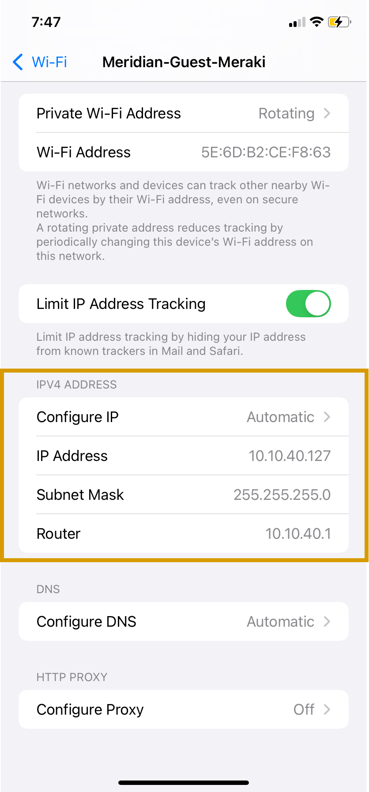

**Captive Portal**

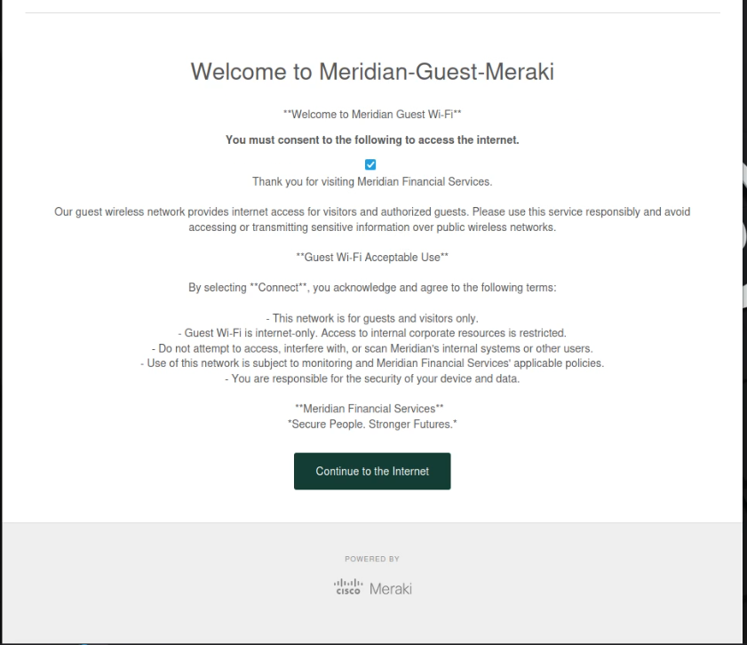

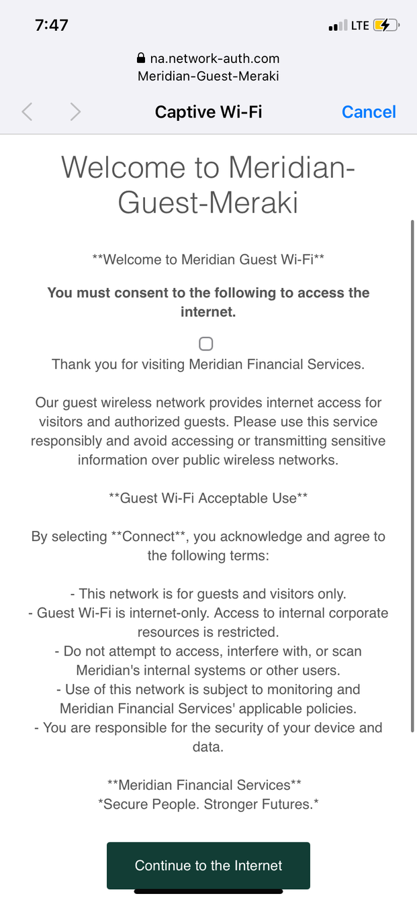

**Clients**

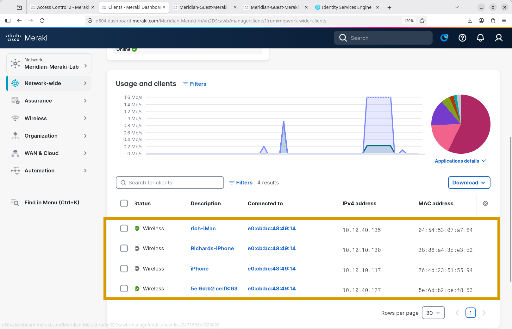

**ISE Live Logs**

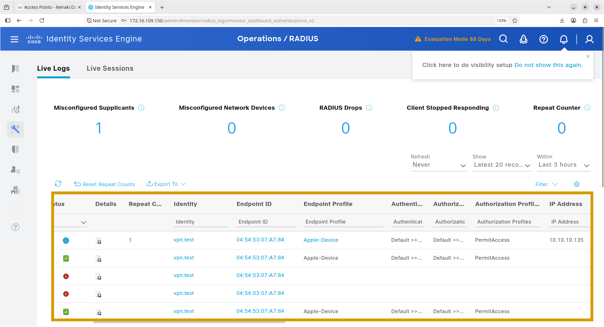

---

## 5. HQ-R1 Guest ACL

The screenshot `vlan-40-sh-acl.png` shows the following extended ACL on HQ-R1:

```cisco
Extended IP access list GUEST-VLAN40-IN
 10 permit udp any eq bootpc any eq bootps
 20 permit udp 10.10.40.0 0.0.0.255 host 172.16.109.133 eq domain
 40 deny ip 10.10.40.0 0.0.0.255 10.0.0.0 0.255.255.255
 50 deny ip 10.10.40.0 0.0.0.255 172.16.0.0 0.15.255.255
 60 deny ip 10.10.40.0 0.0.0.255 192.168.0.0 0.0.255.255
 70 permit ip 10.10.40.0 0.0.0.255 any
```

---

### What's Next?

With the cloud-managed Meraki wireless network configured and validated, the next step is to explore centralized observability and monitoring for the entire infrastructure.

Continue to the next major module to explore the Grafana implementation:
- **[Grafana Observability](../Grafana/)** – Dashboard configuration, data sources, metrics visualization, and infrastructure monitoring.
