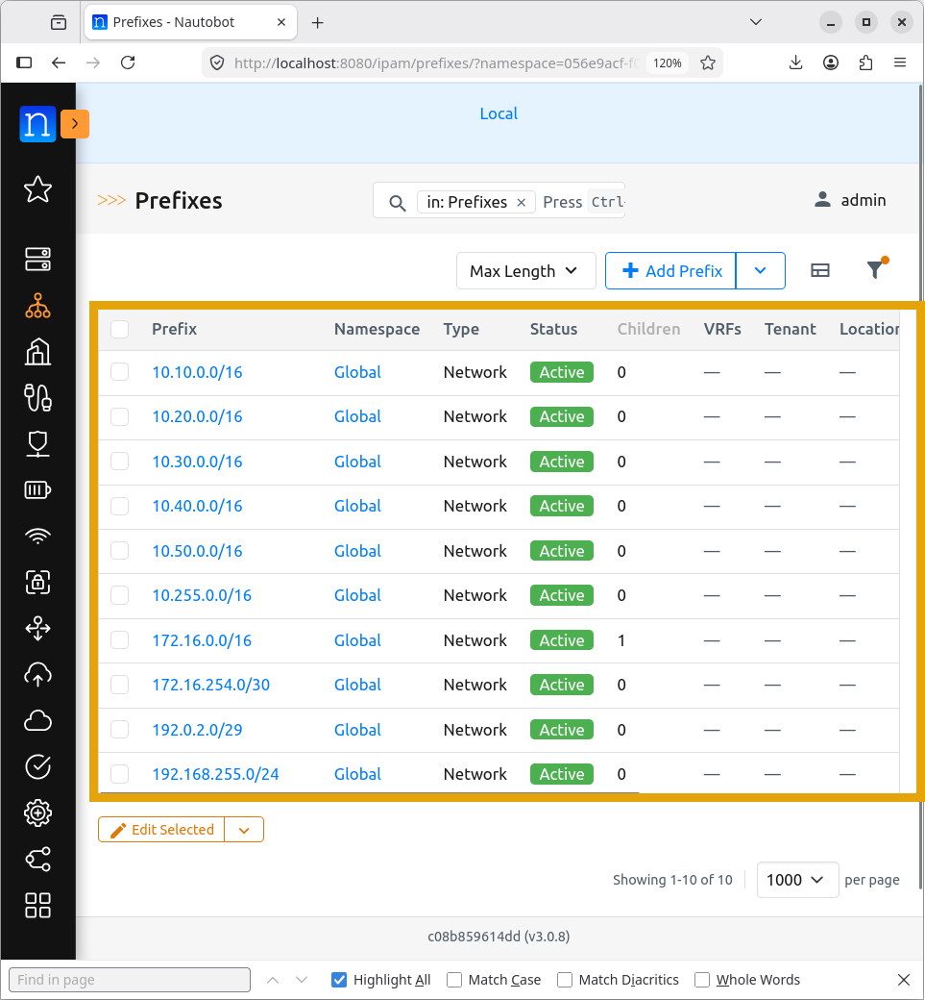
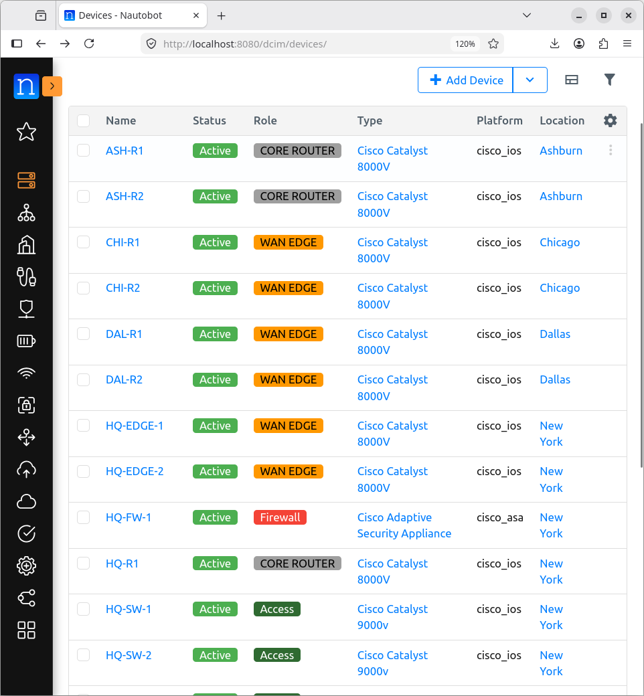
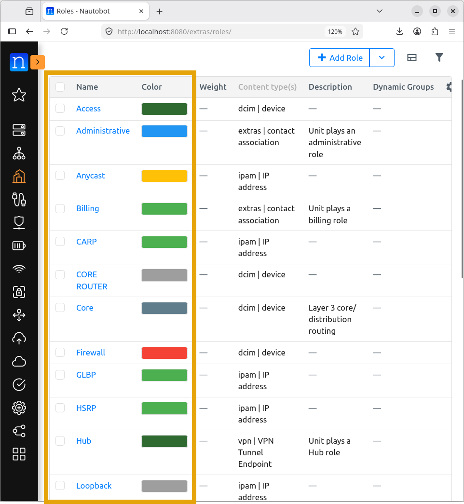
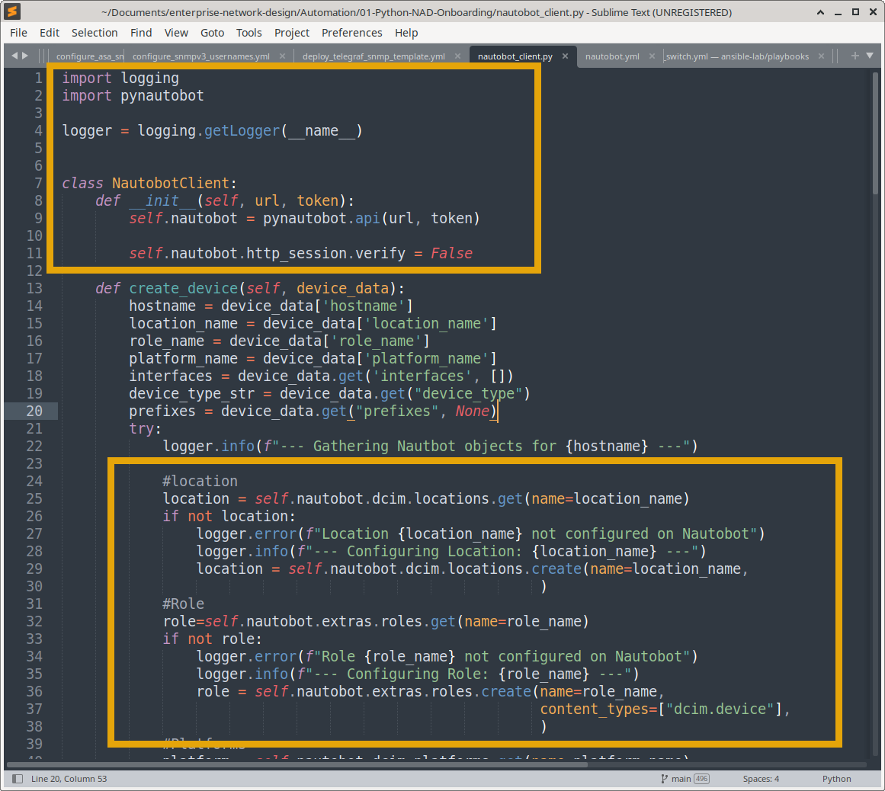
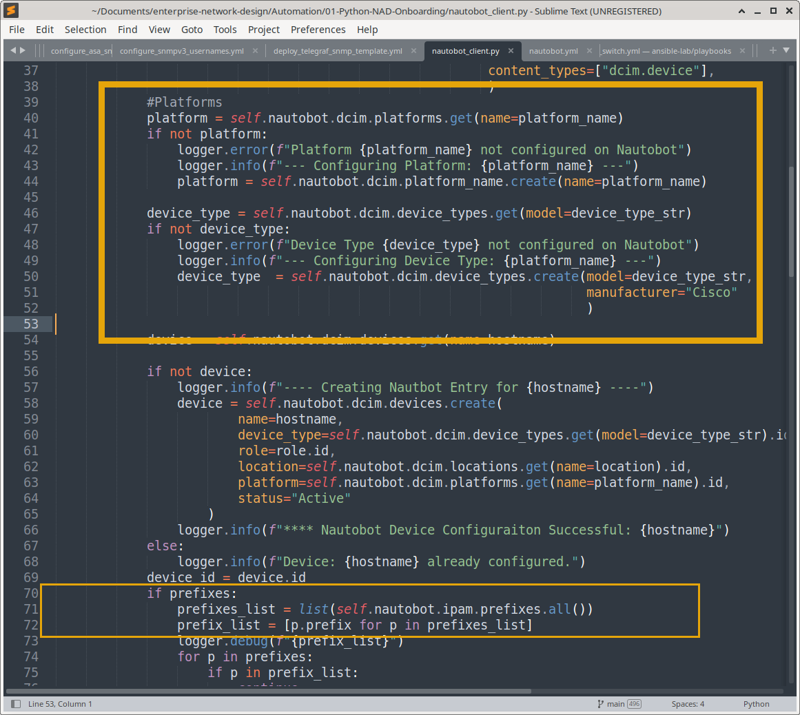

# Nautobot — Network Source of Truth (SOT)

## Overview

Nautobot serves as the centralized, single source of truth (SOT) for the Meridian Financial Services enterprise network. It transitions network documentation from static spreadsheets to a structured, API-driven database that actively powers network automation, configuration generation, and operational tooling.

## Objectives

- **Centralized Inventory:** Maintain a definitive record of all network devices, sites, platforms, and roles.
- **IP Address Management (IPAM):** Track subnet allocations, VLAN assignments, and individual interface IP addresses.
- **Automation Enabler:** Provide structured, machine-readable data via REST API to drive Ansible playbooks and Python (`pynautobot`) scripts.
- **Configuration Validation:** Serve as the baseline for automated configuration compliance and drift detection.

## Enterprise Sites & Topology

The Meridian network is logically segmented into five primary locations, each with dedicated IP addressing blocks:

| Site | Role | IPv4 Allocation | Loopback Range |
| :--- | :--- | :--- | :--- |
| **New York** | Headquarters (HQ) | `10.10.0.0/16` | `10.255.10.0/24` |
| **Chicago** | Branch Office | `10.20.0.0/16` | `10.255.20.0/24` |
| **Dallas** | Branch Office | `10.30.0.0/16` | `10.255.30.0/24` |
| **Miami** | Branch Office | `10.40.0.0/16` | `10.255.40.0/24` |
| **Ashburn** | Disaster Recovery (DR) | `10.50.0.0/16` | `10.255.50.0/24` |
| **WAN Links** | Point-to-Point | `172.16.0.0/16` | N/A |

## Device Inventory & Platform Definitions

Devices are categorized by site and functional role (e.g., `wan-edge`, `core-router`, `access-switch`, `firewall`). The inventory explicitly tracks hardware platforms to ensure automation scripts apply the correct templates:

- **Cisco IOS / IOS-XE:** Routers and Layer 3 switches.
- **Cisco ASA:** Stateful firewalls and security appliances.

*Note: Interface names, management IPs, and platform versions in Nautobot are strictly validated against the live running configurations before being used as automation inputs.*

## Automation & Tooling Integration

Nautobot is not just a documentation tool; it is the engine for the project's Infrastructure as Code (IaC) workflows:

1. **Python API Clients:** Custom Python scripts utilizing the `pynautobot` library query the SOT to dynamically generate device-specific variables.
2. **Jinja2 Templating:** Data pulled from Nautobot is passed into Jinja2 templates to render standardized, error-free device configurations (e.g., SNMPv3 users, interface descriptions).
3. **Ansible Dynamic Inventory:** (Optional/Planned) Utilizing Nautobot as an Ansible dynamic inventory source to ensure playbooks only target devices marked with an `automation_ready: true` status.
4. **Monitoring Generation:** Scripts query Nautobot to automatically generate PRTG/Grafana device discovery lists, ensuring no device is left unmonitored.

**Pulling Location and Device Role in Script**

**Pulling Platform, Device Type, and Prefix in Script**

## Validation & Compliance Workflow

To maintain SOT integrity, a strict validation workflow is enforced before any data is used for operational changes:

1. **Discovery:** Query Nautobot API for target device details.
2. **Verification:** Cross-reference Nautobot management IPs and interface names with live `show run` or `show ip interface brief` output.
3. **Execution:** Proceed with Ansible/Python automation only if the SOT data matches the live state.
4. **Reconciliation:** Update Nautobot if legitimate, undocumented changes are discovered on the network.

## Documentation Structure & Evidence

This directory contains the proof of concept and operational validation of the Nautobot SOT:

| Document | Purpose |
| :--- | :--- |
| `README.md` | High-level architecture, objectives, and automation workflows. |
| `configuration.md` | Data model setup, custom fields, and IPAM structure. |
| `automation-examples/` | Python (`pynautobot`) scripts and Jinja2 templates demonstrating SOT-driven config generation. |
| `screenshots/` | Visual evidence of the Nautobot UI, API queries, and successful automation runs. |

---

### Next Section

Continue to the detailed configuration, API integration, and automation workflows:
- **[Configuration & Automation](configuration.md)** – Data model setup, pynautobot integration, IPAM structure, and SOT-driven automation examples.
