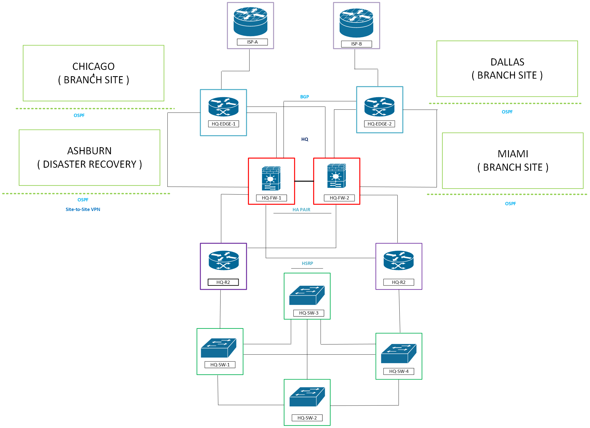

#  Meridian Financial Services — Enterprise Network Design & Implementation

## Summary
This repository represents a comprehensive, production-grade enterprise network design and implementation for "Meridian Financial Services," a fictional 500–2,000 user multi-site organization. 

This portfolio documents the end-to-end design, implementation, and operation of a resilient, multi-site enterprise network. It seamlessly bridges traditional core infrastructure (routing, switching, firewalls) with modern hybrid cloud architectures (Azure), centralized identity management, and comprehensive observability. Rather than a collection of isolated configurations, this project demonstrates a cohesive, production-ready environment where every component is validated through rigorous testing, documented with architectural diagrams, and ultimately orchestrated by a modern, end-to-end NetDevOps ecosystem.

---

## High-Level Architecture
The network is designed around a hierarchical model featuring a New York Headquarters, regional branches (Chicago, Dallas, Miami), and a Disaster Recovery site (Ashburn). The infrastructure is fully integrated with Microsoft Azure for hybrid cloud workloads and centralized identity management.

*   **On-Premises Core:** Cisco Catalyst Switches, ISR/ASR Routers, ASA Firewalls (HA), and Cisco ISE.
*   **Hybrid Cloud:** Azure VNet, Site-to-Site IPsec VPN, NAT Gateway, and Azure Monitor.
*   **Enterprise Services:** Windows Server (AD, DNS, DHCP, GPO), Microsoft 365, and centralized SIEM/Monitoring.

---

##  Repository Modules

This repository is organized into functional domains. Click on any folder to view its dedicated documentation, architecture diagrams, and execution evidence.

### Network Infrastructure & Routing
*   **[Routing](./Routing/)** — Multi-area OSPF, eBGP WAN redundancy (Local Preference/AS-Path), and HSRP gateway redundancy. Includes full configuration backups for all 5 sites and rigorous failover testing.
*   **[Switching](./Switching/)** — Enterprise LAN design including VLAN segmentation, 802.1Q Trunking, STP/RPVST+, LACP EtherChannels, Port Security, and BPDU Guard.
*   **[IPv6 (Dual-Stack)](./IPv6%20(Dual-Stack)/)** — Full dual-stack migration featuring OSPFv3, SLAAC, Stateful/Stateless DHCPv6, BGP IPv6 Address Families, and Layer 3 Rogue RA mitigation.

### Security, Identity & Access
*   **[Cisco-ASA-Firewall](./Cisco-ASA-Firewall/)** — Stateful firewall design with DMZ, NAT/PAT, High Availability (Active/Standby), and strict inter-zone security policies.
*   **[Cisco-ISE](./Cisco-ISE/)** — Centralized Network Access Control (NAC). Includes Active Directory integration, 802.1X, TACACS+ for device administration, Guest Access, and MAC Authentication Bypass (MAB) profiling for IoT/Voice.
*   **[Site-to-site-VPN](./Site-to-site-VPN/)** — Branch-to-HQ IPsec connectivity using IKEv2, ESP encryption, and interesting traffic ACLs.
*   **[Remote-Access-VPN](./Remote-Access-VPN/)** — AnyConnect remote access integrated with Active Directory, certificate-based authentication, and split-tunneling policies.

### Cloud & Hybrid Infrastructure
*   **[Azure](./Azure/)** — 9-module hybrid cloud implementation. Covers VNet/Subnet design, Site-to-Site BGP VPN, NAT Gateway egress, NSGs, Azure Defender, BGP routing, monitoring, and geo-redundant backups.
*   **[Windows](./Windows/)** — Enterprise Windows Server infrastructure including DHCP/DNS integration, Group Policy Objects (GPO), secure File Shares, NTP synchronization, and Microsoft 365/Entra ID integration.

###  Wireless & Branch Access
*   **[Cisco-WLC](./Cisco-WLC/)** — Centralized wireless controller design with Corporate (802.1X) and Guest (Captive Portal) SSIDs, integrated with ISE.
*   **[Meraki](./Meraki/)** — Cloud-managed branch wireless deployment featuring dashboard configuration, VLAN mapping, and ISE RADIUS integration.

### Observability & Monitoring
*   **[PRTG-Monitoring](./PRTG-Monitoring/)** — SNMPv3 network monitoring with custom alerting thresholds, email notifications, and automated ticket generation.
*   **[Splunk](./Splunk/)** — Centralized SIEM ingesting syslogs from routers, firewalls, and ISE to create Network Operations and Security dashboards.
*   **[Grafana](./Grafana/)** — Advanced time-series monitoring using Telegraf and SNMP, featuring automated Ansible deployment of monitoring agents.

### Automation & DevOps
*   **[Automation](./Automation/)** — Python and Ansible automation pipelines. Includes ITSM-driven Jira provisioning, physical OS upgraders, GitHub Actions CI/CD pipelines, and Batfish pre-deployment mathematical modeling.

### Operations & Documentation
*   **[Documentation (Run Books & Diagrams)](./Documentation%20(Run%20Books%20&%20Diagrams)/)** — Standardized Change Requests (CR) and Run Books (RB) for enterprise operational procedures (e.g., OS Upgrades, SNMPv3 migration, 802.1X deployment).

---

## ️ Core Competencies Demonstrated

| Domain | Technologies & Protocols |
| :--- | :--- |
| **Routing & Switching** | OSPFv2/v3, BGP, HSRP, STP, LACP, VLANs, VTP, IPv4/IPv6 Dual-Stack |
| **Security & Identity** | Cisco ASA, ISE, 802.1X, TACACS+, RADIUS, MAB, IPsec, IKEv2, AnyConnect |
| **Cloud & Virtualization** | Microsoft Azure, VNet, NSG, NAT Gateway, VMware, Windows Server, AD CS |
| **Automation & CI/CD** | Python, Ansible, Jinja2, Netmiko, Batfish, GitHub Actions, Git |
| **Observability** | Splunk (SIEM), PRTG, Grafana, Telegraf, SNMPv3, Wireshark, Syslog |

---

## How to Navigate This Portfolio

1. **For Hiring Managers:** Start with the **[Automation](./Automation/)** and **[Azure](./Azure/)** folders to see modern NetDevOps and Cloud skills, then review **[Cisco-ISE](./Cisco-ISE/)** for security depth.
2. **For Technical Interviewers:** Dive into **[Routing](./Routing/)** and **[Switching](./Switching/)** for protocol-level depth, or review the **[Documentation](./Documentation%20(Run%20Books%20&%20Diagrams)/)** folder to see operational maturity.
3. **Evidence:** Every module contains a `screenshots/` and/or `videos/` directory proving real-world execution, failover testing, and packet-level analysis.
---

## Connect & Portfolio

Explore more of my technical writing, live portfolio, and specialized troubleshooting labs:

*   **🌐 Personal Portfolio:** [richardpateau.github.io](https://richardpateau.github.io/)
*   **📝 Technical Blog:** [Networking Notebook](https://networkingnotebook.com)
*   **🚨 Incident Response Lab:** [Network Incident Response Lab Repository](https://github.com/richardpateau/network-incident-response-lab)

---

*Designed and implemented by Richard Pateau. All configurations, diagrams, and documentation represent a comprehensive, production-grade enterprise network engineering portfolio.*
