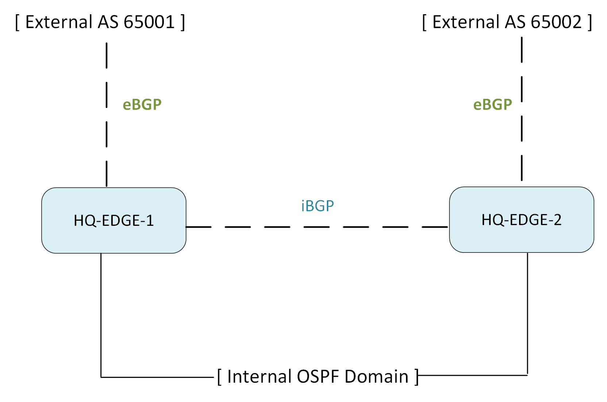
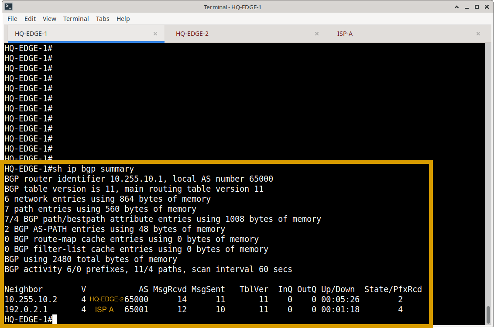
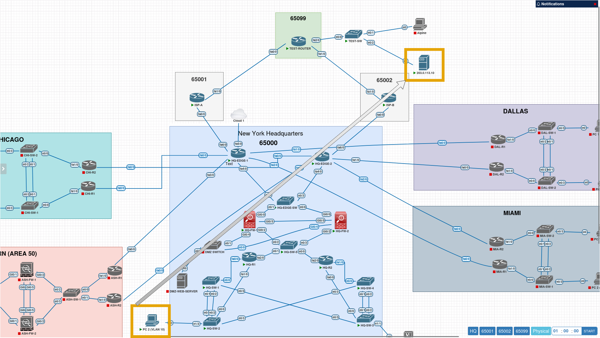
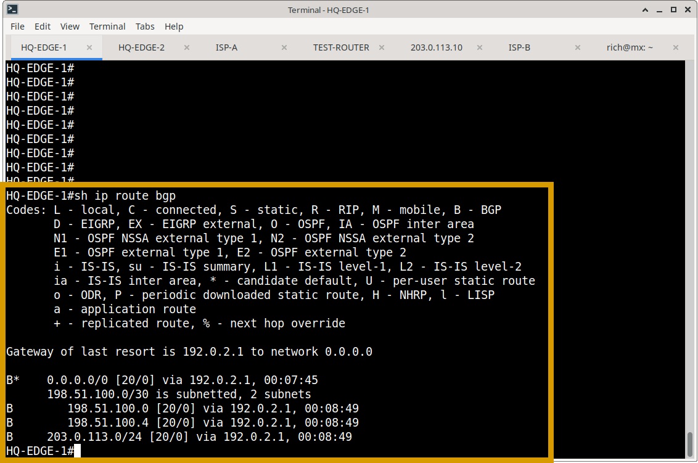
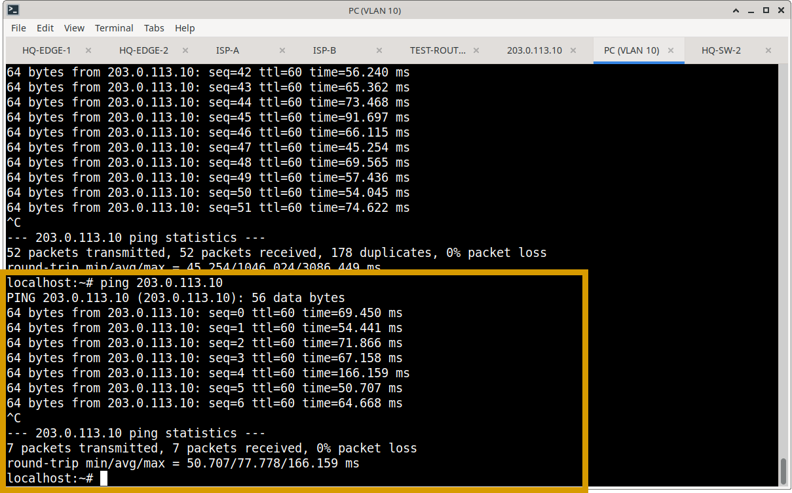
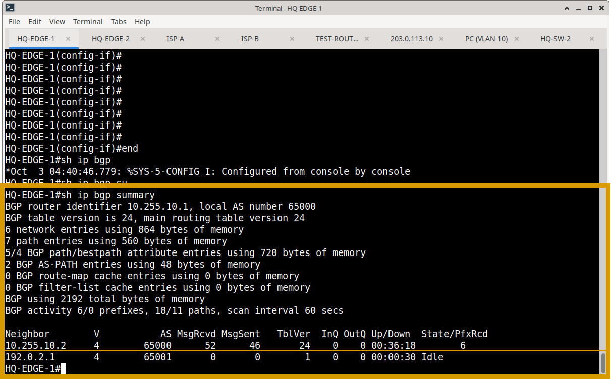
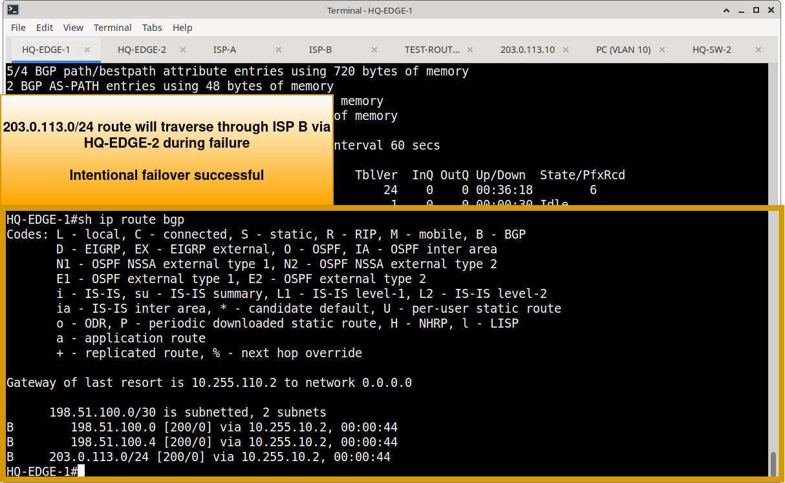
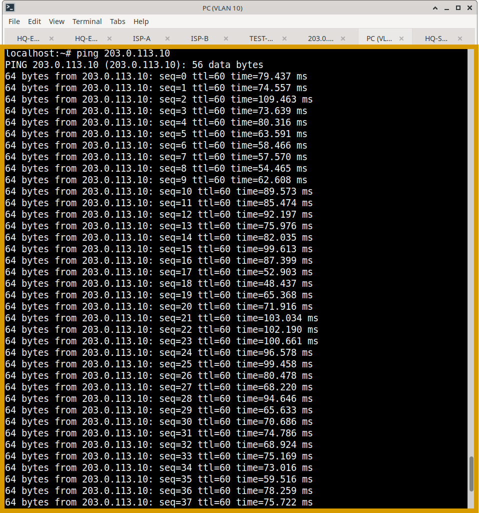

# Border Gateway Protocol (BGP) Architecture

## Overview

Meridian Financial Services utilizes Border Gateway Protocol (BGP) as the Exterior Gateway Protocol (EGP) at the network edge. BGP is strictly separated from the internal OSPF routing domain, providing a scalable, policy-driven control plane for external ISP peering and hybrid-cloud connectivity.

**Core Routing Philosophy:**
- **OSPF (IGP):** Manages internal, site-to-site enterprise routing and rapid convergence.
- **BGP (EGP):** Manages external routing, ISP multi-homing, and hybrid/cloud path selection.

---

## Autonomous System (AS) Design

Meridian operates within a dedicated private Autonomous System, establishing distinct external and internal BGP relationships at the HQ edge.

| Entity | Role | AS Number | Router ID | Peering Method |
| :--- | :--- | :---: | :--- | :--- |
| **Meridian HQ** | Internal Edge | **65000** | `10.255.10.1` / `10.255.10.2` | iBGP (Loopback) |
| **ISP-A** | Primary ISP | **65001** | `192.255.10.5` | eBGP (Point-to-Point) |
| **ISP-B** | Secondary ISP | **65002** | `192.255.10.6` | eBGP (Point-to-Point) |




### HQ Edge iBGP Topology
HQ-EDGE-1 and HQ-EDGE-2 establish a resilient iBGP adjacency using their dedicated loopback interfaces (`10.255.10.1` and `10.255.10.2`). This ensures the BGP control plane remains stable even if a single physical transit link experiences a failure, relying on the underlying OSPF domain to route the loopback traffic.

---

## Protocol Boundaries: BGP vs. OSPF

Maintaining a strict boundary between the IGP and EGP is critical for enterprise network stability and scalability.

| Feature | OSPF (Interior Gateway Protocol) | BGP (Exterior Gateway Protocol) |
| :--- | :--- | :--- |
| **Primary Scope** | Internal enterprise routing (Areas 0, 20, 30, 40, 50). | External routing, ISP multi-homing, and hybrid cloud. |
| **Metric / Path Selection** | Cost (based on interface bandwidth). | Complex attributes (LOCAL_PREF, AS_PATH, MED, Weight). |
| **Convergence Speed** | Fast (sub-second to seconds). | Deliberate (designed for stability over rapid convergence). |
| **Routing Policy** | Limited (basic summarization/filtering at ABRs). | Extensive (prefix-lists, route-maps, AS-path filtering). |

---

## Hybrid Cloud Integration (Azure)

Meridian’s hybrid architecture extends the on-premises network to Microsoft Azure. BGP serves as the dynamic routing control plane for this connectivity (e.g., Azure VPN Gateway or ExpressRoute), allowing seamless, dynamic exchange of routes between the on-premises AS 65000 and the Azure virtual network infrastructure. 

*(Note: Detailed Azure BGP peering configurations and topology are documented within the `Azure/` directory).*

---

## Routing Policy & High Availability

### Routing Policy Controls
BGP is deployed with intentional route-policy controls to govern traffic flow:
- **Inbound Filtering:** Prefix-lists and route-maps are used to accept only expected, legitimate routes from external peers, protecting the Meridian routing table from spoofing or accidental leaks.
- **Outbound Advertisement:** Strict controls dictate which internal Meridian subnets are advertised to external peers.
- **Path Manipulation:** Techniques such as `LOCAL_PREF` or `AS_PATH` prepending are available to influence inbound/outbound traffic engineering across the dual ISP links.

### High Availability
The HQ edge is designed for maximum resilience:
1. **Physical Redundancy:** Diverse uplinks to separate ISPs.
2. **Control Plane Redundancy:** iBGP full-mesh between HQ-EDGE-1 and HQ-EDGE-2.
3. **Data Plane Redundancy:** Underlying OSPF provides alternate paths to the edge routers if a direct link fails.

## Configuration Model

The following represents the standard BGP configuration model applied to the HQ edge routers. 

### HQ-EDGE-1 (Representative Configuration)
```cisco
router bgp 65000
 bgp router-id 10.255.10.1
 bgp log-neighbor-changes
 !
 ! iBGP Peering
 ! Uses loopback interfaces for stability
 neighbor 10.255.10.2 remote-as 65000
 neighbor 10.255.10.2 update-source Loopback0
 neighbor 10.255.10.2 description iBGP_PEER_HQ_EDGE_2
 !
 ! eBGP Peering (External ISP Connectivity)
 neighbor 203.0.113.1 remote-as 65001
 neighbor 203.0.113.1 description eBGP_PEER_ISP_A
 !
 ! Policy to prefer ISP-A
 route-map ISP-A-IN permit 10
 	set local-preference 200
 !
 !  Routing Policy & Security 
 neighbor 203.0.113.1 route-map ISP-A-IN in
 !
 ! network commands
  network 10.10.10.0 mask 255.255.255.0
  network 10.10.20.0 mask 255.255.255.0
  network 10.10.30.0 mask 255.255.255.0
  network 10.10.40.0 mask 255.255.255.0
  network 10.10.50.0 mask 255.255.255.0
  network 10.10.60.0 mask 255.255.255.0
  network 10.10.70.0 mask 255.255.255.0
  network 10.255.110.1 mask 255.255.255.240
  network 192.0.2.0 mask 255.255.255.252
  ```

### Key Configuration Directives
* **`update-source Loopback0`**: Ensures the iBGP session remains stable even if a physical transit interface fails, provided OSPF maintains reachability to the loopback.
* **`route-map ISP-A-IN in`**: Enforces a strict inbound filtering policy. Only explicitly permitted prefixes from the external peer are accepted into the BGP table.

---

## 1. Steady-State Operational Verification

Before testing failure scenarios, the baseline health of the BGP control plane was verified to ensure correct session establishment and route propagation.

### 1.1 BGP Process & Neighbor Adjacencies
**Commands:** `show ip bgp summary`, `show ip bgp neighbors`  
**Validation Criteria:** Confirms the local AS (65000), correct Router IDs, and that all expected iBGP and eBGP sessions are in the `Established` state with active prefix counts.    
**Observation:** 
- **iBGP:** HQ-EDGE-1 (`10.255.10.1`) and HQ-EDGE-2 (`10.255.10.2`) show an `Established` session with uptime, confirming control-plane redundancy.
- **eBGP:** External sessions to AS 65001 and AS 65002 are `Established`, with expected prefix counts received.



### 1.2 Routing Table & Best-Path Selection
**Commands:** `show ip bgp`, `show ip route bgp`, `show ip bgp <prefix>`  
**Validation Criteria:** Verifies that BGP-learned routes are present in the BGP table, the best path is correctly selected based on attributes (Weight, Local Preference, AS Path), and the route is installed in the main RIB (indicated by the `B` code).    
**Observation:** External prefixes are learned via the expected eBGP peers, and the best-path selection aligns with the configured routing policy (e.g., preferred AS Path or Local Preference).

**HQ-EDGE-1: show ip bgp**


**HQ-EDGE-1: show ip route bgp**


**HQ-EDGE-1: show ip bgp 203.0.113.10**


### 1.3 Route Policy & Filtering Verification
**Commands:** `show ip bgp neighbors <IP> advertised-routes`, `show ip bgp neighbors <IP> routes`, `show route-map`  
**Validation Criteria:** Confirms that inbound and outbound route-maps are actively filtering traffic.    
**Observation:** The inbound route-map on the eBGP session successfully filters unexpected prefixes, ensuring only legitimate, intended routes are accepted into the Meridian BGP table.


---

## 2. Functional Failover Testing (Resiliency)

**Objective:** Demonstrate that the Meridian network maintains external routing continuity when a primary BGP path fails, and correctly reconverges upon recovery.


### 2.1 Pre-Failure Baseline
Before inducing a failure, the baseline state was captured to confirm normal routing and connectivity.
- **Neighbor State:** Primary eBGP/iBGP adjacency is `Established`.
- **Routing Table:** Destination is reachable via the primary BGP next-hop.
- **Connectivity:** Continuous ICMP ping to a remote external or hybrid destination is successful.  

**BGP Topology**



**Neighbor State**


**Routing Table**



**HQ PC1 ping to 203.0.113.10 successful**



### 2.2 Failure Injection
A controlled failure was introduced by administratively shutting down the primary BGP transport interface (or clearing the BGP session) on the active edge router.
*Example:* `interface FastEthernet0/0` → `shutdown`


### 2.3 Convergence Observation
Immediately following the failure, the network state was re-evaluated:
- **Neighbor State:** The failed BGP session transitioned to `Idle` or `Active`.
- **Routing Table:** BGP rapidly withdrew the affected routes. The alternate path (e.g., via the secondary ISP or the iBGP peer) was evaluated and installed into the RIB.  

**Neighbor State**



**Routing table**




### 2.4 Connectivity Validation
- **Ping Test:** The continuous ping experienced a brief interruption (aligning with BGP hold-timer defaults and routing table update time) before seamlessly restoring connectivity via the alternate path.
- **Traceroute:** Confirmed traffic is now flowing through the redundant BGP topology.  
*[Insert Screenshot: `bgp-failover-after-connectivity.png`]*

**Continous ping PC 1 > 203.0.113.10**



**Traceroute before and during failure**


### 2.5 Path Recovery
The failed interface was restored (`no shutdown`). BGP successfully re-established the TCP connection, exchanged Open/Keepalive messages, and the routing table reconverged to the intended primary operational state.  

## Verification Evidence 

| Verification Area | Command(s) Used | Status | Evidence File |
| :--- | :--- | :---: | :--- |
| BGP Process & Neighbor State | `show ip bgp summary` | ✅ Verified | `hq-edge1-sh-bgp-summary.png)` |
| iBGP / eBGP Session Details | `show ip bgp neighbors` | ✅ Verified | `bgp-neighbors.png` |
| Route Installation & Best Path | `show ip bgp`, `show ip route bgp` | ✅ Verified | `bgp-routes.png` |
| Route Policy & Filtering | `show ip bgp neighbors ... advertised-routes` | ✅ Verified | `sh-route-map.png` |
| Failover Convergence | `show ip bgp summary`, `ping` | ✅ Verified | `bgp-failover-after-routes.png` |
