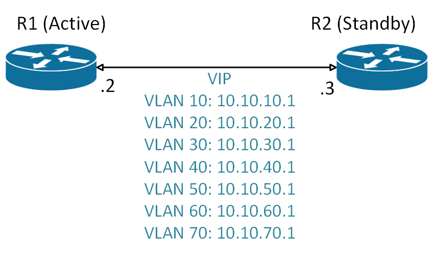
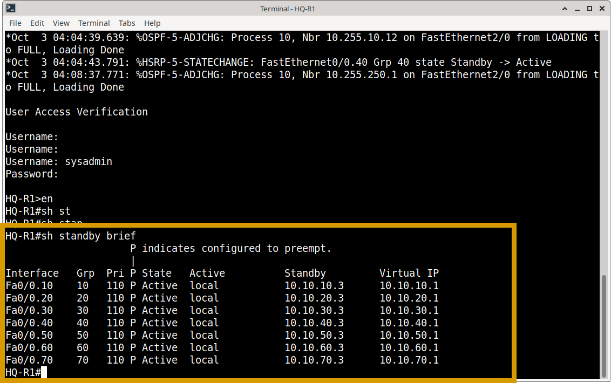
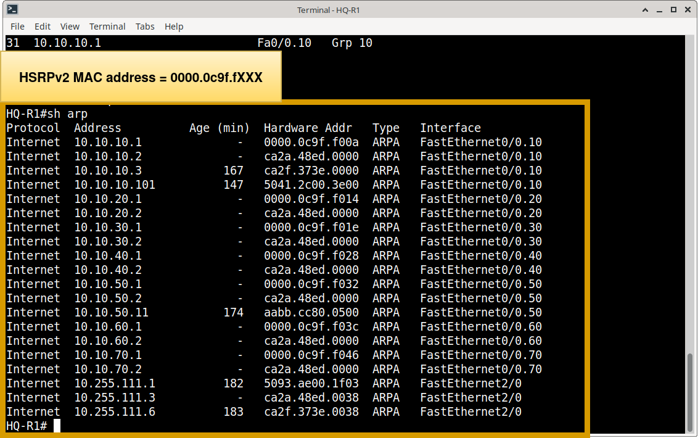
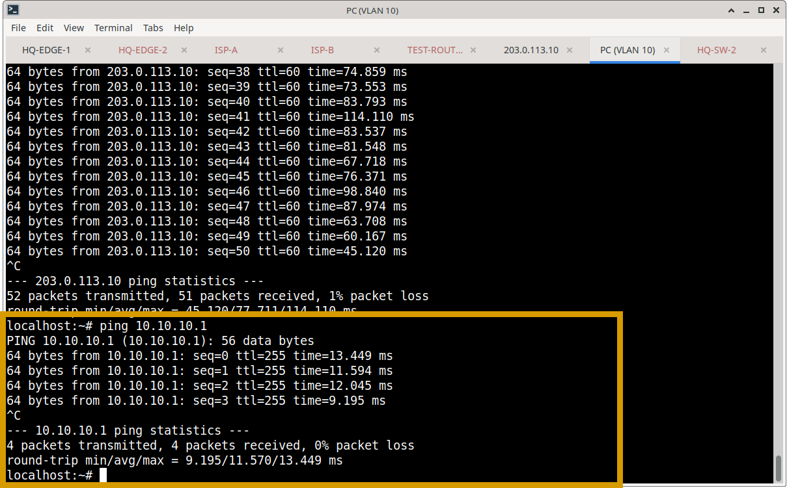
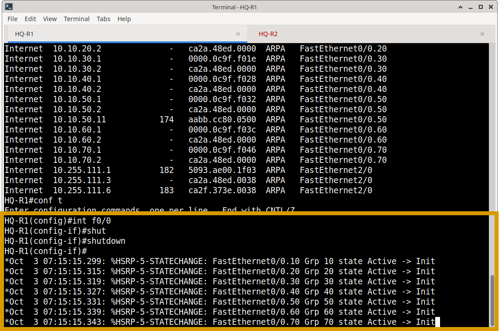
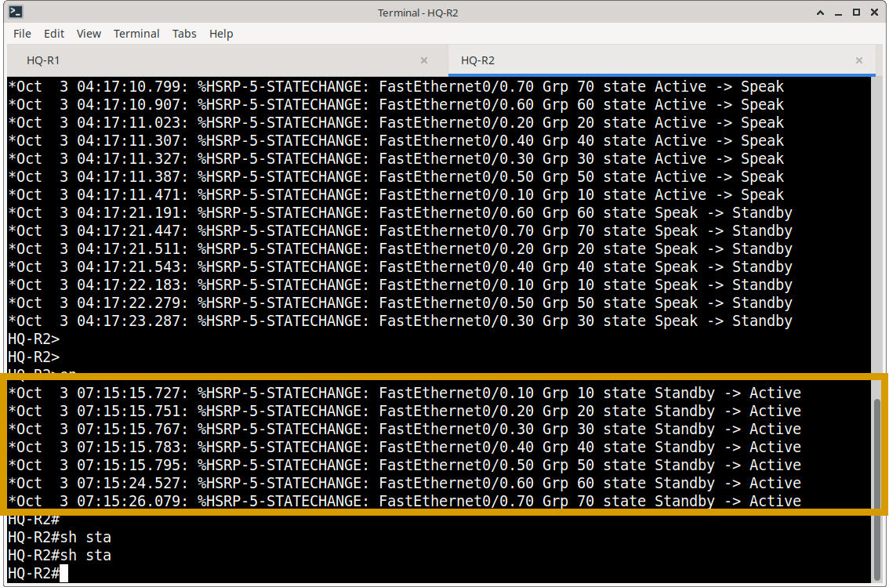

# First-Hop Redundancy: HSRP Architecture

## Overview

Meridian Financial Services utilizes Hot Standby Router Protocol (HSRP) to provide seamless First-Hop Redundancy Protocol (FHRP) for enterprise VLANs. 

HSRP allows a pair of redundant routers to share a virtual default gateway address. One router operates in the **Active** state, forwarding traffic for the Virtual IP (VIP), while the other operates in the **Standby** state, ready to assume forwarding duties instantly if the active router or its uplink fails. This ensures uninterrupted default-gateway availability for all endpoint devices.

---

## HSRP Design Principles

- **Virtual Gateway:** Each VLAN is assigned a dedicated Virtual IP (VIP) ending in `.1`, serving as the default gateway for all endpoints in that subnet.
- **Priority & Preemption:** The preferred router is configured with a higher priority (e.g., `110`) and the `preempt` command. This ensures that upon recovery from a failure, the primary router automatically reclaims the Active role, restoring the intended traffic flow.
- **1:1 Group Mapping:** HSRP group numbers directly correspond to their associated VLAN IDs (e.g., VLAN 10 uses HSRP Group 10). This simplifies configuration auditing, troubleshooting, and operational consistency.
- **Version:** HSRP Version 2 is utilized to support IPv4 and provide enhanced MAC address allocation (`0000.0C9F.FXXX`).

---

## Addressing & Role Assignment

### Headquarters (HQ)
HQ-R1 acts as the primary Active router for all HQ VLANs, with HQ-R2 providing Standby redundancy.

| VLAN | Subnet | HQ-R1 (Active) | HQ-R2 (Standby) | Virtual Gateway (VIP) | HSRP Group |
| :---: | :--- | :--- | :--- | :--- | :---: |
| **10** | `10.10.10.0/24` | `10.10.10.2` | `10.10.10.3` | `10.10.10.1` | 10 |
| **20** | `10.10.20.0/24` | `10.10.20.2` | `10.10.20.3` | `10.10.20.1` | 20 |
| **30** | `10.10.30.0/24` | `10.10.30.2` | `10.10.30.3` | `10.10.30.1` | 30 |
| **40** | `10.10.40.0/24` | `10.10.40.2` | `10.10.40.3` | `10.10.40.1` | 40 |
| **50** | `10.10.50.0/24` | `10.10.50.2` | `10.10.50.3` | `10.10.50.1` | 50 |
| **60** | `10.10.60.0/24` | `10.10.60.2` | `10.10.60.3` | `10.10.60.1` | 60 |
| **70** | `10.10.70.0/24` | `10.10.70.2` | `10.10.70.3` | `10.10.70.1` | 70 |

*(HQ-R1 is configured with `standby <group> priority 110` and `standby <group> preempt`)*



### Standardized Branch Model (Chicago, Dallas, Miami, Ashburn)
To ensure operational consistency, all branch sites follow the exact same addressing and role pattern. Router 1 (e.g., CHI-R1, DAL-R1, MIA-R1, ASH-INTERNAL-1) is designated as the Active router with Priority 110.

| Site | VLAN Range | Router 1 (Active) | Router 2 (Standby) | Virtual Gateway (VIP) |
| :--- | :---: | :--- | :--- | :--- |
| **Chicago** | 10 – 70 | `10.20.x.2` | `10.20.x.3` | `10.20.x.1` |
| **Dallas** | 10 – 70 | `10.30.x.2` | `10.30.x.3` | `10.30.x.1` |
| **Miami** | 10 – 70 | `10.40.x.2` | `10.40.x.3` | `10.40.x.1` |
| **Ashburn** | 110 – 150| `10.50.y.2` | `10.50.y.3` | `10.50.y.1` |

*(Where `x` or `y` represents the specific VLAN/subnet identifier, e.g., VLAN 110 uses `10.50.10.2`, `10.50.10.3`, and VIP `10.50.10.1`)*

---

## Configuration Model

The following represents the standard configuration applied to the preferred (Active) router for a given VLAN:

### Active Router Template (Preferred)
```cisco
interface FastEthernet0/0.10
 encapsulation dot1Q 10
 ip address 10.10.10.2 255.255.255.0
 !
 ! --- HSRP Configuration ---
 standby version 2
 standby 10 ip 10.10.10.1
 standby 10 priority 110
 standby 10 preempt
```

### Standby Router Template (Secondary)
```cisco
interface FastEthernet0/0.10
 encapsulation dot1Q 10
 ip address 10.10.10.3 255.255.255.0
 !
 ! --- HSRP Configuration ---
 standby version 2
 standby 10 ip 10.10.10.1
 standby 10 preempt
 ! Priority defaults to 100
```
### Ashburn DR Site
**Interfaces:** `FastEthernet0/0.x`
**Active Router:** ASH-INTERNAL-1 | **Standby Router:** INTERNAL-2
**Note:** Ashburn subinterfaces also integrate OSPF Area 50 directly on the interface.

**Example Configuration (VLAN 110):**
```cisco
! ASH-INTERNAL-1 (Active)
interface FastEthernet0/0.110
 encapsulation dot1Q 110
 ip address 10.50.10.2 255.255.255.0
 standby 110 ip 10.50.10.1
 standby 110 priority 110
 standby 110 preempt
```
---

## 1. Steady-State Operational Verification

Before testing failure scenarios, the baseline health of the HSRP topology was verified to ensure correct role assignment and gateway reachability.

### 1.2 HSRP State & Role Verification
**Command:** `show standby brief`  
**Validation Criteria:** Confirms the correct router is in the `Active` state (indicated by the `A` flag and priority 110) and the secondary is in the `Standby` state (`S` flag). The Virtual IP column must match the design.    
**Observation:** HQ-R1 correctly holds the Active role for VLANs 10-70, while HQ-R2 is in Standby. Preemption (`P` flag) is active.



### 1.3 Detailed HSRP & ARP Verification
**Commands:** `show standby interface [interface]`, `show arp`  
**Validation Criteria:** Verifies HSRP version (v2), hello/hold timers, and confirms that the ARP table on the switch/router resolves the VIP to the correct HSRP virtual MAC address (`0000.0C9F.FXXX`).  



### 1.4 Gateway Reachability
**Command:** `ping [VIP]` (from an endpoint or management station)  
**Validation Criteria:** Confirms that the virtual gateway is actively responding to ICMP requests, proving the Active router is successfully processing traffic destined for the VIP.  
*[Insert Screenshot: `hq-hsrp-gateway-ping.png`]*



---

## 2. Functional Failover Testing (Resiliency)

**Objective:** Demonstrate that the Meridian network maintains default-gateway continuity when the Active HSRP router fails, and correctly preempts upon recovery.

### 2.1 Pre-Failure Baseline
Before inducing a failure, the baseline state was captured to confirm normal routing and connectivity.
- **HSRP State:** R1 is `Active`, R2 is `Standby`.
- **Connectivity:** Continuous ICMP ping from a VLAN 10 endpoint to a remote destination (e.g., Ashburn DR subnet) is successful via the VIP (`10.10.10.1`).  

### 2.2 Failure Injection
A controlled failure was introduced by administratively shutting down the primary VLAN interface on the Active router (HQ-R1).
*Example:* `interface FastEthernet0/0.10` → `shutdown`



### 2.3 Convergence & Role Transition
Immediately following the failure, the network state was re-evaluated on the secondary router (HQ-R2):
- **HSRP State:** HQ-R2 detected the loss of HSRP hello messages (after the hold timer expired) and immediately transitioned to the **`Active`** state for Group 10.  



### 2.4 Connectivity Validation
- **Ping Test:** The continuous ping from the endpoint experienced a brief, acceptable interruption (typically 3–5 dropped packets, aligning with HSRP hold-timer defaults) before seamlessly restoring connectivity through the new Active router (HQ-R2).  

**Please enlarge for clearer video**

https://github.com/user-attachments/assets/b726446d-5f2e-445f-bfa7-cb1e55ea5388

### 2.5 Path Recovery & Preemption
The failed interface on HQ-R1 was restored (`no shutdown`). 
- **Observation:** Because `standby 10 preempt` is configured, HQ-R1 immediately reclaimed the `Active` role upon interface recovery, and HQ-R2 gracefully returned to the `Standby` state.  

---

## 3. Verification Evidence Matrix

| Verification Area | Command(s) Used | Status | Evidence File |
| :--- | :--- | :---: | :--- |
| HSRP State & Roles | `show standby brief` | ✅ Verified | `hq-r1-sh-standby-brief.png` |
| HSRP v2 MAC | `show arp` | ✅ Verified | `hq-r1-sh-arp.png` |
| Gateway Reachability | `ping [VIP]` | ✅ Verified | `hq-hsrp-gateway-ping.png` |
| Failover Convergence | `show standby brief`, `ping` | ✅ Verified | `hsrp-failover.png` |
| Preemption Recovery | `show standby brief` | ✅ Verified | `hsrp-failover-recovered.png` |

---

---

### What's Next?

With First-Hop Redundancy (HSRP) fully configured and validated for seamless gateway failover, the next step is to explore the dynamic routing protocol that directs traffic across the enterprise WAN.

Continue to the next module to explore the OSPF implementation:
- **[OSPF Configuration & Verification](../OSPF/)** – Multi-area OSPF design, neighbor adjacencies, route redistribution, and convergence testing.
