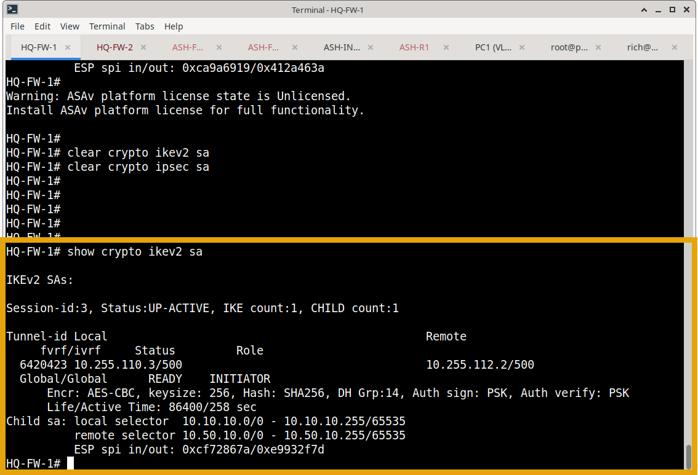
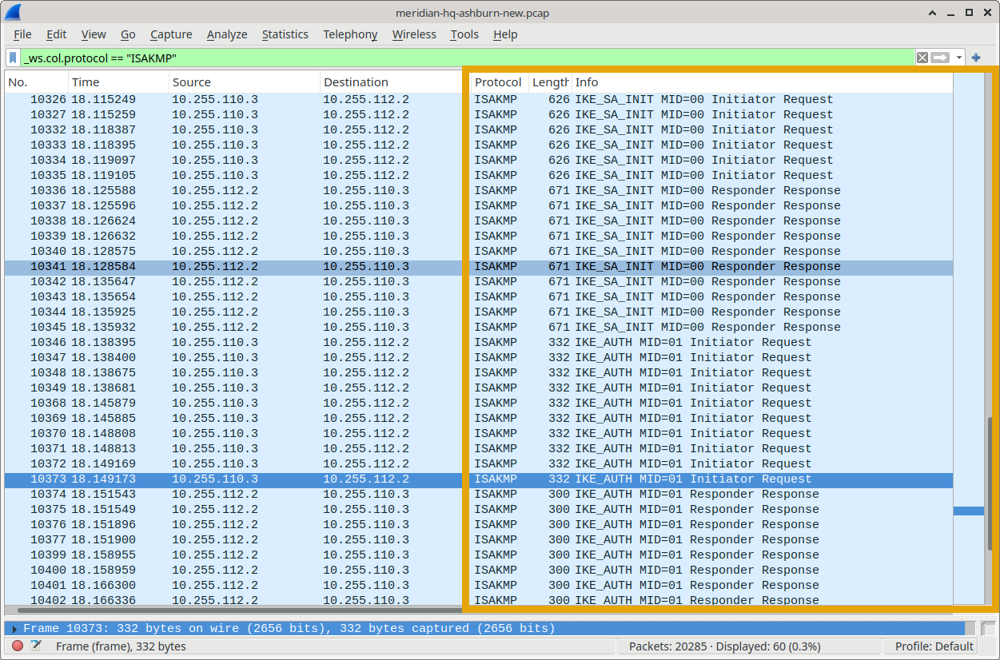
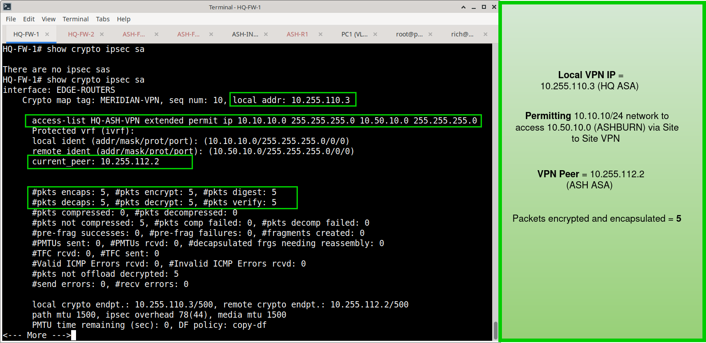
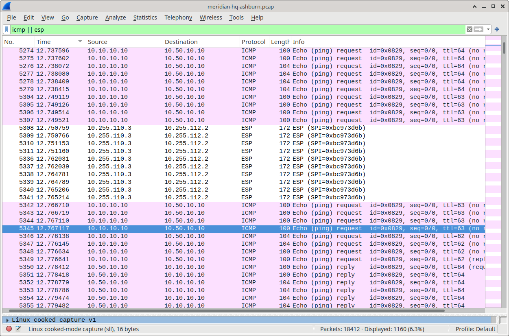
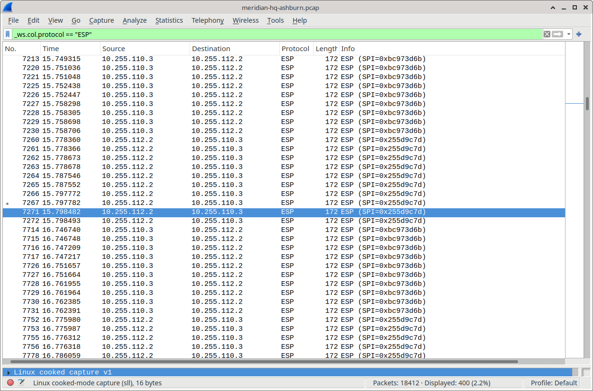
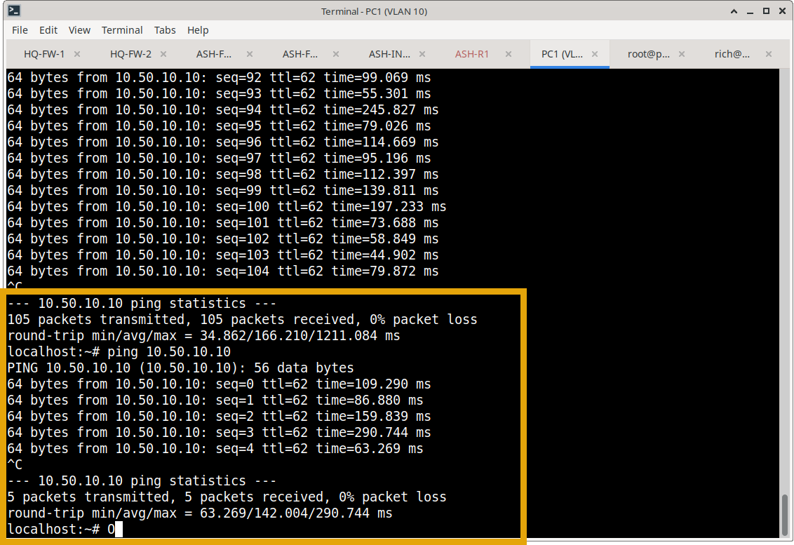
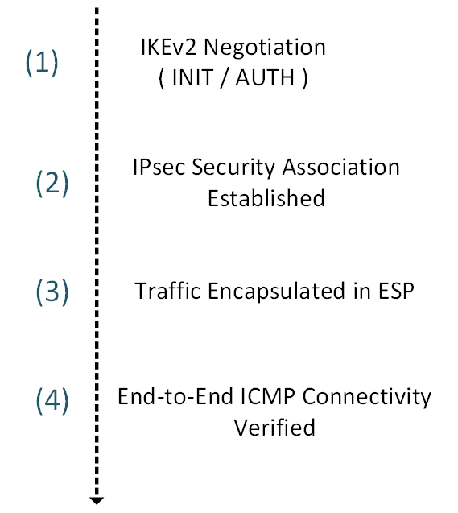

# Site-to-Site IPsec VPN Implementation & Validation

## Overview

This document details the validation workflow for the Meridian HQ-to-Ashburn Site-to-Site IPsec VPN. It covers firewall Security Association (SA) verification, packet-level analysis of the encrypted tunnel, and functional end-to-end connectivity testing.

---

## 1. Tunnel Group Configuration

The site-to-site VPN relies on tunnel-groups to define the IPsec peer relationships and authentication methods between the Headquarters (HQ-FW-1) and Ashburn (ASH-FW-1) firewalls.

**HQ-FW-1 Configuration:**
Points to the Ashburn peer IP (`10.255.112.2`) using IKEv2 pre-shared keys.
```cisco
HQ-FW-1# sh run tunnel-group 10.255.112.2
tunnel-group 10.255.112.2 type ipsec-l2l
tunnel-group 10.255.112.2 ipsec-attributes
 ikev2 remote-authentication pre-shared-key *****
 ikev2 local-authentication pre-shared-key *****
```

**ASH-FW-1 Configuration:**
Points to the HQ peer IP (`10.255.110.3`) with matching IKEv2 pre-shared keys.
```cisco
ASH-FW-1# sh run tunnel-group
tunnel-group 10.255.110.3 type ipsec-l2l
tunnel-group 10.255.110.3 ipsec-attributes
 ikev2 remote-authentication pre-shared-key *****
 ikev2 local-authentication pre-shared-key *****
```

- **Type `ipsec-l2l`:** Configures the tunnel for site-to-site (Layer 2 Layer) connectivity rather than remote access. 

## 2. IPsec Proposal & Profile Configuration

To ensure strong encryption standards, both firewalls utilize a unified IPsec proposal (`MERIDIAN-AES256`) enforcing AES-256 encryption and SHA-256 integrity.

**ASH-FW-1 Configuration:**
```cisco
ASH-FW-1# sh run ipsec
crypto ipsec ikev2 ipsec-proposal MERIDIAN-AES256
 protocol esp encryption aes-256
 protocol esp integrity sha-256
crypto ipsec security-association pmtu-aging infinite
```

**HQ-FW-1 Configuration:**
```cisco
HQ-FW-1# sh run ipsec
crypto ipsec ikev2 ipsec-proposal MERIDIAN-AES256
 protocol esp encryption aes-256
 protocol esp integrity sha-256
crypto ipsec profile AZURE-IPSEC-PROFILE
 set ikev2 ipsec-proposal MERIDIAN-AES256
crypto ipsec security-association pmtu-aging infinite
```

## 3. ACLs

The "interesting traffic" that triggers IPsec encryption is defined by extended access-lists on each firewall. These ACLs are mirrored to ensure bidirectional traffic between the HQ and Ashburn networks is encrypted.

**ASH-FW-1 Configuration:**
Permits traffic from the Ashburn network (`10.50.10.0/24`) to the HQ network (`10.10.10.0/24`).
```cisco
ASH-FW-1# sh run | include ASH-HQ-VPN
access-list ASH-HQ-VPN extended permit ip 10.50.10.0 255.255.255.0 10.10.10.0 255.255.255.0
crypto map MERIDIAN-VPN 10 match address ASH-HQ-VPN
```

**HQ-FW-1 Configuration:**
Permits traffic from the HQ network (`10.10.10.0/24`) to the Ashburn network (`10.50.10.0/24`).
```cisco
HQ-FW-1# sh run | include HQ-ASH-VPN
access-list HQ-ASH-VPN extended permit ip 10.10.10.0 255.255.255.0 10.50.10.0 255.255.255.0
crypto map MERIDIAN-VPN 10 match address HQ-ASH-VPN
```

**Key Design Elements:**
- **Mirrored ACLs:** The source and destination subnets are swapped between the two firewalls to ensure bidirectional encryption.
- **Subnet Specificity:** Only traffic between the specific `10.10.10.0/24` (HQ) and `10.50.10.0/24` (Ashburn) subnets triggers the IPsec tunnel.
- **Crypto Map Binding:** The `match address` command in the crypto map explicitly references these ACLs to define what traffic is protected.

## 3. Crypto Map & Interface Application

**ASH-FW-1 Configuration:**
Applied to the `ROUTER` interface, matching traffic defined in the `ASH-HQ-VPN` ACL.
```cisco
ASH-FW-1# sh run | include MERIDIAN-VPN
crypto map MERIDIAN-VPN 10 match address ASH-HQ-VPN
crypto map MERIDIAN-VPN 10 set peer 10.255.110.3
crypto map MERIDIAN-VPN 10 set ikev2 ipsec-proposal MERIDIAN-AES256
crypto map MERIDIAN-VPN interface ROUTER
```

**HQ-FW-1 Configuration:**
Applied to the `EDGE-ROUTERS` interface, matching traffic defined in the `HQ-ASH-VPN` ACL. Includes the SSL trustpoint for the remote access portal.
```cisco
HQ-FW-1# sh run | include MERIDIAN-VPN
crypto map MERIDIAN-VPN 10 match address HQ-ASH-VPN
crypto map MERIDIAN-VPN 10 set peer 10.255.112.2
crypto map MERIDIAN-VPN 10 set ikev2 ipsec-proposal MERIDIAN-AES256
crypto map MERIDIAN-VPN interface EDGE-ROUTERS
crypto ca trustpoint MERIDIAN-VPN-SSL
crypto ca certificate chain MERIDIAN-VPN-SSL
```

**Key Design Elements:**
- **`match address`:** References the specific ACLs that define the traffic to be encrypted.
- **`set peer`:** Explicitly points to the remote firewall's outside IP address.
- **`set ikev2 ipsec-proposal`:** Links the crypto map to the `MERIDIAN-AES256` proposal configured in the previous section.
- **Interface Application:** Binds the crypto map to the outside-facing interfaces (`ROUTER` and `EDGE-ROUTERS`).

## 5. IKEv2 Policy & Phase 1 Negotiation

The foundation of the IPsec tunnel is the IKEv2 negotiation, which establishes a secure channel for key exchange. Both firewalls utilize an identical IKEv2 policy to ensure successful Phase 1 SA establishment.

**ASH-FW-1 Configuration:**
```cisco
ASH-FW-1# sh run crypto ikev2
crypto ikev2 policy 10
 encryption aes-256
 integrity sha256
 group 14
 prf sha256
 lifetime seconds 86400
crypto ikev2 enable ROUTER
```

**HQ-FW-1 Configuration:**
```cisco
HQ-FW-1# sh run crypto ikev2
crypto ikev2 policy 10
 encryption aes-256
 integrity sha256
 group 14
 prf sha256
 lifetime seconds 86400
crypto ikev2 enable EDGE-ROUTERS
crypto ikev2 enable HQ-LAN
```

The foundation of the IPsec tunnel is the IKEv2 negotiation, which establishes a secure channel for key exchange.

**Firewall Verification:**  
The HQ firewall was checked to confirm an active IKEv2 Security Association with the Ashburn peer.  



**Packet Analysis:**  
Wireshark was used to capture and analyze the ISAKMP/IKE negotiation. The capture shows the initiation and response phases of the key exchange.  



**[Download Full Packet Capture (`ip-sec-pcap.pcap`)](pcaps/ip-sec-pcap.pcap)** to inspect the complete IKE negotiation and ESP traffic flow in Wireshark.

---

## . Data Plane Verification (IPsec SA & ESP)

Once the IKE SA is established, the IPsec SA is negotiated to protect the actual data traffic.

**Firewall Verification:**  
The HQ firewall was verified to show an active IPsec Security Association, confirming the tunnel is ready to encrypt traffic.  



**Packet Analysis:**  
Wireshark filters were applied to observe the traffic crossing the tunnel. The capture confirms that ICMP traffic is successfully encapsulated within Encapsulating Security Payload (ESP) packets, proving that the data plane is actively encrypting the payload.  





---

## . Functional End-to-End Connectivity

To validate that the encrypted tunnel is functionally routing traffic, an end-to-end ping test was performed.

**Test Scenario:**  
A host on the Meridian HQ network successfully pinged a server located in the Ashburn DR environment.  



---

## . Evidence Matrix

| Validation Area | Evidence File | What It Proves |
| :--- | :--- | :--- |
| **Control Plane (Firewall)** | `01-hq-fw1-ikev2-sa.png` | Active IKEv2 Security Association on HQ firewall. |
| **Control Plane (Packet)** | `02-isakmp-pcap-initiation-response.png` | ISAKMP initiation and response captured. |
| | `03-isakmp-pcap-initiator.png` | IKE initiator details verified. |
| | `06-wireshark-isakmp-filter.png` | Wireshark ISAKMP filter applied successfully. |
| **Data Plane (Firewall)** | `05-hq-fw1-ipsec-sa.png` | Active IPsec Security Association on HQ firewall. |
| **Data Plane (Packet)** | `07-wireshark-esp-icmp-filter.png` | ICMP traffic encapsulated in ESP verified. |
| | `08-wireshark-esp-icmp-filter-part2.png` | Continued ESP/ICMP traffic analysis. |
| | `09-wireshark-esp-overview.png` | High-level overview of ESP packet structure. |
| **Functional Connectivity** | `04-pc1-vpn-connectivity-ashburn-server.png` | Successful end-to-end ping from HQ to Ashburn. |
| **Raw Evidence** | `ip-sec-pcap.pcap` | Full, unaltered packet capture for independent review. |

---

## 5. Validation Sequence

The VPN validation followed this logical progression:



---


