# EtherChannel with LACP — Layer 2 Link Aggregation

## Design Objective

Implement link-level redundancy and increased aggregate bandwidth across all 
switching environments without spanning-tree reconvergence delays.

## Protocol Selection: LACP (IEEE 802.3ad)

**Decision:** LACP was selected enterprise-wide over PAgP (Cisco proprietary).

| Criteria          | LACP (Selected)     | PAgP (Rejected)     |
|-------------------|---------------------|---------------------|
| Standard          | IEEE 802.3ad        | Cisco proprietary   |
| Multi-vendor      | Yes                 | No                  |
| Future-proofing   | Aligns with different vendors   | Vendor lock-in      |

**Rationale:** Maintains consistency across HQ (Cisco) and branch offices, 
aligns with multi-vendor strategy documented in `docs/standards/01-requirements.md`.

## Architecture

### HQ Site — Dual Switch Pairs

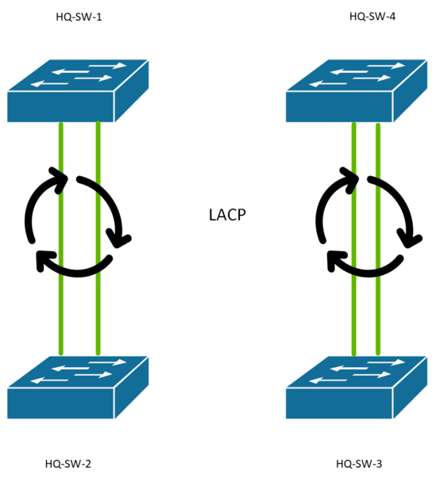

### Branch Offices (Chicago, Dallas, Miami)

Standardized 2-link LACP bundles between switch pairs using Et0/1 + Et0/2.

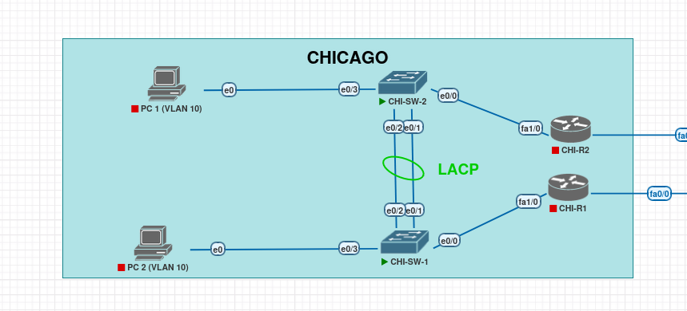

### Ashburn DR Site

Modified design using **Et0/2 + Et0/3** (vs. standard Et0/1 + Et0/2) due to 
interface availability constraints.

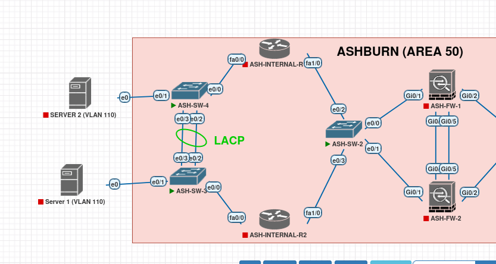

## Configuration Model

```cisco
interface range Ethernet0/1 - 2
 description LACP-TO-HQ-SW-<number.
 switchport trunk encapsulation dot1q
 switchport trunk native vlan 999
 switchport trunk allowed vlan 10,20,30,40,50,60,70,999
 switchport mode trunk
 channel-group 1 mode active
!
interface Port-channel1
 switchport trunk encapsulation dot1q
 switchport trunk native vlan 999
 switchport trunk allowed vlan 10,20,30,40,50,60,70,999
 switchport mode trunk
```

**Mode Selection:** Active/Active on both sides ensures LACP negotiation 
initiates from either end, eliminating single-point-of-failure in negotiation.

## EtherChannel Inventory

| Site       | Switch Pair              | Port-channel | Member Interfaces | Protocol |
|------------|--------------------------|--------------|-------------------|----------|
| HQ         | HQ-SW-1 ↔ HQ-SW-2       | Po1          | E0/1, E0/2        | LACP     |
| HQ         | HQ-SW-3 ↔ HQ-SW-4       | Po1          | E0/1, E0/2        | LACP     |
| Chicago    | CHI-SW-1 ↔ CHI-SW-2     | Po1          | E0/1, E0/2        | LACP     |
| Dallas     | DAL-SW-1 ↔ DAL-SW-2     | Po1          | E0/1, E0/2        | LACP     |
| Miami      | MIA-SW-1 ↔ MIA-SW-2     | Po1          | E0/1, E0/2        | LACP     |
| Ashburn    | ASH-SW-3 ↔ ASH-SW-4     | Po1          | E0/2, E0/3        | LACP     |


## State Indicators

Healthy Layer 2 LACP bundle appearance:

```
Group  Port-channel  Protocol  Ports
1      Po1(SU)        LACP     Et0/1(P)  Et0/2(P)
```

**Flags:**
- **S** = Layer 2 EtherChannel
- **U** = Port-channel in use
- **P** = Physical interface bundled
- **LACP** = Protocol in use

### HQ-SW-1 ↔ HQ-SW-2

**EtherChannel Summary:**

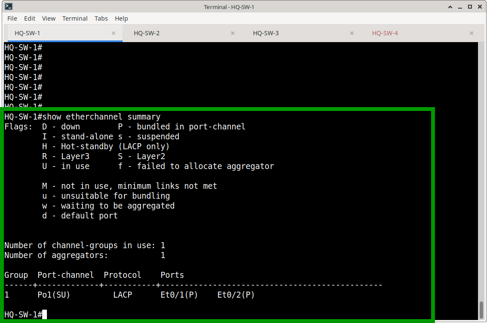

**Observation:** Group 1, Po1(SU), LACP protocol. Both Et0/1 and Et0/2 
show flag **P** (bundled). Port-channel is Layer 2 and in use.

**LACP Neighbor:**

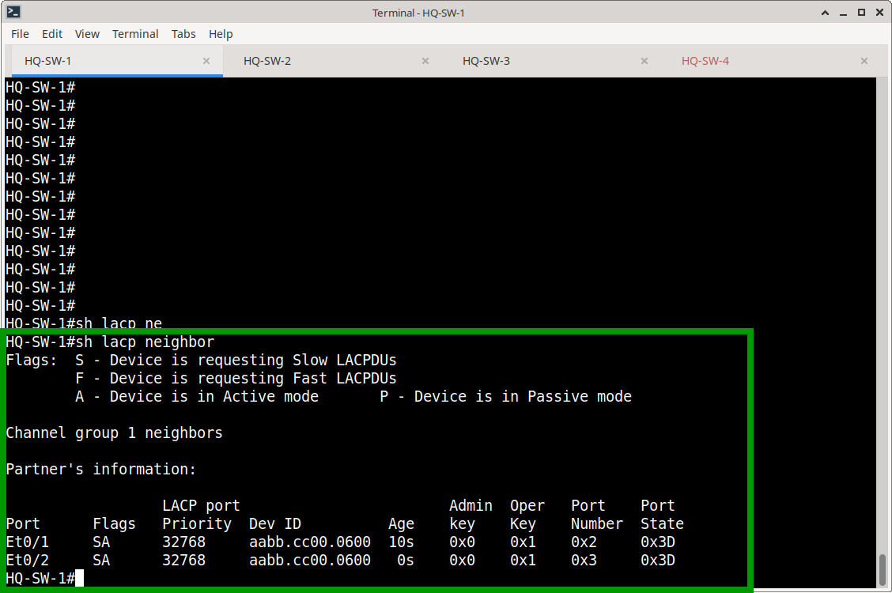

**Observation:** Both neighbors report flags **SA**:
- **S** = Slow LACPDU (1-second intervals)
- **A** = Active mode

**Port-Channel Interface State:**

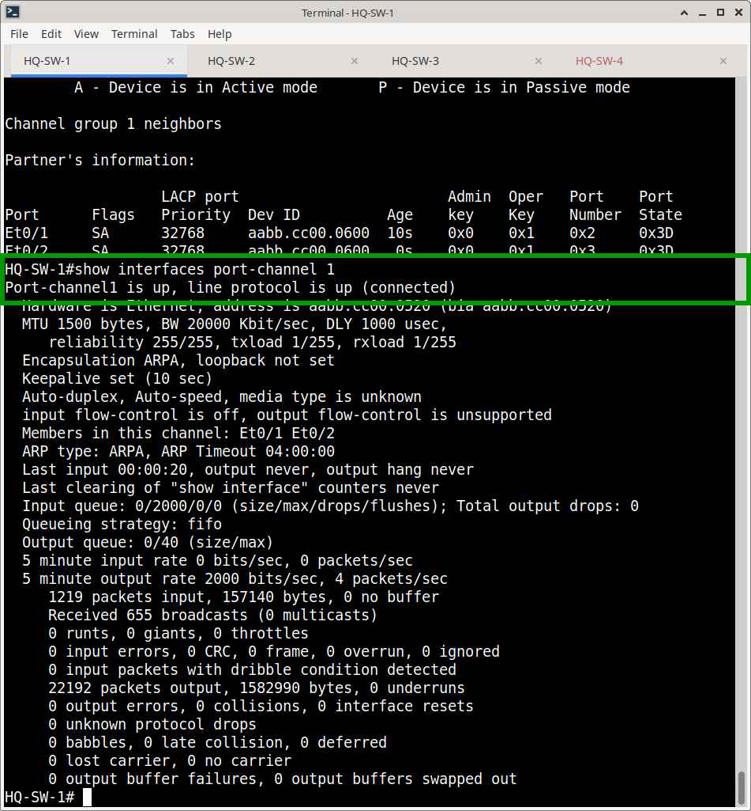

**Observation:** `Port-channel1 is up, line protocol is up (connected)`. 
Members: `Et0/1 Et0/2`. Bandwidth: 20000 Kbit/sec (2 Gbps aggregate — 
confirms both links active). Zero input/output errors.

**HQ-SW-2 Independent Verification:**
- Po1(SU), LACP, Et0/1(P) + Et0/2(P)
- Port-channel1 up/up
- LACP neighbor: HQ-SW-1

---

## 1. Functional Failure Testing (Resiliency)

A core benefit of LACP is N+1 link redundancy. Functional testing was performed to prove that the logical bundle survives the loss of a physical member link without dropping active sessions.

### Test Methodology
1. **Baseline State:** Verified all member links were active `(P)` and initiated a continuous ICMP ping stream across the EtherChannel.
2. **Failure Injection:** Intentionally shut down a single active member interface (e.g., `Ethernet0/1`) on the primary switch.
3. **Observation:** Monitored the continuous ping, LACP neighbor state, and Port-Channel summary during the failure window.
4. **Recovery:** Re-enabled the failed interface and verified LACP automatically renegotiated and re-bundled the link.

### Test Results
* **Zero Packet Loss:** The continuous ping stream experienced **0% packet loss** during the member link failure, proving sub-second traffic redistribution to the remaining active link(s).
* **Logical Stability:** The `Port-channel 1` interface state remained `up/up` throughout the entire test.
* **Automatic Recovery:** Upon re-enabling the physical interface, LACP successfully renegotiated, and the interface returned to the `(P)` bundled state without manual intervention.

**LACP Test Topology**

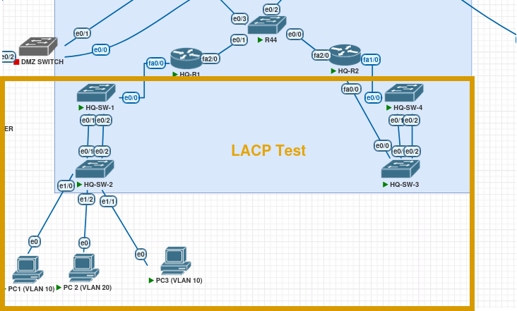

**HQ-SW-1 e0/1 intentional shutdown**

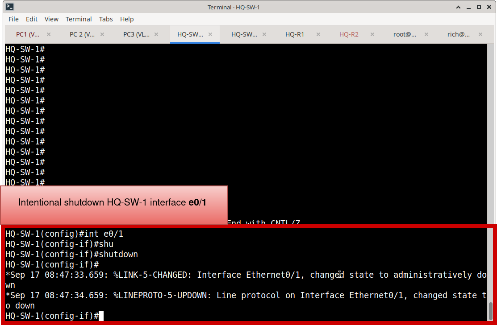

**HQ-SW-1 show etherchannel summary during failure**

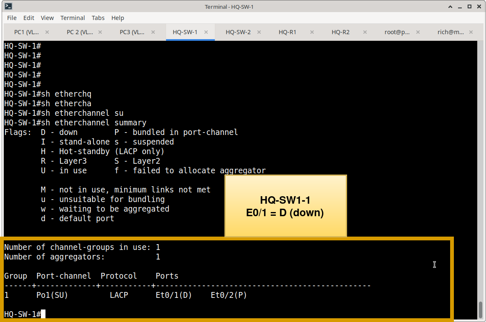

**HQ-SW-2 show etherchannel summary during failure**

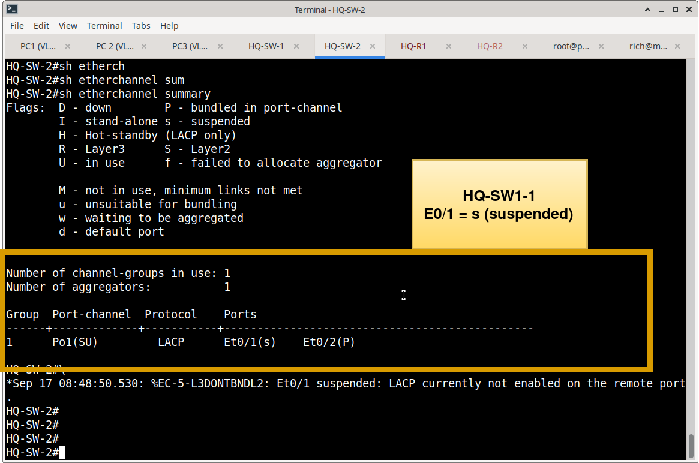

**PC1 unbroken ping during failure**

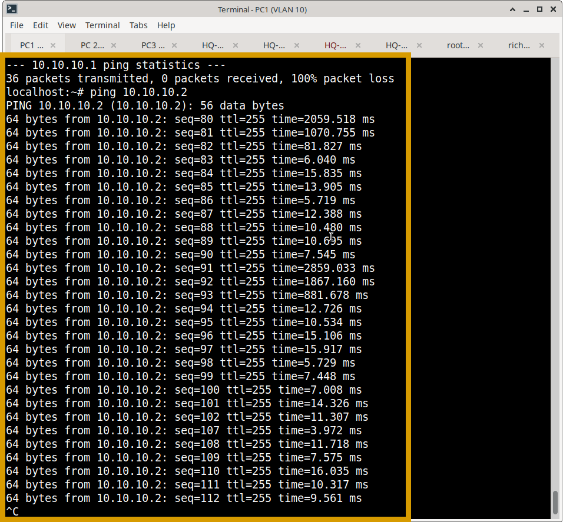

---

### What's Next?

With link aggregation and physical redundancy fully configured and validated, the next step is to explore the Layer 2 access control mechanisms that secure endpoint-facing ports against unauthorized MAC addresses.

Continue to the next module to explore Port Security implementation:
- **[Port Security](../Port-Security/)** – MAC address limiting, sticky learning, violation modes, and endpoint access control.
