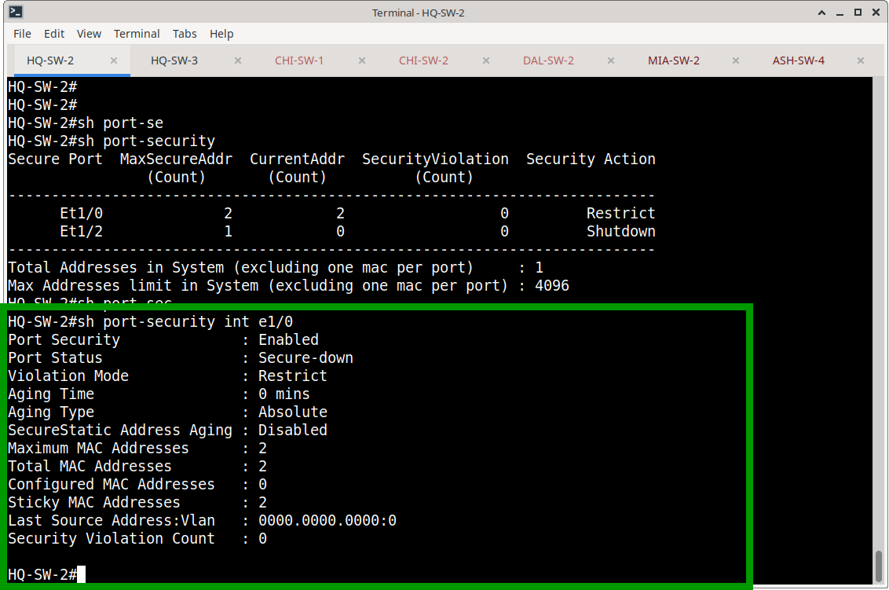
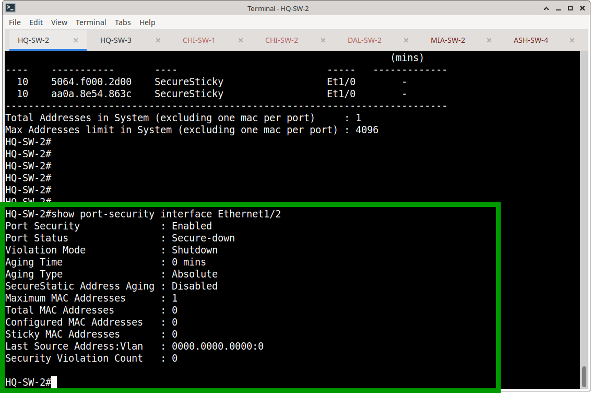
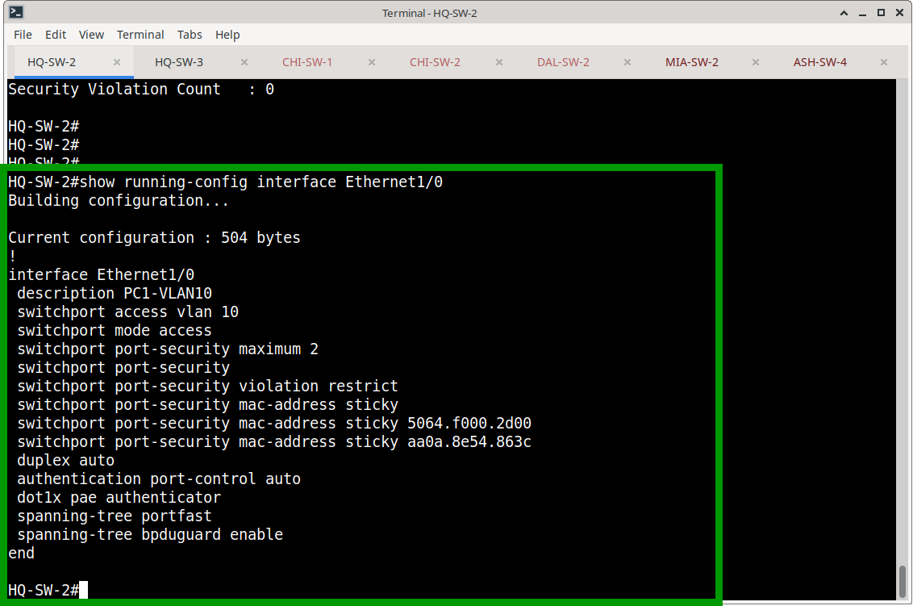
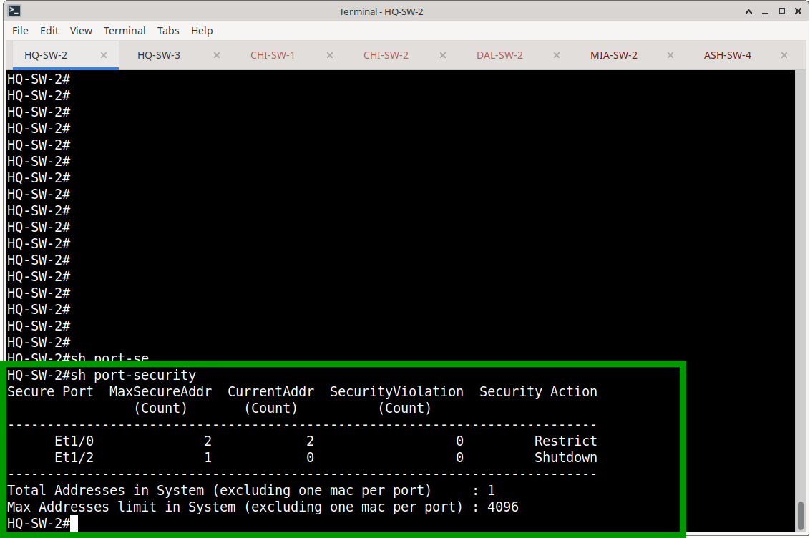
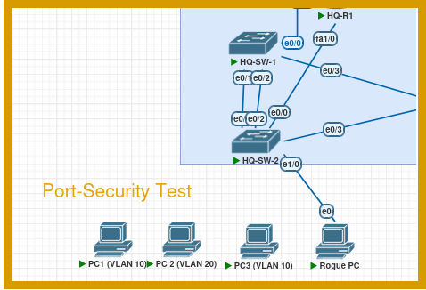
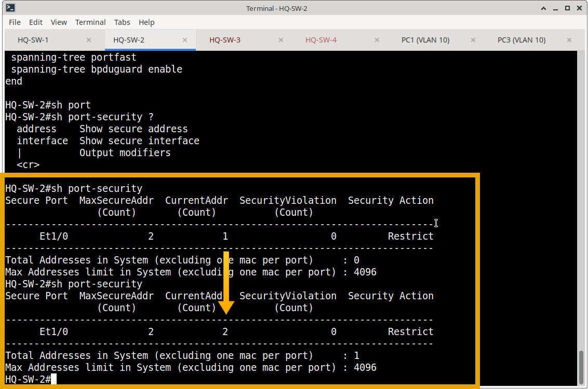
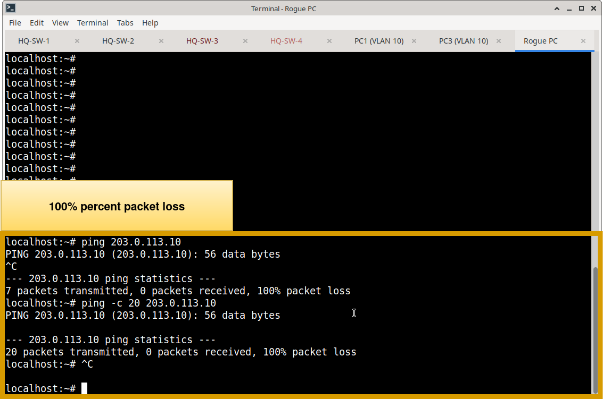
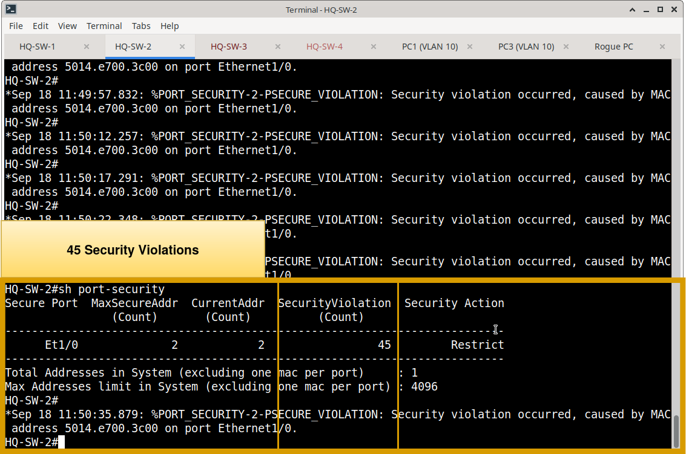
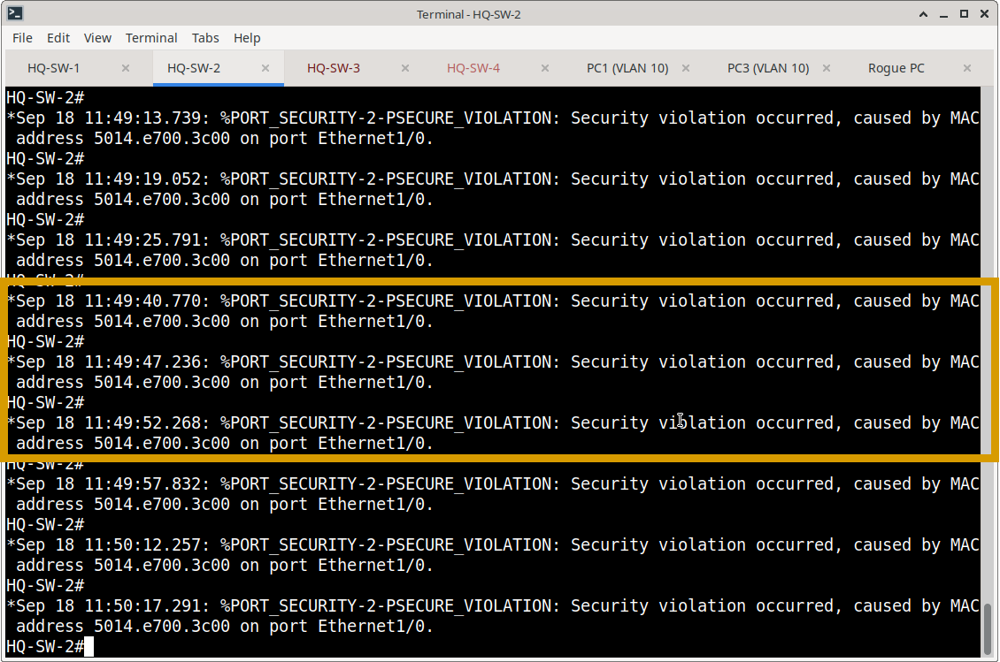

# Port Security — Access Layer Endpoint Protection

## Overview

This section documents the implementation of Cisco switchport security within the Meridian Financial Services switching environment. Port Security is deployed on endpoint-facing access ports to control which MAC addresses are permitted to utilize a switchport, preventing unauthorized Layer 2 access.

## Design Objectives

- **MAC Address Limiting:** Restrict the number of permitted MAC addresses per endpoint port.
- **Dynamic Learning:** Utilize sticky MAC learning to dynamically bind legitimate endpoint hardware addresses.
- **Violation Enforcement:** Apply distinct violation responses (Restrict vs. Shutdown) based on endpoint use cases.
- **Defense in Depth:** Integrate Port Security with 802.1X, PortFast, and BPDU Guard on access ports.

## Port Security Profiles

The documented implementation on HQ-SW-2 utilizes two distinct security profiles tailored to specific endpoint types:

| Switch | Interface | Endpoint Use Case | Max MACs | Learning Method | Violation Mode |
| :--- | :--- | :--- | :---: | :--- | :--- |
| **HQ-SW-2** | `Ethernet1/0` | PC1 (Standard User) | 2 | Sticky | **Restrict** |
| **HQ-SW-2** | `Ethernet1/2` | Printer / MAB Test | 1 | None (Static) | **Shutdown** |

### Profile 1: Standard User (Restrict Mode)
Applied to `Ethernet1/0`. Allows up to two MAC addresses (accommodating the PC and potentially a softphone/VM). Uses **sticky learning** to automatically bind the MAC addresses. The **restrict** violation mode drops unauthorized traffic and increments the violation counter/syslog without taking the port down, ensuring user productivity is not interrupted by transient MAC changes.



### Profile 2: IoT/Printer (Shutdown Mode)
Applied to `Ethernet1/2`. Hard-limited to a single MAC address. Uses the **shutdown** violation mode. If an unauthorized device is connected, the port is immediately placed into an `err-disabled` state, providing strict isolation for static IoT devices.



## Integrated Access Security

Port Security is not deployed in isolation. Both documented interfaces integrate with broader access-layer security features:

- **802.1X Authentication:** `authentication port-control auto` and `dot1x pae authenticator` are enabled.
- **Spanning-Tree Optimization:** `spanning-tree portfast` is enabled to bypass listening/learning states.
- **Loop Prevention:** `spanning-tree bpduguard enable` is applied to `Ethernet1/0` to immediately disable the port if a rogue switch is connected.



## Current Operational State

Verification of the HQ-SW-2 Port Security summary confirms the design is active and stable:

```text
Secure Port  MaxSecureAddr  CurrentAddr  SecurityViolation  Security Action
      Et1/0              2            2                  0         Restrict
      Et1/2              1            0                  0         Shutdown
```

- **Et1/0:** Has successfully learned and bound its two permitted sticky MAC addresses. Zero violations.
- **Et1/2:** Awaiting its first learned MAC address. Zero violations.



## Functional Security Testing (Access Control)

Functional testing was performed to prove that the switch actively enforces the configured MAC address limits and responds appropriately to policy violations.

### Test Methodology
1. **Baseline Connectivity:** Verified that the authorized endpoint (e.g., PC1 on VLAN 10) could successfully communicate across the network.
2. **Violation Injection:** Connected an unauthorized "rogue" device to the protected switchport, introducing a new, unlearned MAC address.
3. **Observation:** Monitored the rogue device's connectivity, the switch's violation counters, and system logging (syslog) behavior.

### Test Results by Violation Mode
* **Restrict Mode (e.g., HQ-SW-2 Ethernet1/0):** 
  - The authorized endpoint maintained uninterrupted connectivity.
  - The rogue device's traffic was silently dropped (blackholed) at Layer 2.
  - The switch incremented the `Security Violation Count` and generated a syslog message, alerting administrators without disrupting the legitimate user.

**Port-Security Test Topology**



**HQ-SW-2 show port-security: maximum mac-addresses full**



**Rogue PC unable to communicate via ping**



**Security Violation Counter = 45**



`*Sep 18 11:49:13.739: %PORT_SECURITY-2-PSECURE_VIOLATION: Security violation occurred, caused by MAC address 5014.e700.3c00 on port Ethernet1/0.`



---

### What's Next?

With endpoint MAC address security fully configured and validated, the next step is to explore the foundational Layer 2 loop prevention and topology management protocol.

Continue to the next module to explore Spanning Tree Protocol (STP):
- **[STP (Spanning Tree Protocol)](../STP/)** – Root bridge election, port roles, rapid reconvergence, and loop prevention testing.
