# Spanning Tree Protocol (STP)

## Overview

This section documents Spanning Tree Protocol (STP) implementation and verification for the Meridian Financial Services enterprise network.

The switching environment uses Rapid-PVST configuration to provide Layer 2 loop prevention and rapid convergence while maintaining VLAN-specific spanning-tree instances.

---

## STP Design

The HQ switching environment uses Rapid-PVST:

```text
spanning-tree mode rapid-pvst
```

HQ-SW-1 is configured with the lowest STP priority and operates as the root bridge for the documented HQ VLANs.

### HQ Root Bridge

HQ-SW-1

Root bridge for:

- VLAN 10 - USERS
- VLAN 20 - VOICE
- VLAN 30 - SERVERS
- VLAN 40 - GUEST
- VLAN 50 - MANAGEMENT
- VLAN 60 - PRINTERS/IoT
- VLAN 70 - NETWORK INFRASTRUCTURE
- VLAN 999 - NATIVE_UNUSED

HQ-SW-1 uses:

```text
spanning-tree vlan 10,20,30,40,50,60,70 root primary 
```

### Endpoint Port Protection

Endpoint-facing access ports use:

```text
spanning-tree portfast
spanning-tree bpduguard enable
```

PortFast allows an endpoint port to transition rapidly toward forwarding.

BPDU Guard protects endpoint-facing ports by preventing an unexpected switch or other Layer 2 device from establishing a spanning-tree relationship on the port.

**SW1: sh spanning-tree interface e1/0 detail**

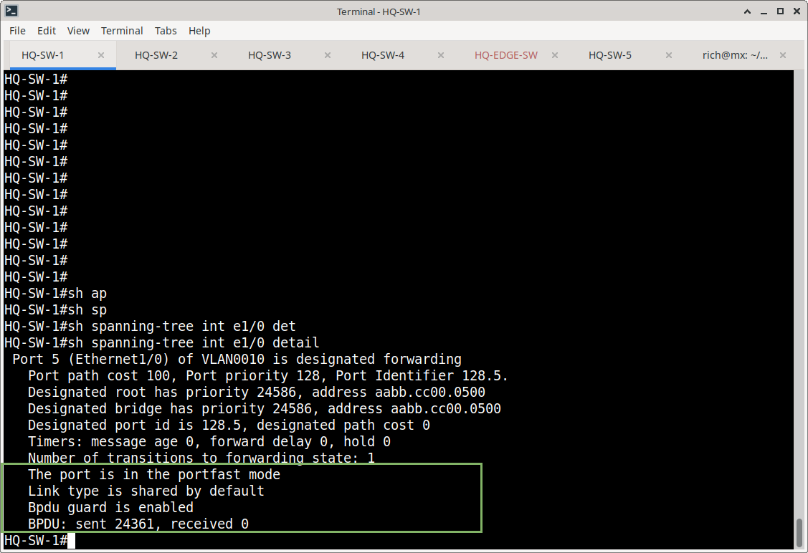

### HQ STP Verification

The HQ switching topology was verified using:

```text
show spanning-tree root
show spanning-tree vlan 10
```

The verification confirmed HQ-SW-1 as the root bridge for the documented HQ VLANs.

The other HQ switches use their available redundant paths to reach the root bridge.

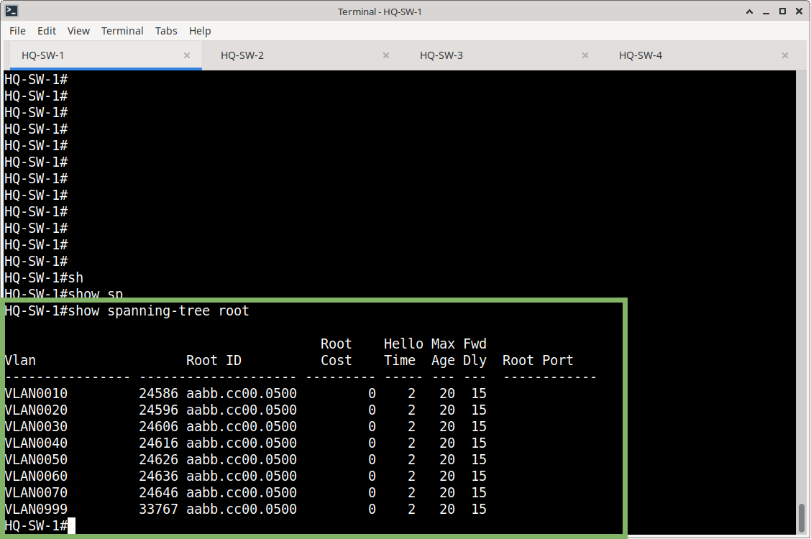

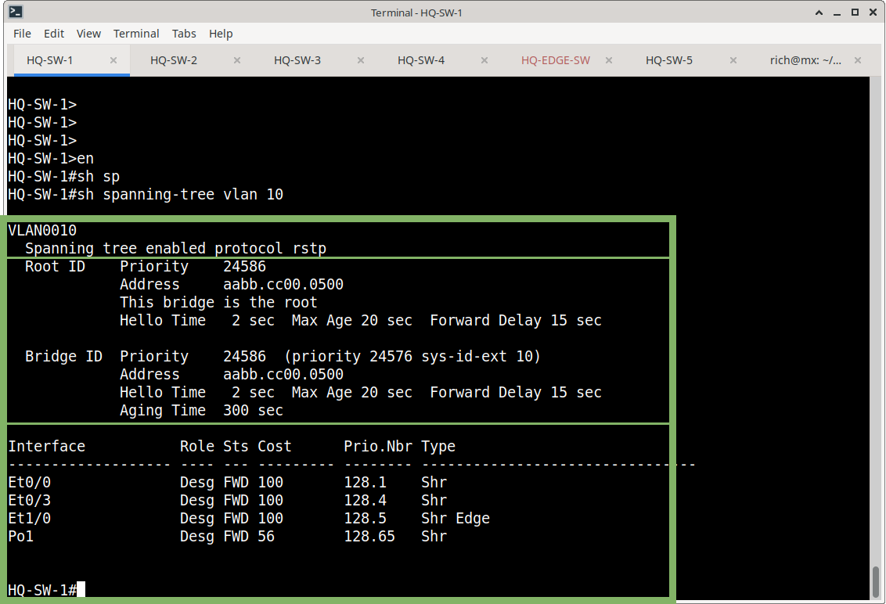


#### Verified Root Paths

| Switch | Root Path |
|---|---|
| HQ-SW-1 | Root bridge |
| HQ-SW-2 | Port-channel1 |
| HQ-SW-3 | Ethernet0/3 |
| HQ-SW-4 | Port-channel1 |

---

## 7. STP Verification

### HQ-SW-1

VLAN 10 verification:

```text
show spanning-tree vlan 10
```

Result:

```text
Root ID    Priority    24586
           Address     aabb.cc00.0500
           This bridge is the root
```

HQ-SW-1 is therefore the root bridge for VLAN 10.


### HQ-SW-2

VLAN 10 verification showed:

```text
Root ID    Priority    24586
           Address     aabb.cc00.0500
           Cost        56
           Port        65 (Port-channel1)
```

Port roles included:

```text
Et0/0    Desg FWD
Et0/3    Altn BLK
Po1      Root FWD
```

This confirms Port-channel1 as the root path toward HQ-SW-1 and Ethernet0/3 as an alternate blocking path.

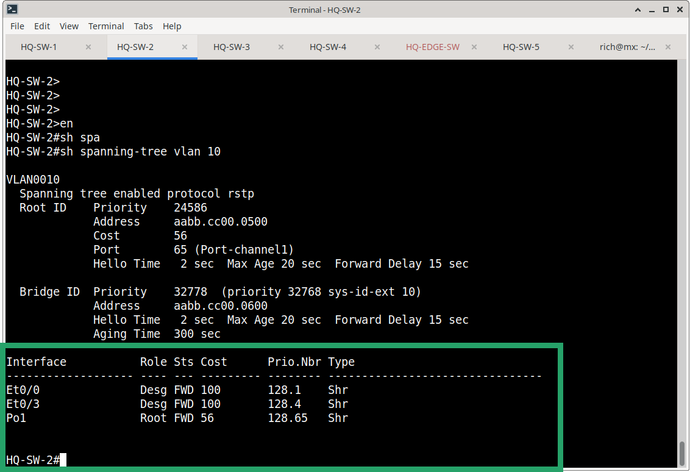

### HQ-SW-3

VLAN 10 verification showed:

```text
Root ID    Priority    24586
           Address     aabb.cc00.0500
           Cost        100
           Port        4 (Ethernet0/3)
```

The root path is Ethernet0/3.

The interface roles included:

```text
Et0/0    Desg FWD
Et0/3    Root FWD
Et1/0    Desg FWD
Et1/1    Desg FWD
Po1      Desg FWD
```

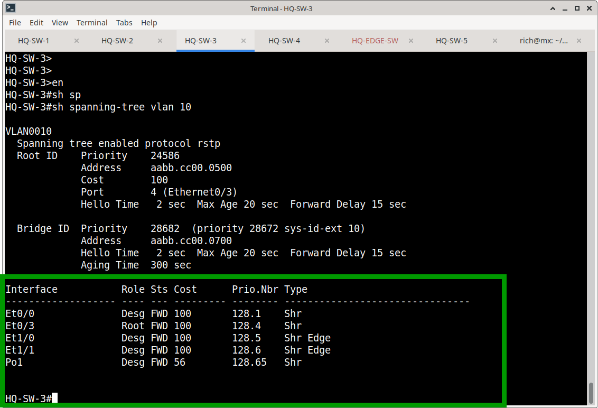

### HQ-SW-4

VLAN 10 verification showed:

```text
Root ID    Priority    24586
           Address     aabb.cc00.0500
           Cost        56
           Port        65 (Port-channel1)
```

The root path is Port-channel1.

The interface roles included:

```text
Et0/0    Desg FWD
Et0/3    Desg FWD
Po1      Root FWD
```

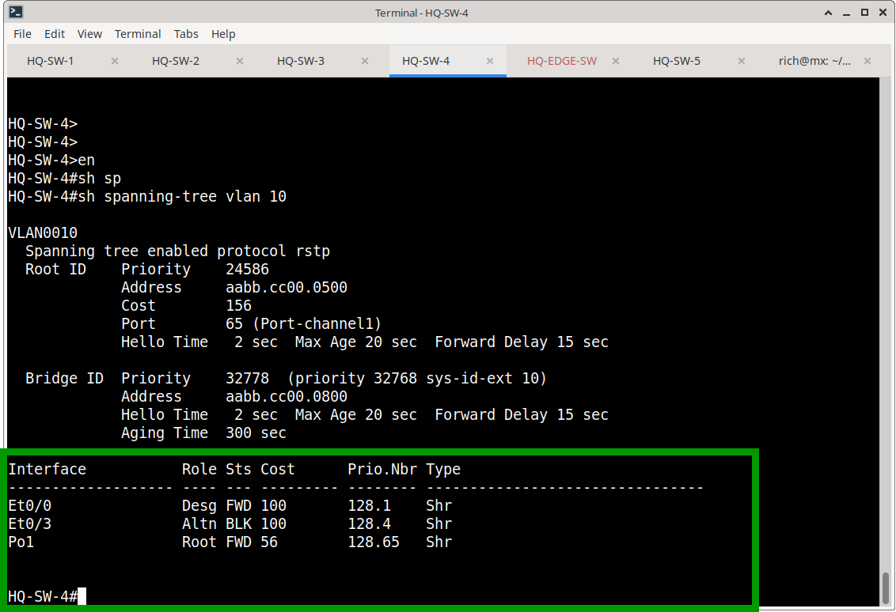

---

## HQ Root Bridge Summary

The verified HQ STP topology is:

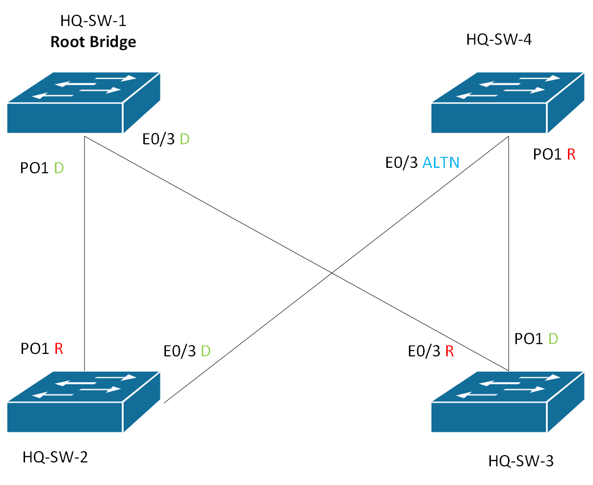

## Functional Convergence Testing (Resiliency)

Operational state only proves the network is healthy *today*. Functional testing proves the network will survive a failure *tomorrow*. 

A controlled topology change was executed to validate STP convergence behavior.

### Test Methodology
1. **Pre-Failure State:** Captured baseline STP port roles, forwarding states, and initiated a continuous ping to the default gateway.
2. **Failure Injection:** Intentionally shut down the active Root Port (or primary trunk link) on a downstream switch.
3. **Post-Failure State:** Captured the new STP topology, verifying the Alternate port transitioned to Root Port/Forwarding state.

### Convergence Results
* **Topology Update:** The downstream switch successfully identified the loss of the primary path and promoted the Alternate port to Root Port.
* **Traffic Restoration:** The continuous ping experienced a brief, acceptable interruption (sub-second to a few seconds, depending on STP mode) before successfully restoring Layer 2 connectivity.
* **Loop Prevention:** No broadcast storms or MAC flapping were observed during the transition.

**STP Test Topology**

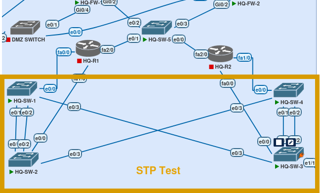

**HQ-SW-1: Intentional Failure**

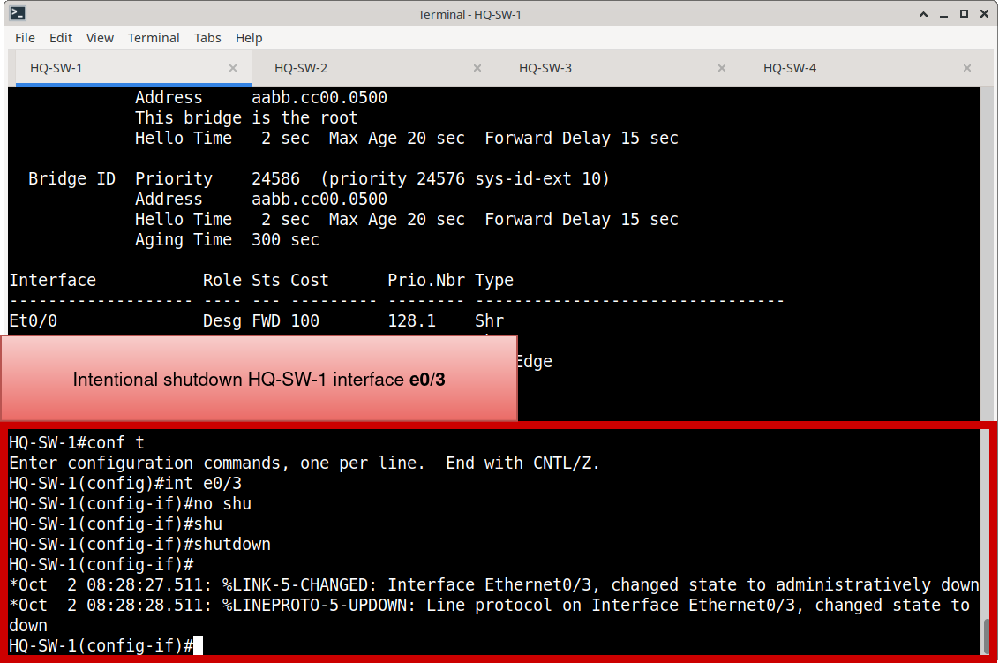

**HQ-SW-1**

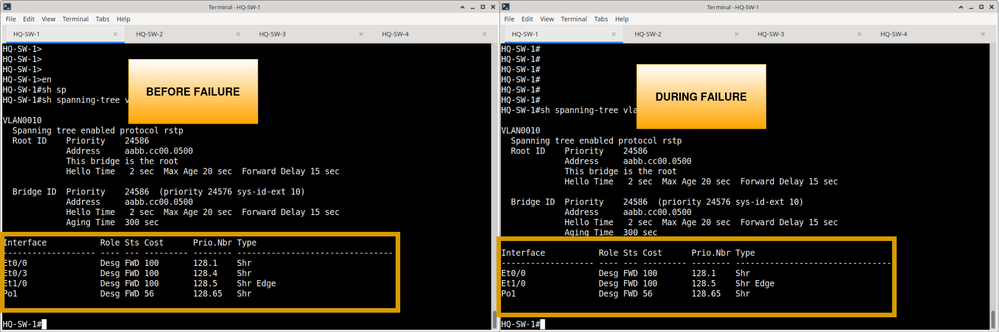

**HQ-SW-2**

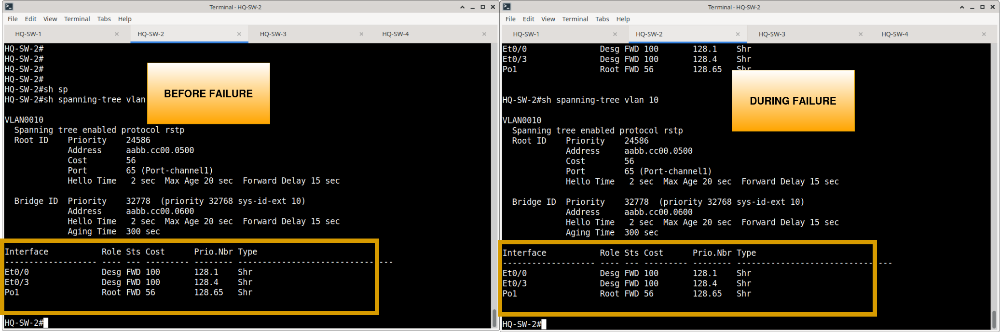

**HQ-SW-3**

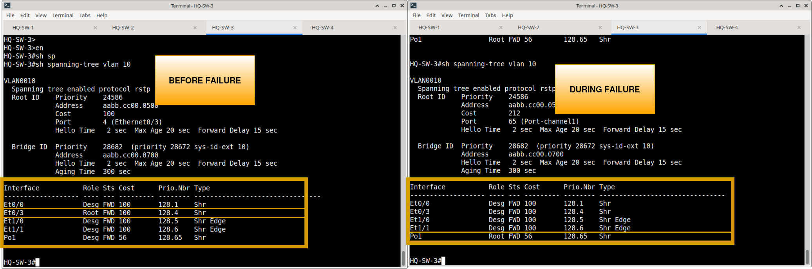

**HQ-SW-4**

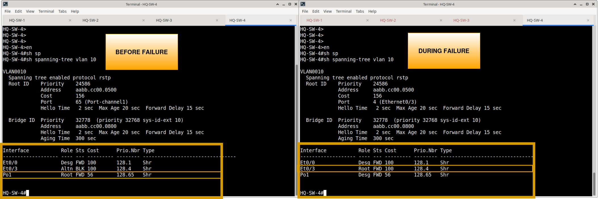

---

### ➡️ What's Next?

With Spanning Tree Protocol fully configured, verified, and proven to converge rapidly during link failures, the next step is to explore the foundational Layer 2 segmentation that defines the network's broadcast domains.

Continue to the next module to explore VLAN configuration and trunking:
- **[VLAN Configuration & Trunking](../VLAN/)** – VLAN segmentation, 802.1Q trunking, native VLAN security, and inter-VLAN routing integration.
