# VLAN Configuration & Verification

## Overview

This section documents the VLAN architecture used throughout the Meridian Financial Services enterprise network.

VLANs provide logical Layer 2 segmentation for users, voice, servers, guest devices, management, printers/IoT devices, and network infrastructure.

The VLAN design is implemented across the headquarters and branch switching infrastructure while preserving site-specific VLAN requirements.

---

## VLAN Design

### Headquarters / Standard Branch VLANs

| VLAN | Name | Purpose |
|---:|---|---|
| 10 | USERS | User workstation and endpoint traffic |
| 20 | VOICE | Voice/VoIP traffic |
| 30 | SERVERS | Server infrastructure |
| 40 | GUEST | Guest network traffic |
| 50 | MANAGEMENT | Network device management |
| 60 | PRINTERS_IOT | Printers and IoT devices |
| 70 | NETWORK_INFRASTRUCTURE | Network infrastructure services |
| 999 | NATIVE_UNUSED | Unused/native VLAN |

These VLANs are carried across the required 802.1Q trunk links.

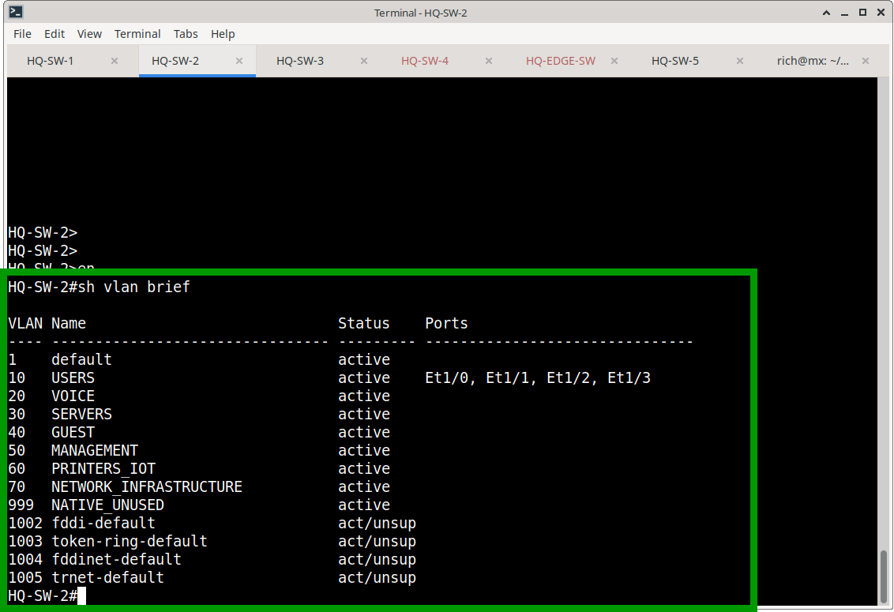

### Ashburn

Ashburn uses a site-specific VLAN range:

| VLAN | Purpose |
|---:|---|
| 110 | DR-SERVERS |
| 120 | DR-VOICE |
| 130 | DR-APPLICATIONS |
| 140 | DR-MGMT |
| 150 | DR-INFRA |
| 999 | NATIVE-UNUSED |

The Ashburn switching configuration uses VLANs 110–150 on the trunk infrastructure.

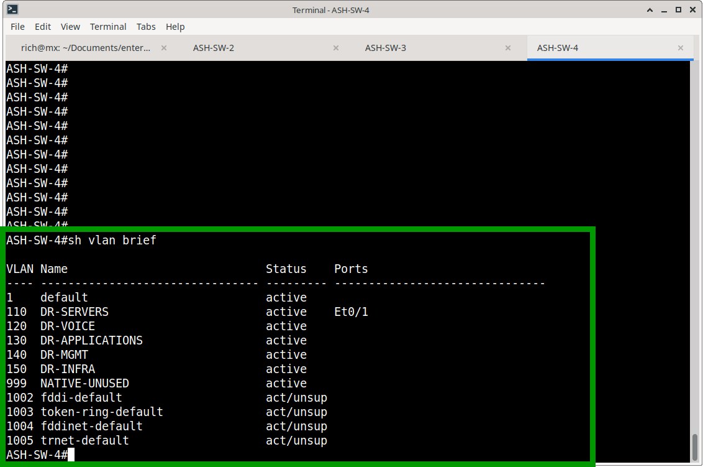

---

## Switching Implementation

### Headquarters

The primary HQ access switches are:

- HQ-SW-1
- HQ-SW-2
- HQ-SW-3
- HQ-SW-4

HQ-SW-5 and HQ-EDGE-SW operate as infrastructure/uplink switches rather than endpoint access switches.

HQ access switches use:

- 802.1Q trunking
- Access VLAN assignments
- Rapid-PVST/PVST
- LACP EtherChannel
- VLAN 999 for unused/native VLAN purposes
- 802.1X on endpoint access ports
- Port-Security

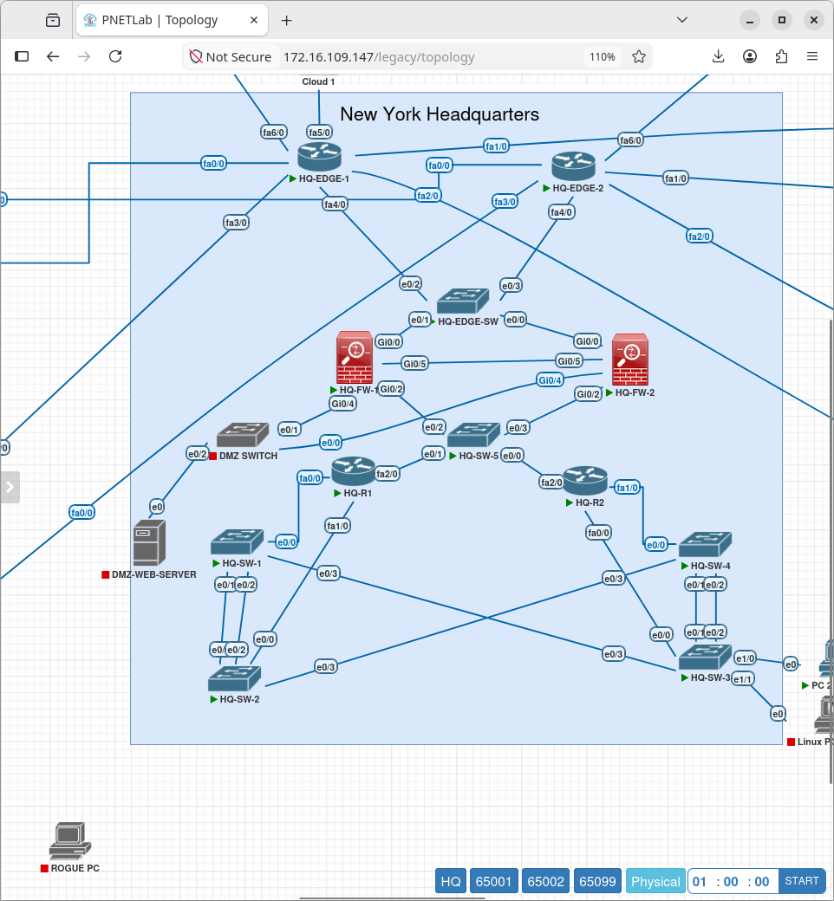

### Branches

Standard branch switching includes:

- Chicago
- Dallas
- Miami

Each standard branch contains two switches with:

- A router-facing trunk
- An LACP EtherChannel between switches
- Endpoint access ports
- VLANs 10–70 and 999

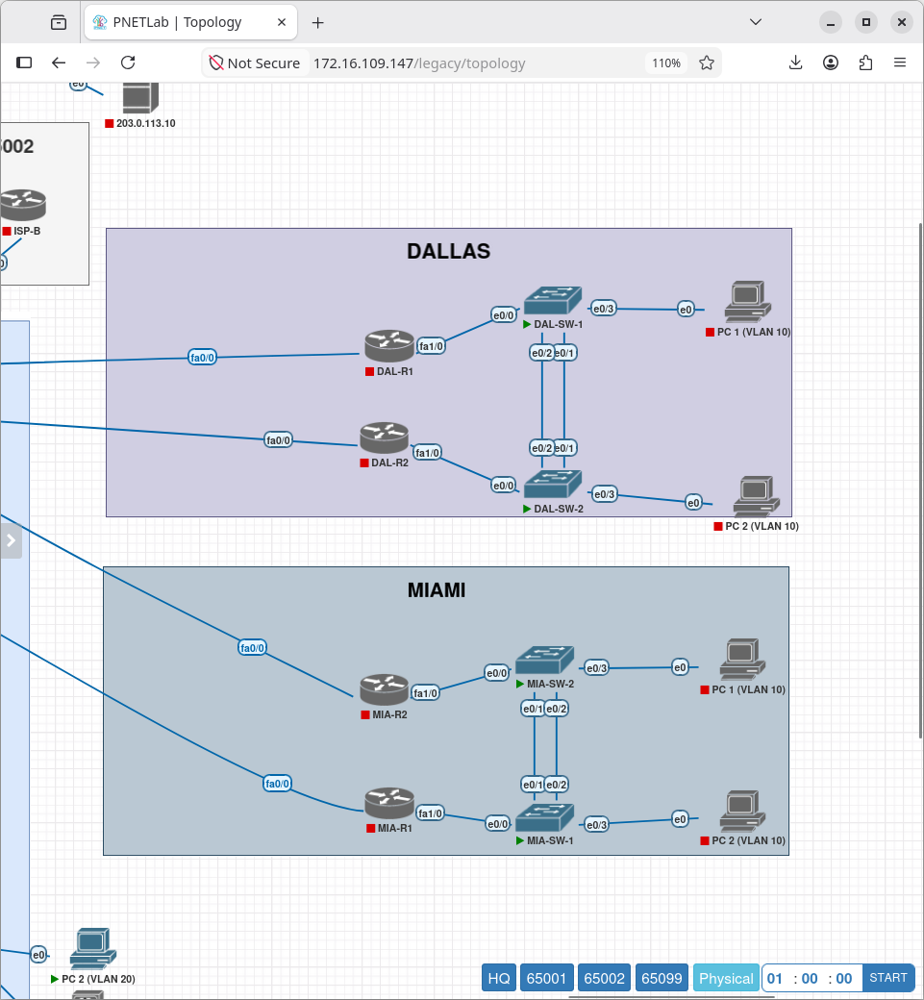 

### Ashburn

Ashburn uses four switches.

ASH-SW-1 and ASH-SW-2 provide infrastructure/transit connectivity.

ASH-SW-3 and ASH-SW-4 provide endpoint access switching and use VLANs 110–150.

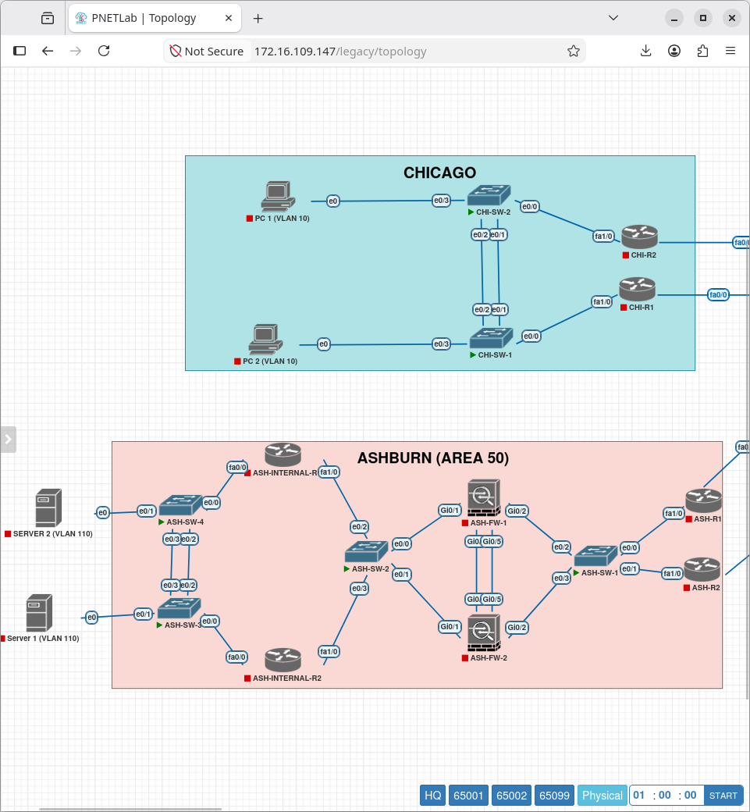

---

## Trunking

Infrastructure trunk links use 802.1Q encapsulation.

Standard HQ/branch trunks carry:

```text
10,20,30,40,50,60,70,999
```
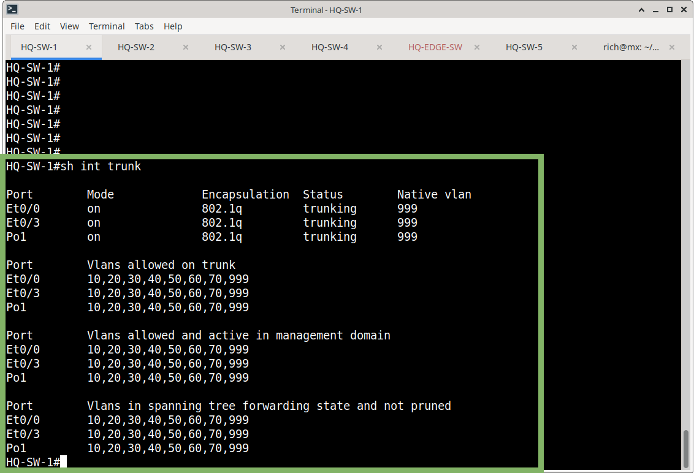

Ashburn trunks carry:

```text
110,120,130,140,150
```

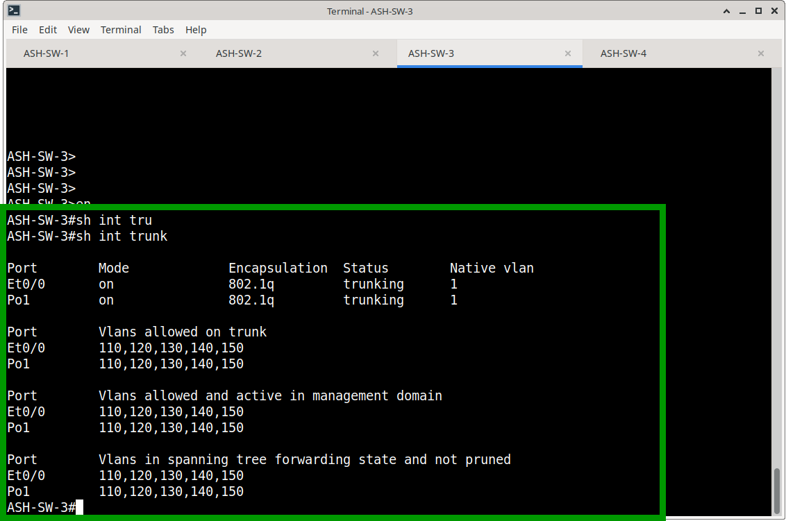

---

## HQ Infrastructure/Uplink Switches

- HQ-SW-5
- HQ-EDGE-SW

These switches provide infrastructure/uplink connectivity between routers and firewalls.

They are not configured as endpoint access switches.

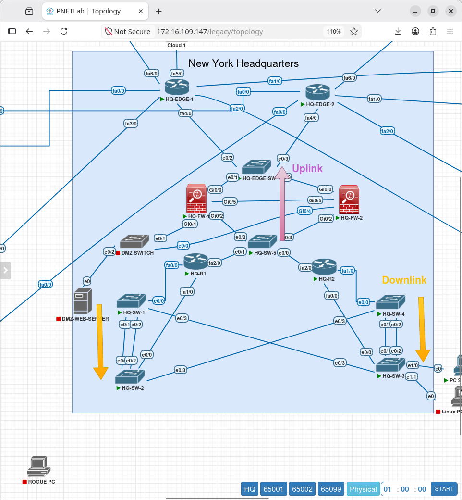

## Functional Testing (Isolation & Connectivity)

Beyond operational state, functional testing was performed to prove that Layer 2 segmentation is actively enforced and that traffic flows correctly within boundaries.

### Test Methodology
1. **Intra-VLAN Connectivity:** Verified that endpoints within the same VLAN (e.g., VLAN 10) can successfully communicate (ping/ARP resolution).
2. **Inter-VLAN Isolation:** Verified that endpoints in different VLANs (e.g., VLAN 10 and VLAN 20) **cannot** communicate at Layer 2, proving the switch is correctly enforcing broadcast domain boundaries.

### Test Results
* **Same-VLAN Communication:** Successful. Endpoints successfully resolved ARP and passed ICMP traffic.
* **Cross-VLAN Communication:** Blocked. ICMP traffic between VLAN 10 and VLAN 20 failed at the Layer 2 boundary, confirming strict segmentation.

**VLAN Topology**

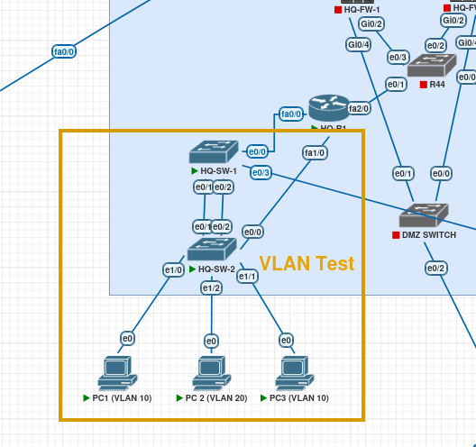

**Same-VLAN Ping**

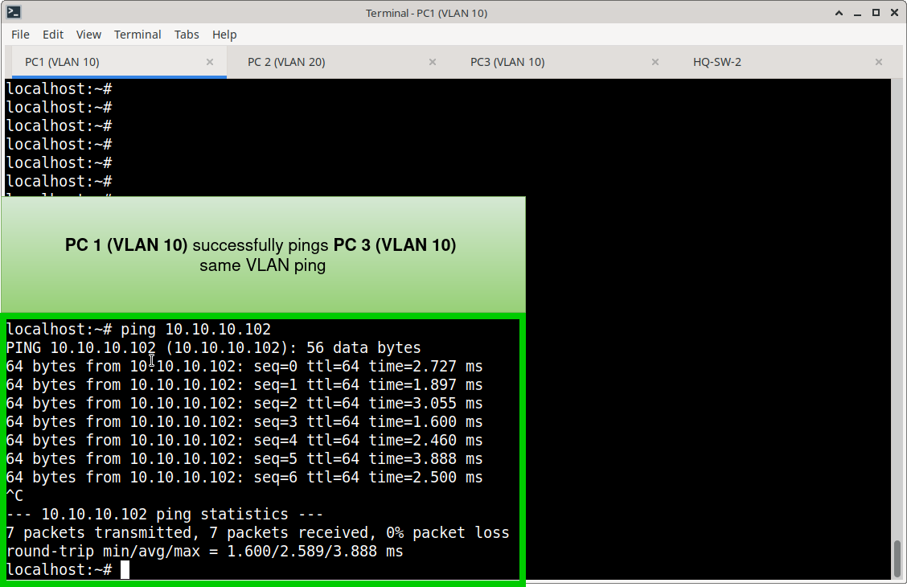

**Inter-VLAN Ping**

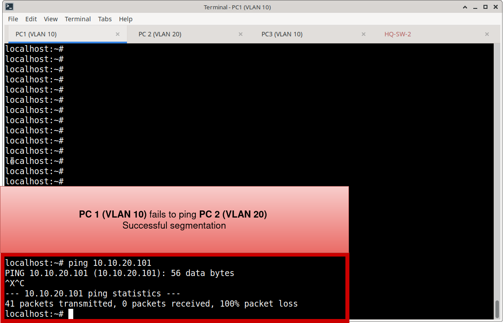
